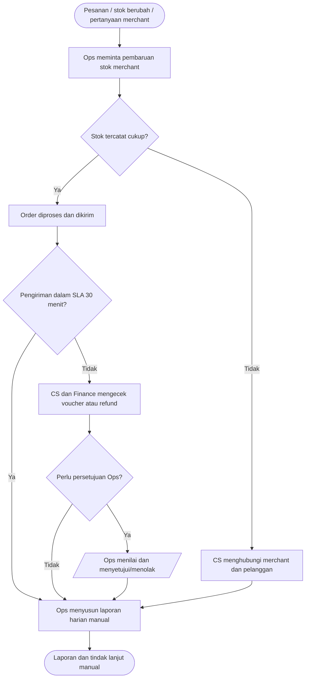
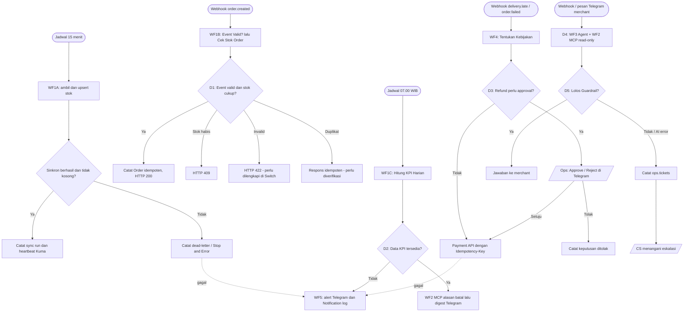

# 01 · BRD Ringkas + Process Map As-Is / To-Be · H8Mart Quick-Commerce Ops

**Nama:** Syifa Mutaalia  
**Pembaruan:** 10 November 2026  
**Basis:** skenario dan kriteria `README.md`, `guide/tasks.md`, `guide/submission.md`, `data-contract.md`, serta hasil uji di n8n yang telah dilaporkan peserta. Status pengujian terperinci ada di dokumen 04 dan 05.

## 1. BRD Ringkas

| Item | Isi | Sumber |
| --- | --- | --- |
| Masalah bisnis (minimal 3, mencakup stok, SLA atau refund, dan reliability) | (1) Stok mitra sering tidak sinkron, membuat order tidak terpenuhi; (2) voucher keterlambatan lebih dari SLA 30 menit diproses manual; (3) refund order gagal berisiko diproses ganda; (4) CS mengambil data merchant secara manual; (5) kegagalan sinkron/digest tidak mudah diketahui. | `README.md` §1 Skenario, butir 1–5. |
| Tujuan & ukuran keberhasilan (angka) | Sinkron setiap 15 menit untuk 12 merchant; jumlah `core.merchant_stock` tetap 205 setelah dua siklus; WF1B memberikan HTTP 200 bila valid dan stok cukup, 409 bila stok kurang; digest 07.00 WIB berisi KPI tanggal data; WF2 menyediakan 3 tool read-only; WF3 menjawab atau membuat tiket CS; WF4 menghindari pembayaran ganda; WF5 memberi alert dengan business key. Angka ini **target** kecuali disebut telah diuji pada dokumen 04. | `guide/submission.md`, `guide/wf1...`–`guide/wf5...`, hasil percobaan peserta. |
| Stakeholder & actor | Merchant (termasuk M003), pelanggan, Ops, CS, Finance, kurir, pengelola server; sistem eksternal: Merchant Stock API, Payment & Notification Mock API, Telegram, OpenAI, PostgreSQL. | `README.md` §1, `data-contract.md` §1–5. |
| Volume & frekuensi | 12 merchant; sinkron 15 menit = 96 jadwal/hari jika aktif; digest 1 kali/hari jam 07.00 WIB; seed berisi 205 relasi stok, data 90 hari; traffic bulanan untuk ROI/TCO adalah asumsi tersendiri. | `data-contract.md` §2, `guide/tasks.md`. |
| Aturan bisnis BR1 | Periksa struktur event, kecukupan stok, dan nominal `total_amount = Σ(qty × unit_price) + Rp8.000`; order harus idempoten dengan kunci `order_id`. | `data-contract.md` §2, §5; WF1 jalur B. |
| Aturan bisnis BR2 | Voucher/refund menggunakan kebijakan deterministik dan `Idempotency-Key`; refund besar membutuhkan persetujuan Ops sebelum Payment API. Besar ambang aktual perlu disalin dari ekspor WF4. | `guide/wf4-compensation-refund.md`. |
| Aturan bisnis BR3 | Retry kegagalan sementara, catat kegagalan permanen di `ops.dead_letter`, kirim alert Telegram berisi business key, pantau heartbeat dan deteksi hasil kosong/durasi berlebih. | `guide/wf5-reliability-monitoring.md`. |
| Dalam scope automasi | WF1 (sinkron, order, digest); WF2 (3 MCP tools); WF3 (AI merchant + guardrail + tiket CS, termasuk adapter Telegram); WF4 (voucher/refund + approval); WF5 (Error Trigger, Telegram, log Notification). | `guide/tasks.md`, desain workflow peserta. |
| Di luar scope (saat ini) | Gateway pembayaran produksi dan data pelanggan nyata; mengotorisasi refund besar tanpa manusia; penyediaan rincian semua order merchant yang tidak diekspos tool MCP; penggantian keputusan CS. | Skenario mock, batas tool MCP yang diuji, keputusan desain. |

**Temuan aktual 10 Nov 2026:** WF2 berhasil mengembalikan KPI M003 (15 order, 9 batal, cancel rate 60%, SLA 50%), alasan batal (8 stok habis + 1 pelanggan membatalkan), dan 30 produk stok M003. WF1 sinkron pernah menghasilkan 188 baris sinkron/11 merchant berhasil dari 12; pada tes WF1B, input total salah mengeluarkan `stok_status: invalid` dan berhenti di Switch sehingga perlu jalur respons kesalahan. Pengiriman digest terjadwal serta hasil percabangan IF belum dibuktikan lulus.

## 2. Process Map As-Is (proses manual hari ini)

Peta ini menyederhanakan **skenario bisnis manual** yang diberikan instruktur, bukan observasi lapangan H8Mart sungguhan (H8Mart fiktif).

## 3. Process Map To-Be (rancangan automasi)

Penomoran **D1–D5** selaras dengan tabel keputusan di `docs/02-desain-solusi-roi.md`. Keputusan D1–D3 bersifat aturan, D4 memanfaatkan AI hanya untuk merumuskan jawaban dari data tool, dan D5 memastikan eskalasi bila tidak layak. Tindakan manusia: approval refund Ops dan penyelesaian tiket oleh CS.

**Catatan implementasi:** `WF3B Telegram Merchant Assistant` disatukan dengan WF3 utama pada satu canvas: `Telegram Trigger → Check Allowlist → Chat Terdaftar? → Tanya Asisten WF3` memanggil Webhook WF3 utama, sehingga proses agent berjalan pada eksekusi terpisah. Pada WF1C, nama node **`Digest Kosong?`** menguji kondisi kebalikan D2 (TRUE bila kosong, FALSE bila data tersedia).

## 4. Tabel Translasi ke Automation Flow

| Kode | Langkah manual (as-is) | Elemen automation flow (n8n) | Nama node / workflow | Alasan (bukan sekadar mengulang nama node) |
| --- | --- | --- | --- | --- |
| T1 | Meminta stok merchant satu per satu | Schedule 15 menit + HTTP Request + validasi + upsert | `WF1`, jalur A; `Catat Sync Run` | Pengulangan terjadwal mengurangi kelalaian dan menyediakan audit sinkronisasi. |
| P1 | Mencocokkan SKU dengan katalog | Transform/normalisasi + Merge + Postgres | `WF1`, jalur A | `product_id` hasil katalog dibutuhkan agar data stok valid dan tidak duplikat. |
| D1 | Menentukan menerima atau menolak pesanan | Webhook + If/Switch + SQL | `Event Valid?`, `Cek Stok Order`, `Routing Stok` (WF1B) | Keputusan kuantitatif harus deterministik; nilai `invalid` perlu jalur HTTP 422. |
| D2 | Menghitung laporan manual | Query SQL, IF, MCP, Telegram | `Hitung KPI Harian`, `Digest Kosong?`, `Alasan Batal Teratas` (WF1C) | Angka dari DB lebih dapat ditelusuri daripada rangkuman bebas; jalur FALSE mengirim digest. |
| D3 | Memeriksa voucher/refund dan meminta persetujuan | Switch/If + Telegram approval + Payment | `WF4`; node approval sesuai ekspor akhir | Menghindari keputusan finansial besar tanpa manusia dan transaksi berulang. |
| D4 | CS mencari data dan menjawab pertanyaan merchant | AI Agent + MCP Client Tool | `Asisten Merchant`, `Tool KPI Merchant`, `Tool Alasan Batal`, `Tool Status Stok` | AI hanya menyusun bahasa; angka diperoleh dari SELECT read-only. |
| D5 | CS memeriksa kelayakan jawaban | Guardrail + tiket | `Normalisasi Jawaban AI`, `Lolos Guardrail?`, `Buat Tiket CS` (WF3) | Confidence tinggi tidak otomatis boleh menjawab jika `perlu_eskalasi=true`. |
| E1 | Operator baru mengetahui kegagalan setelah keluhan | Error Trigger + Telegram + Notification | `Susun Pesan Alert`, `Kirim Alert Telegram`, `Kirim Alert Notification` (WF5) | Mempercepat visibilitas kegagalan dengan workflow/node/waktu/business key. |

## 5. Langkah yang Sengaja Tidak Diautomasi

| Langkah | Kenapa tetap manusia | Bentuknya di workflow |
| --- | --- | --- |
| Refund di atas ambang kebijakan | Risiko keuangan; perlu keputusan eksplisit Ops. | WF4 menunggu Approve/Reject melalui Telegram atau Wait node. |
| Pertanyaan dengan bukti tidak cukup, permintaan kompensasi, dan rincian order yang tidak tersedia | Agent tidak boleh mengarang fakta atau menjanjikan uang. | WF3 mencatat `ops.tickets`; CS menindaklanjuti. |
| Penanganan insiden, audit akses, dan restore | Memerlukan hak administratif dan evaluasi dampak. | WF5 memberi alarm; operator bertindak. |

## 6. Asumsi & pertanyaan terbuka

- H8Mart adalah dataset sintetis; angka trafik bulanan, waktu kerja, tingkat adopsi, biaya SDM, dan ROI pada dokumen 02 bukan hasil pengukuran.
- Jumlah stok `188` adalah hasil baris yang tersinkron menurut log sampel, **bukan** verifikasi bahwa `core.merchant_stock` tetap 205; perlu query `COUNT(*)` setelah dua sinkron.
- Nominal serta ambang voucher/refund harus dicek terhadap **ekspor workflow WF4 aktual**, belum dapat dinyatakan final dari log yang tersedia.
- Routing status `invalid` dan `duplicate` di WF1B, jalur FALSE `Digest Kosong?`, email/restore backup, dan bukti error handling WF5 masih perlu uji atau perbaikan sebelum pengumpulan.
- Simpan screenshot eksekusi dan path evidence sesuai `guide/submission.md` agar klaim lulus memiliki bukti repo.
