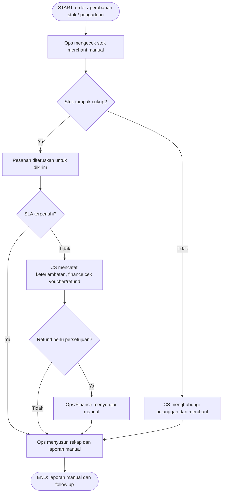
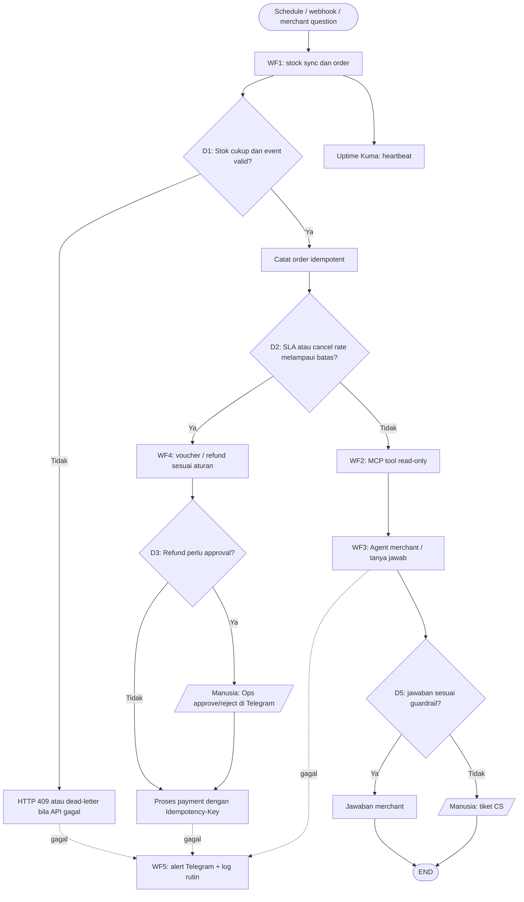

# 01 · BRD Ringkas + Process Map As-Is / To-Be · H8Mart Quick-Commerce Ops

**Nama:** [isi nama peserta]  
**Status:** Rancangan berdasarkan skenario set_1, belum uji produksi.

## 1. BRD Ringkas

| Item | Isi | Sumber |
| --- | --- | --- |
| Masalah bisnis (minimal 3, mencakup stok, SLA atau refund, dan reliability) | Stok merchant sering tertinggal/silent failure; SLA 30 menit menyebabkan voucher manual; refund manual berisiko terduplikasi; pertanyaan merchant memperlambat CS; tidak ada alert sinkron/laporan berhenti. | `README.md` §1 Skenario, poin 1–5 |
| Tujuan & ukuran keberhasilan (angka) | Sinkron stok tiap 15 menit untuk 12 merchant; `core.merchant_stock` tetap 205 baris setelah sinkron berulang (target kasus uji); webhook order mengembalikan 200 untuk diterima / 409 saat stok tidak cukup; digest 07.00 WIB; 1 event bisnis tidak menciptakan refund ganda; error masuk alert Ops. | `guide/tasks.md`, `guide/submission.md` (target uji, belum hasil) |
| Stakeholder & actor | Pelanggan, merchant, Ops, CS, Finance, kurir, admin pengelola platform, penilai; sistem: Merchant Stock API, Payment API, PostgreSQL, bot Telegram, LLM. | `README.md` §1, §3 |
| Volume & frekuensi | 12 merchant, tiga zona; sinkron 15 menit (96 kali/hari), digest 07.00; estimasi TCO 35.000 eksekusi/bulan adalah **asumsi**, bukan traffic terukur. | `README.md` §1 + asumsi `docs/03` |
| Aturan bisnis BR1 | Order hanya diterima bila stok tersedia, kuantitas valid, dan event duplikat tidak membuat pesanan kedua. | `guide/wf1-stock-sync-order-intake.md` |
| Aturan bisnis BR2 | Kompensasi keterlambatan dan refund ditentukan oleh aturan; nominal besar memerlukan persetujuan Ops; Payment wajib `Idempotency-Key`. | `guide/wf4-compensation-refund.md` |
| Aturan bisnis BR3 | Kegagalan harus terlihat: retry terbatas, dead-letter pada gagal permanen, alert dengan business key, heartbeat serta pemeriksaan hasil kosong / durasi. | `guide/wf5-reliability-monitoring.md` |
| Dalam scope automasi | WF1 sinkron, order, digest; WF2 data tools MCP; WF3 asisten merchant + CS escalation; WF4 voucher/refund; WF5 reliability & monitoring. | `README.md` §3 |
| Di luar scope (saat ini) | Gateway pembayaran nyata, inventory real-time dari seluruh merchant produksi, pemrosesan data pelanggan nyata, penentuan refund besar tanpa manusia. | Batasan lab Mock API dan asumsi risiko |

## 2. Process Map As-Is (proses manual hari ini)

## 3. Process Map To-Be (rancangan automasi)

## 4. Tabel Translasi ke Automation Flow

| Kode | Langkah manual (as-is) | Elemen automation flow (n8n) | Nama node / workflow | Alasan (bukan sekadar mengulang nama node) |
| --- | --- | --- | --- | --- |
| T1 | Menunggu laporan perubahan stok | Schedule Trigger | **WF1 · Stock Sync, Order Intake & Digest** | Jadwal mengurangi ketergantungan operator dan membuat hasil konsisten. |
| P1 | Mencocokkan data merchant dan katalog | HTTP Request + Merge + PostgreSQL Upsert | **WF1 · Stock Sync, Order Intake & Digest** | Merge berdasar SKU untuk memastikan foreign key produk valid; upsert mencegah duplikasi. |
| D1 | Mengecek stok dan memutuskan order | If / Switch + Respond to Webhook | **WF1 · Stock Sync, Order Intake & Digest** | Keputusan deterministik berdasarkan qty aktual, bukan LLM. |
| D2 | Menghitung pelanggaran SLA dan pembatalan | Query KPI tanggal dari DB | **WF2 · Merchant Data Tools** | Sumber data terstruktur, dapat ditelusuri untuk pertanyaan merchant. |
| D3 | Menentukan voucher/refund dan approval | If + Telegram approval + Payment API | **WF4 · Kompensasi & Refund** | Melindungi transaksi bernilai besar dengan human-in-the-loop. |
| D4 | Menjawab pertanyaan merchant dengan tarik data manual | AI Agent + MCP Client Tool | **WF3 · Asisten AI Merchant** | Natural language membantu CS, tetapi angka berasal dari tools yang terbatas. |
| D5 | Mengecek apakah jawaban perlu eskalasi | Guardrail If + Postgres ticket | **WF3 · Asisten AI Merchant** | Pertanyaan di luar sumber/ketidakpastian diarahkan ke CS, tidak mengarang. |
| E1 | Kegagalan luput tanpa pemberitahuan | Error Trigger + If severity + Telegram/log | **WF5 · Reliability & Monitoring H8Mart** | Kelompokkan respons berdasarkan urgensi, business key dan waktu. |

**Catatan:** Nama di tabel adalah *nama workflow rancangan*. Pastikan nama pada ekspor akhir dan setiap node yang diujikan konsisten setelah workflow selesai.

## 5. Langkah yang Sengaja Tidak Diautomasi

| Langkah | Kenapa tetap manusia | Bentuknya di workflow |
| --- | --- | --- |
| Refund bernilai besar | Keputusan keuangan berisiko, persetujuan eksplisit diwajibkan dalam skenario. | WF4 mengirim approval Ops di Telegram (atau Wait node sebagai fallback). |
| Pertanyaan merchant dengan bukti tidak cukup | Tidak boleh mengarang data pelanggan atau kebijakan; butuh klarifikasi/penanganan CS. | WF3 membuat `ops.tickets`, menjawab status eskalasi. |
| Penanganan insiden berulang / restoring backup | Butuh penilaian kondisi dan kemungkinan konsekuensi operasional. | WF5 memberi alert, operator menindaklanjuti. |

## 6. Asumsi & pertanyaan terbuka

- Volume transaksi 35.000 eksekusi/bulan digunakan **hanya** untuk TCO, perlu diganti hasil pengukuran saat n8n berjalan.
- Jadwal, jumlah kasus, biaya tenaga, dan efisiensi pada dokumen ROI merupakan asumsi studi kasus.
- Chat ID Telegram, email SSL, domain, nominal rule voucher/refund, dan nama workflow final menunggu konfigurasi saat implementasi EC2.
