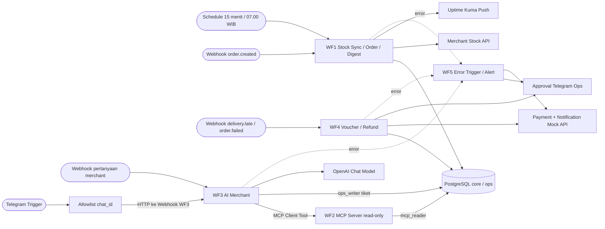

# 02 · Desain Solusi + Solution Fit + ROI · H8Mart Quick-Commerce Ops

**Nama:** Syifa Mutaalia  
**Workflow yang dibangun:** WF1 Stock Sync, Order Intake & Digest; WF2 Merchant Data Tools; WF3 Asisten AI Merchant (termasuk Telegram Trigger dalam canvas yang sama); WF4 Kompensasi & Refund; WF5 Reliability & Monitoring.  
**Pembaruan:** 10 November 2026. Pisahkan realisasi uji dari estimasi finansial.

## 1. Arsitektur 5 Workflow

**Deployment yang telah digunakan untuk uji:** AWS EC2 Ubuntu 24.04, Docker Compose, Caddy HTTPS pada `h8mart-syifa.duckdns.org`, n8n, PostgreSQL `h8mart`, Mock API, Uptime Kuma, dan task runners sesuai berkas compose. Nama service internal `n8n`, `postgres`, `mock-api`, `uptime-kuma` tidak boleh diganti dengan `localhost` di dalam node n8n. **Bukti deployment akhir masih perlu dimasukkan ke repo.**

**Fakta hasil uji yang telah dilaporkan:**

- WF1A: 12 merchant, 11 berhasil; `rows_synced=188` pada satu sampel; `new_stockouts=0` pada contoh run. Tidak sama dengan kewajiban `COUNT(*)` tabel stok tetap 205 setelah dua sinkron.
- WF1C: `tanggal_laporan=2026-11-07`, 162 total order, 25 batal, 134 terkirim, 111 tepat waktu, cancel rate 15,43%, SLA 82,84%; jalur `Digest Kosong?` masih pernah mengarah TRUE meskipun data ada.
- WF2: tiga tool MCP menghasilkan data M003 yang konsisten, dan query privilege menegaskan `mcp_reader` dapat SELECT `core.orders` tetapi tidak INSERT/UPDATE/DELETE tabel tersebut.
- WF3: agent pernah menjawab alasan pembatalan M003 secara benar dan membuat tiket CS pada fallback error (`ticket_id=4`, alasan `ai_error`); integrasi Telegram dan format respons masih perlu verifikasi akhir.
- WF4: panggilan voucher untuk HM-SP-001 pernah menghasilkan `voucher_id=VC-00001`; alur refund besar, approval, reject, dan idempotensi belum dapat ditandai lulus tanpa bukti tambahan.
- WF5: workflow Error Trigger, Telegram alert, dan Notification telah dibangun; keberhasilan end-to-end terpicu WF1–WF4 masih perlu dibuktikan.

## 2. Keputusan Pendekatan per Titik Keputusan (rule-based vs AI-driven)

| Kode | Pertanyaan yang diputuskan | Jenis data | Pendekatan (rule-based / AI / manusia) | Alasan |
| --- | --- | --- | --- | --- |
| D1 | Apakah order valid, harga konsisten, dan stok cukup? | `order_id`, SKU, `qty`, harga katalog, ongkir Rp8.000, stok | **Rule-based** | Hasil harus deterministik: 200 jika dapat diproses, 409 jika stok habis, 422 bila invalid; event ganda tidak boleh menciptakan duplikat. |
| D2 | Apakah data digest tersedia dan apakah indikator SLA/cancel rate melewati ambang? | Agregat SQL tanggal `hari_data_terakhir` | **Rule-based** | IF menyaring hasil kosong; parameter tanggal diambil dari dataset, bukan sistem hari ini. |
| D3 | Voucher atau refund? Perlu approval? | Jenis event, nominal, payment_status dan aturan kebijakan | **Rule-based + manusia** | Otomasi menghitung keputusan awal, Ops menyetujui refund bernilai besar. Payment API memakai Idempotency-Key. |
| D4 | Mengapa pesanan merchant batal? | KPI + alasan batal + stok dari tool MCP | **AI dengan retrieval tool read-only** | LLM merangkum dalam bahasa alami, tidak boleh mengarang angka atau mengakses merchant lain. |
| D5 | Apakah jawaban AI boleh dikirim? | `jawaban`, `data_dipakai`, `confidence`, `perlu_eskalasi` | **Rule-based guardrail + CS** | Jika data kurang, output tidak valid, kebutuhan eskalasi, atau error AI: catat tiket dan berikan respons eskalasi, walau confidence tinggi. |

## 3. Estimasi ROI

**PENTING — Seluruh angka ROI berikut adalah skenario perencanaan Day 3, bukan hasil timesheet, tagihan AWS, ataupun jumlah token riil.** Jumlah hari kerja 22 per bulan dan ongkos SDM diasumsikan **USD 15/jam** agar rumus dapat diaudit.

| Komponen | Rumus / asumsi | Angka |
| --- | --- | ---: |
| Waktu manual per hari untuk menyusun laporan Ops | 45 menit × 22 hari × 75% penghematan ÷ 60 | **12,375 jam/bulan** |
| Waktu CS per pertanyaan merchant | 8 menit × 100 pertanyaan × 65% ÷ 60 | **8,667 jam/bulan** |
| Waktu finance/Ops untuk refund/voucher | 12 menit × 80 kasus × 60% ÷ 60 | **9,600 jam/bulan** |
| Jumlah kasus per bulan | 22 laporan + 100 pertanyaan + 80 voucher/refund; **asumsi**, bukan count data seed | **202 aktivitas** |
| Tarif personel | Asumsi lab Day 3 | **USD 15/jam** |
| Penghematan tenaga per bulan | `(12,375 + 8,6667 + 9,6) × 15` | **≈ USD 459,63** |
| Token LLM per bulan | 100 pertanyaan × 2.000 token input dan 400 token output (hipotesis) | **200.000 input; 40.000 output** |
| Biaya LLM per bulan | `(200.000/1.000.000 × P_in) + (40.000/1.000.000 × P_out)`; **`P_in`/`P_out` wajib diisi dari tarif resmi model dan usage akun saat pengumpulan** | **Belum dapat dikonfirmasi** |
| Biaya platform bulanan | TCO self-hosted simulasi dokumen 03: USD 1.560 ÷ 12 (mencakup biaya staf/operasional/risiko asumsi; bukan tagihan AWS) | **USD 130/bulan (simulasi)** |
| **Manfaat bersih per bulan** | `459,63 - 130 - biaya_LLM_aktual` | **USD 329,63 − biaya_LLM** |
| **Payback** | Dengan asumsi biaya implementasi awal 8 jam × USD 15 = USD 120: `120 / manfaat_bersih_bulanan` | **≈ 0,36 bulan jika biaya LLM sangat kecil** |

Tarif token berbeda menurut model, cache, dan penyedia. Jangan menuliskan tarif contoh sebagai harga OpenAI yang pasti; gunakan dashboard [OpenAI API Pricing](https://openai.com/api/pricing/) untuk model yang benar-benar dipakai dan ukur token melalui eksekusi/penggunaan API. **Jika data token aktual belum tersedia, tetap tulis “belum diukur”** daripada membuat angka.

**Risiko ROI dan skenario terburuk:** Jika pemakaian hanya 20% dari volume asumsi dengan penghematan proporsional, manfaat tenaga hanya ≈ USD 91,93/bulan; dikurangi biaya platform simulasi USD 130, manfaat bersih sudah **negatif ≈ USD 38,07/bulan**, belum termasuk LLM. Eksekusi gagal, approval manual tambahan, data stok salah, dan provider LLM down juga dapat mengurangi realisasi penghematan. ROI bersifat ilustratif, **bukan klaim penghematan terbukti**.

## 4. Batas Automasi & Risiko

| Risiko | Dampak | Mitigasi di rancangan / status saat ini |
| --- | --- | --- |
| Routing WF1B tidak menangani status `invalid` / `duplicate` | Webhook berhenti tanpa HTTP yang semestinya | Tambahkan jalur 422 untuk invalid dan respons duplikat sesuai kontrak; **masih perlu perbaikan dan retest**. |
| Kondisi IF `Digest Kosong?` salah arah | KPI tersedia tetapi pesan tidak terkirim | Verifikasi INPUT IF, operator boolean, dan koneksi TRUE → Stop And Error / FALSE → MCP/digest; **belum dinyatakan lulus**. |
| M009 gagal permanen / sinkron API mengembalikan 0 baris | Data stok basi; insiden senyap | Retry terbatas, dead-letter, alert dan Kuma; audit bukti API calls dan tabel `ops.dead_letter`. |
| Produk tanpa `synced_at` dikategorikan `habis` akibat `COALESCE(qty, 0)` | AI menyampaikan stok “habis” padahal data bisa belum tersedia | Bedakan `no stock record` vs `qty=0` saat revisi query; status stok WF2 tidak boleh menyesatkan. |
| Prompt injection pada `customer_note` | AI mengarang janji kompensasi dan mengubah confidence | Prompt system dan guardrail; catatan pelanggan sebagai data tidak tepercaya, MCP SELECT saja, uji kasus injeksi. |
| AI confidence tinggi tetapi `perlu_eskalasi=true` | Pelanggan mendapat jawaban tidak berwenang | Prioritaskan `perlu_eskalasi`, buat tiket CS, respons status `eskalasi_cs`. |
| Payment event/approval ganda | Voucher/refund dobel | Unique constraint pada `idempotency_key`, gunakan header Payment `Idempotency-Key`, uji duplikasi. |
| Secret bocor lewat workflow export/screenshot | Penyalahgunaan API dan event palsu | Rotasi `X-H8Mart-Token`, scrub credential IDs/token, jangan commit `.env` dan kunci bot/OpenAI. |
| EC2 dinonaktifkan sebelum smoke test | Penilai tidak bisa menjangkau Production URL | Pertahankan server sampai dinyatakan selesai, awasi AWS Budgets, deactivate schedule yang sudah selesai dibuktikan jika perlu. |
