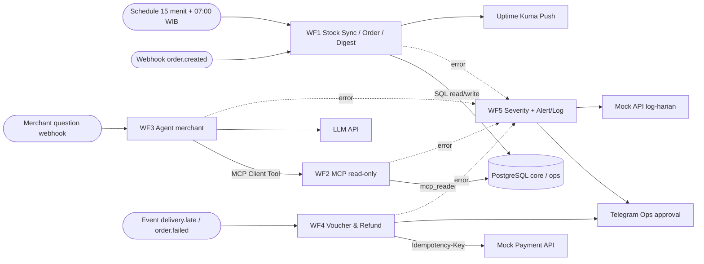

# 02 · Desain Solusi + Solution Fit + ROI · H8Mart Quick-Commerce Ops

**Nama:** [isi nama peserta]
**Workflow yang dibangun (rencana):** WF1 Stock Sync, Order Intake & Digest; WF2 Merchant Data Tools; WF3 Asisten AI Merchant; WF4 Kompensasi & Refund; WF5 Reliability & Monitoring.

## 1. Arsitektur 5 Workflow

## 2. Keputusan Pendekatan per Titik Keputusan (rule-based vs AI-driven)

| Kode | Pertanyaan yang diputuskan | Jenis data | Pendekatan (rule-based / AI / manusia) | Alasan |
| --- | --- | --- | --- | --- |
| D1 | Apakah stok cukup untuk order ini? | Kuantitas numerik per SKU dan merchant | **Rule-based** | Stok harus dibandingkan langsung dengan qty, bukan diprediksi AI. |
| D2 | Apakah cancel rate atau SLA hari ini melewati ambang? | Agregat order dan delivery | **Rule-based** | Batas yang diketahui dapat dibandingkan dengan query SQL untuk hasil konsisten. |
| D3 | Berapa voucher atau apakah refund butuh approval? | Durasi keterlambatan, status pembayaran, nominal | **Rule-based + manusia** | Besaran kecil dapat diotomasi sesuai aturan; refund besar harus disetujui Ops. |
| D4 | Mengapa order merchant banyak batal? | KPI, alasan pembatalan, customer note yang tidak tepercaya | **AI + MCP read-only** | AI untuk merangkum bahasa natural, fakta diambil dari query SQL. |
| D5 | Apakah jawaban AI layak dikirim ke merchant? | Respons AI, bukti dari tools, kecukupan sumber | **Rule-based guardrail + manusia (CS)** | Data kurang, pertanyaan sensitif atau indikasi injeksi harus dieskalasi. |

## 3. Estimasi ROI

**Seluruh angka berikut adalah asumsi bisnis untuk simulasi, bukan pengukuran waktu aktual di EC2**. Periode = 22 hari kerja per bulan, tarif personil USD 15/jam. Ukuran keberhasilan harus diverifikasi menggunakan tab Executions dan catatan waktu tugas nyata.

| Komponen | Rumus / asumsi | Angka |
| --- | --- | --- |
| Waktu manual per hari untuk menyusun laporan Ops | 45 menit/hari × 22 hari × 75% waktu terhemat | **12,375 jam/bulan** |
| Waktu CS per pertanyaan merchant (menarik data manual) | 8 menit × 100 pertanyaan/bulan × 65% waktu terhemat | **8,667 jam/bulan** |
| Waktu finance/Ops per refund atau voucher manual | 12 menit × 80 kasus/bulan × 60% waktu terhemat | **9,600 jam/bulan** |
| Jumlah kasus per bulan (dasar dari data seed atau asumsi eksplisit) | Asumsi: 22 laporan Ops; 100 pertanyaan; 80 refund/voucher. **Bukan observasi nyata** | **202 aktivitas** |
| Biaya tenaga per jam (asumsi) | Materi Day 3 | **USD 15/jam** |
| Penghematan per bulan | (12,375 + 8,667 + 9,600) × 15 | **USD 459,63** |
| Biaya LLM per bulan (asumsi) | 100 pertanyaan × (2.000 token input + 400 token output); asumsi rate Day 3 USD 0,10/1 juta input dan USD 0,50/1 juta output: 200.000×0,1/1M + 40.000×0,5/1M. **Belum diuji; cek ulang harga API dan token aktual di dashboard provider** | **USD 0,04** |
| Biaya platform per bulan (rujuk dokumen 03) | TCO AWS USD 1.560 / 12, mencakup personil, operasi, risiko, langsung | **USD 130,00** |
| **Net benefit per bulan** dan **payback** | 459,63 – 130,00 – 0,04 = **USD 329,59/bulan**. Asumsi biaya implementasi awal 8 jam × USD 15 = USD 120, payback = 120/329,59 | **±0,36 bulan (asumsi)** |

**Risiko ROI dan skenario terburuk:** volume nyata hanya 20% dari asumsi, manfaat waktu dan net benefit turun drastis; EC2 tetap berjalan dan tetap memiliki biaya sumber daya. Kegagalan LLM atau gateway refund berulang bisa menambah waktu penanganan manusia dan memperbesar biaya insiden. Hindari otomatisasi refund tanpa *idempotency key* dan persetujuan sesuai nilai transaksi.

## 4. Batas Automasi & Risiko

| Risiko | Dampak | Mitigasi di rancangan |
| --- | --- | --- |
| Data stok basi / API 200 mengembalikan daftar kosong | Pesanan tak dapat dipenuhi walau status sinkron tampak sukses | WF1 memvalidasi jumlah record, `Stop and Error`, alert dan dead-letter. |
| Event order/refund dipanggil dua kali | Duplikasi proses, kerugian uang | Unique key di DB, upsert, idempotency Payment. |
| Prompt injection pada `customer_note` | Jawaban AI keluar konteks dan data sensitif bocor | Treat note as untrusted, tiga tools `mcp_reader` hanya SELECT, guardrail + CS. |
| Token bot / webhook tersebar | Pihak asing mengirim event atau membaca log | Header Auth, Telegram credential, filter chat ID, pemisahan secrets dari repo. |
| EC2 Free Tier kredit habis sebelum penilaian | Endpoint Production tidak tersedia bagi penilai | Periksa kredit dan tanggal berlaku, buat Budgets alert, jangan terminate sebelum penilai selesai. |
| Error Workflow / log sendiri gagal | Insiden tanpa notifikasi | WF5 mencatat ke log dan Telegram pada kanal terpisah; cek test fault injection di `evidence/wf5`. |
