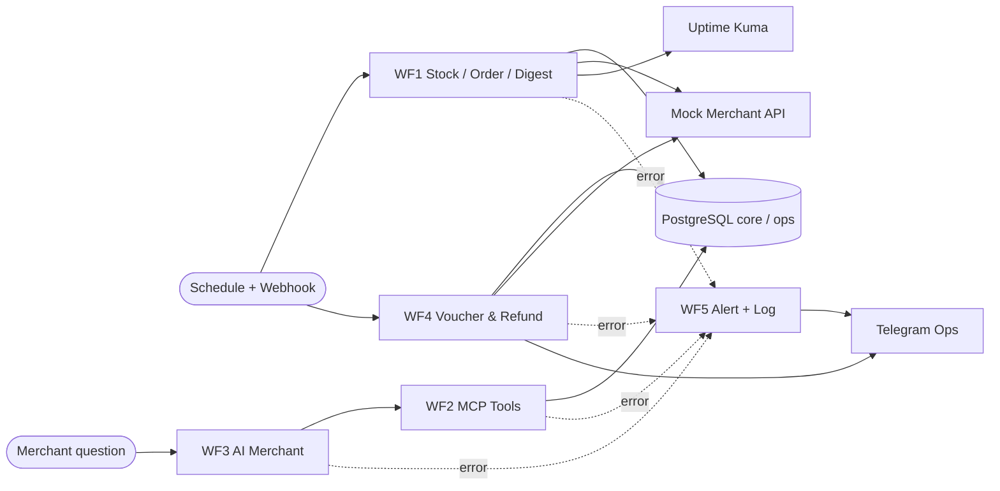

# H8Mart Quick-Commerce Ops · [Nama Peserta]

**Status implementasi:** per 7 November 2026 paket disiapkan untuk deployment langsung di AWS EC2. WF5 starter JSON tersedia; **WF1–WF4, credential, dan verifikasi EC2 belum selesai**. Bagian hasil uji wajib diisi berdasarkan eksekusi nyata, bukan contoh.

## 1. Ringkasan (3 kalimat)

H8Mart adalah sistem quick-commerce dengan 12 merchant di Jabodetabek yang membutuhkan sinkronisasi stok, penanganan pesanan, kompensasi, dan layanan merchant. Solusi yang dirancang menggunakan 5 workflow n8n dengan integrasi PostgreSQL, Mock API, MCP, LLM, bot Telegram, dan Uptime Kuma untuk menjalankan proses secara terkendali dan dapat ditelusuri. Seluruh stack akan ditempatkan pada AWS EC2 Jakarta melalui Docker Compose dan HTTPS, sementara hasil pengujian tetap harus dibuktikan dari instance nyata.

## 2. Arsitektur



Semua container berjalan di **AWS EC2 Ubuntu**; Caddy menerima port 80/443 publik dan meneruskan ke n8n di jaringan Docker. Port PostgreSQL, Mock API, dan Kuma tidak dipublikasi ke internet.

## 3. Workflow

| Workflow | Tujuan | Status saat paket disiapkan |
| --- | --- | --- |
| WF1 Stock Sync, Order Intake & Digest | Sinkron stok; webhook order; digest 07 WIB; retry & heartbeat | Belum diimplementasikan/diuji di EC2 |
| WF2 Merchant Data Tools | Tiga MCP tools SELECT parameterized | Belum diimplementasikan/diuji |
| WF3 Asisten AI Merchant | AI Agent + MCP; jawaban, fallback, eskalasi CS | Belum diimplementasikan/diuji |
| WF4 Kompensasi & Refund | Event, voucher/refund idempotent, approval Ops | Belum diimplementasikan/diuji |
| WF5 Reliability & Monitoring | Error Workflow, alert severity, log rutin | **Starter JSON tersedia**; wajib diimpor, disambungkan kredensial dan diuji |

## 4. Cara Menjalankan (untuk penilai)

Cara paling lengkap: [`MULAI-DI-AWS-EC2.md`](../MULAI-DI-AWS-EC2.md). Setelah instance disiapkan dan repo di-clone di EC2:

```bash
cd ~/h8mart-ops
cp .env.example .env
nano .env                 # isi hanya di EC2, termasuk DOMAIN_NAME dan N8N_ENCRYPTION_KEY
sudo docker compose -f compose.yaml -f compose.vps.yaml up -d
sudo docker compose -f compose.yaml -f compose.vps.yaml ps
```

Credential yang dibuat di n8n: Postgres `mcp_reader`, Postgres `ops_writer`, HTTP Header Auth untuk Mock API (`X-Api-Key`) dan event (`X-H8Mart-Token`), OpenAI API, Telegram bot. Jangan membuka isi `.env` atau screenshot credential lengkap. Tidak ada proses n8n yang berjalan lokal.

## 5. Cara Memverifikasi (untuk penilai)

| Skenario | Perintah / aksi | Hasil yang terlihat (target, belum diuji) | Bukti |
| --- | --- | --- | --- |
| Sinkron stok retry, dead-letter, stockout | Trigger WF1 sinkron, query `SELECT count(*) FROM core.merchant_stock` | 205 baris setelah dua sinkron, retry M004, dead-letter M009 | `evidence/wf1/`, `wf5/` |
| Order stok habis vs cukup | POST fixtures `event-order-created-ok.json` / `event-order-created-stok-habis.json` ke Production URL | HTTP 200 / 409 | `evidence/wf1/` |
| Digest harian vs SQL | Jalankan WF1 digest, bandingkan data DB | Angka cocok + pesan Telegram masuk | `evidence/wf1/` |
| MCP tools | WF3 memanggil WF2 via MCP Client Tool | 3 tools read-only, role mcp_reader | `evidence/wf2/` |
| Agent fallback/eskalasi | POST fixture pertanyaan merchant dan kasus injeksi | JSON terstruktur / tiket CS bila ragu | `evidence/wf3/` |
| Refund besar dan voucher | POST event delivery.late & order.failed, klik approval | Idempotent; pending_approval → refunded | `evidence/wf4/` |
| Reliability + alert + log | Uji error terencana di Production, buka tab Executions | WF5 berjalan, alert Telegram + log severity | `evidence/wf5/` |
| Heartbeat Uptime Kuma | Buka monitor via SSH tunnel | Up/Down teramati | `evidence/wf5/` |
| Deploy | Browser HTTPS + compose ps + POST Production URL | HTTPS valid, 6 containers berjalan, webhook merespons | `evidence/deploy/` |

## 6. Keputusan Desain & Batasan

- `set_1` instruktur dipertahankan termasuk seeding PostgreSQL dan file Compose. TCO Day 3 dilampirkan sebagai `docs/06-...` dengan format asli; tidak mengganti `docs/03-...`.
- Log harian Day 5 menggunakan Mock Notification API internal; alert penting Telegram. Tidak ada klaim uji sebelum screenshot dan data Executions terverifikasi.
- Free Tier adalah kredit/kuota sesuai kondisi akun, bukan jaminan hosting n8n tanpa biaya selama 12 bulan.
- Key OpenAI/Telegram dan `.env` tidak di-commit. Data H8Mart bersifat sintetis dan sistem latihan, bukan gateway transaksi produksi.

## 7. Struktur Repo

```text
h8mart-ops/
├── README.md, SETUP.md, data-contract.md, .env.example
├── compose.yaml, compose.vps.yaml, Caddyfile
├── seed/, mock-api/, fixtures/, assets/, guide/
├── workflows/
│   └── wf5-reliability-monitoring.json         # starter, perlu konfigurasi/test
├── docs/
│   ├── 01-brd-process-map.md
│   ├── 02-desain-solusi-roi.md
│   ├── 03-tco-deployment.md
│   ├── 04-readiness-checklist.md
│   ├── 05-readme-solusi.md
│   ├── 06-rekomendasi-tco-day3.md            # tambahan
│   └── 07-alerting-dan-log-day5.md           # tambahan
├── evidence/{deploy,wf1,wf2,wf3,wf4,wf5}/
├── aws-ec2/bootstrap-ubuntu.sh
└── MULAI-DI-AWS-EC2.md
```
