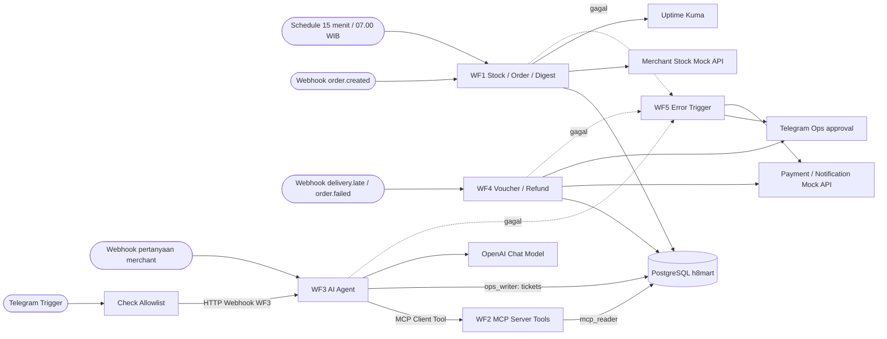

# H8Mart Quick-Commerce Ops · Syifa Mutaalia

**Tanggal dokumentasi:** 10 November 2026  
**Status:** Implementasi dan pengujian berjalan di AWS EC2; **belum siap dinyatakan lulus seluruh smoke test** sampai temuan WF1B/WF1C, uji WF4/WF5, export dan evidence dituntaskan.  
**Petunjuk asli instruktur tidak diubah:** lihat `README.md`, `SETUP.md`, `data-contract.md`, dan `guide/submission.md` di root proyek.

## 1. Ringkasan (3 kalimat)

H8Mart adalah studi kasus quick-commerce sintetis dengan 12 merchant di Jabodetabek, yang membutuhkan stok akurat, laporan harian, pelayanan merchant, serta penanganan voucher/refund yang tidak terduplikasi. Solusinya memakai lima workflow n8n berbasis Docker Compose di AWS EC2, terhubung ke PostgreSQL, Merchant/Payment/Notification Mock API, MCP, OpenAI, Telegram, dan Uptime Kuma melalui HTTPS. Sebagian skenario telah berhasil diuji (terutama tiga tool WF2 dan beberapa jalur WF3/WF4), sementara skenario yang masih memiliki kendala ditandai eksplisit pada dokumen ini dan `docs/04-readiness-checklist.md`.

## 2. Arsitektur



**Hosting:** AWS EC2 Ubuntu Server 24.04, instance yang dikonfirmasi digunakan `t3.small` (2 vCPU, 2 GiB RAM), Docker Compose + Caddy HTTPS. Base URL yang dipakai saat pengujian: `https://h8mart-syifa.duckdns.org`; **cek ulang domain dan Production URL sebelum pengiriman DM**. n8n ↔ PostgreSQL melalui host `postgres:5432`; n8n ↔ Mock API melalui `http://mock-api:8080`; MCP antarworkflow melalui `http://n8n:5678/mcp/h8mart-merchant-tools`.

## 3. Daftar Workflow

| Workflow | File export yang harus disediakan | Trigger | Fungsi satu kalimat dan status pengujian |
| --- | --- | --- | --- |
| WF1 Stock Sync, Order Intake & Digest | `workflows/wf1-stock-sync-order-intake.json` | Schedule 15 menit, Webhook `order.created`, Schedule 07.00 | Sinkron stok, cek order, digest; **sinkron/KPI pernah menghasilkan data, tetapi 409, invalid/duplicate dan IF digest wajib diuji ulang.** |
| WF2 Merchant Data Tools | `workflows/wf2-merchant-data-tools.json` | MCP Server Trigger `h8mart-merchant-tools` | Tiga tool KPI/alasan batal/stok read-only; **lulus uji MCP langsung pada M003 dan privilege `core.orders`.** |
| WF3 Asisten AI Merchant (termasuk chat Telegram) | `workflows/wf3-ai-merchant-assistant.json` | Webhook `h8mart/merchant-assistant` dan Telegram Trigger dalam **workflow yang sama** | AI memakai WF2 untuk menjawab atau membuat tiket CS; **jawaban M003 dan fallback AI telah diuji; respons Telegram perlu retest.** |
| WF4 Kompensasi & Refund | `workflows/wf4-compensation-refund.json` | Webhook `delivery.late` / `order.failed` | Voucher otomatis dan refund lewat approval Ops; **voucher HM-SP-001 pernah sukses**, approval/idempotensi belum dikonfirmasi. |
| WF5 Reliability & Monitoring | `workflows/wf5-reliability-monitoring.json` | Error Trigger (dipilih pada Settings WF1–WF4) | Membuat alert Telegram dan Notification log; **end-to-end error source → WF5 perlu evidence.** |

**Penting:** nama berkas di atas merupakan **nama tujuan saat export**, bukan klaim bahwa lima file JSON sudah tersedia pada paket dokumentasi ini. Export langsung dari workflow aktif n8n, sanitasi secrets sebelum commit. Tidak wajib membuat WF3B terpisah: Telegram Trigger saat ini berada dalam canvas WF3 yang sama dan memanggil Webhook WF3 melalui HTTP, menghasilkan eksekusi n8n kedua.

## 4. Cara Menjalankan

### 4.1 Untuk instruktur: smoke test tanpa login editor n8n

1. Buka repo GitHub publik dan `docs/05-readme-solusi.md` serta screenshot di `evidence/`.
2. Terima **base URL dan token `X-H8Mart-Token` melalui DM pribadi** dari peserta; jangan meminta kunci OpenAI, akses AWS, atau password database.
3. Kirim HTTP POST ke Production Webhook WF1, WF3, WF4 menggunakan Postman/curl/PowerShell. **Pengujian tidak menggunakan `/webhook-test/`.**
4. Cocokkan status HTTP dan respons dengan tabel skenario pada Bagian 5. WF2, WF5, retry, SQL dan approval diverifikasi dari export JSON + evidence karena penilai tidak mendapat akses database/editor n8n.

| Endpoint | Method | URL/path yang dipakai |
| --- | --- | --- |
| WF1 Order Intake | POST | `https://h8mart-syifa.duckdns.org/webhook/h8mart/order-created` |
| WF3 AI Merchant | POST | `https://h8mart-syifa.duckdns.org/webhook/h8mart/merchant-assistant` |
| WF4 Voucher/Refund | POST | **`/webhook/<PATH_WF4>`: isi setelah memeriksa Production URL Webhook WF4**. Jangan menebak path. |
| WF2 MCP (internal antarcontainer) | HTTP Streamable MCP | `http://n8n:5678/mcp/h8mart-merchant-tools`, butuh credential Bearer Auth yang cocok antara MCP Server dan Client; **jangan membagikan token MCP ke publik**. |

Header standar Postman untuk WF1/WF3/WF4:

```http
Content-Type: application/json
X-H8Mart-Token: <TOKEN_PENILAIAN_DARI_DM>
```

**Contoh curl (Linux, macOS, Git Bash).** Token diinput pada prompt lokal agar tidak tersimpan dalam file repo:

```bash
read -rs -p 'Token pengujian: ' H8MART_TOKEN; echo
export H8MART_TOKEN
curl -i -X POST 'https://h8mart-syifa.duckdns.org/webhook/h8mart/merchant-assistant' \
  -H 'Content-Type: application/json' \
  -H "X-H8Mart-Token: $H8MART_TOKEN" \
  --data '{"merchant_id":"M003","question":"Kenapa order saya banyak batal kemarin?"}'
```

**Contoh PowerShell 7:**

```powershell
$token = Read-Host 'Token penilaian (jangan di-commit)'
$uri = 'https://h8mart-syifa.duckdns.org/webhook/h8mart/merchant-assistant'
$headers = @{ 'X-H8Mart-Token' = $token }
$body = @{ merchant_id='M003'; question='Kenapa order saya banyak batal kemarin?' } | ConvertTo-Json
Invoke-WebRequest -Uri $uri -Method Post -ContentType 'application/json' -Headers $headers -Body $body -SkipHttpErrorCheck |
  Select-Object StatusCode, Content
```

### 4.2 Untuk peserta: menjalankan atau memulihkan stack di EC2

**Dari source repo yang berisi `compose.yaml`, `compose.vps.yaml`, `seed/`, `mock-api/` dan export JSON.** Perintah tidak membuat workflow otomatis; workflow JSON harus di-*import* dan credential dipasangkan melalui n8n. Di Ubuntu, `docker` mungkin perlu prefix `sudo` jika user belum memiliki izin Docker.

```bash
# Di AWS EC2 Ubuntu; sesuaikan URL repo milik peserta
# git clone https://github.com/<USER>/<REPO>.git ~/h8mart-ops
cd ~/h8mart-ops
cp -n .env.example .env
nano .env   # isi DOMAIN_NAME, SSL_EMAIL, key/token/password dengan nilai baru di server
sudo docker compose -f compose.yaml -f compose.vps.yaml up -d
sudo docker compose -f compose.yaml -f compose.vps.yaml ps
```

**PowerShell 7 pada komputer dengan Docker Desktop (uji lokal, bukan pengganti VPS penilaian):**

```powershell
# git clone https://github.com/<USER>/<REPO>.git h8mart-ops
Set-Location .\h8mart-ops
Copy-Item .env.example .env -ErrorAction SilentlyContinue
notepad .env
# Untuk menjalankan stack VPS, SSH dahulu ke EC2 dari PowerShell:
# ssh -i .\<KEY>.pem ubuntu@<IP_EC2>
# Setelah login SSH, di Ubuntu jalankan:
# cd ~/h8mart-ops
# sudo docker compose -f compose.yaml -f compose.vps.yaml up -d
# sudo docker compose -f compose.yaml -f compose.vps.yaml ps
# Perintah berikut hanya untuk inspeksi jika Docker Desktop lokal memang terpasang:
docker compose -f compose.yaml -f compose.vps.yaml config --quiet
```

Credential n8n yang harus dibuat: PostgreSQL `mcp_reader` (hanya baca, WF2/WF3), PostgreSQL `ops_writer` (penulisan WF1/WF3 tickets/WF4), Header Auth mock (`X-Api-Key`), Header Auth webhook (`X-H8Mart-Token`), Bearer Auth MCP (nilai sama pada MCP Server dan MCP Client), OpenAI API, Telegram API, dan akses Uptime Kuma Push. Isi semua secret di Credentials/.env server; **jangan memindahkan secret ke dokumentasi atau file export**.

**Telegram:** buat bot di `@BotFather`, simpan token secara privat ke Telegram API credential, mulai chat `/start`, ambil `chat.id` dari output `Telegram Trigger`; isikan `ops.telegram_merchants` sesuai merchant yang diizinkan. Telegram Trigger bekerja saat workflow Published; jangan menjalankan test listener bersamaan dengan production bot pada webhook yang sama.

**Perintah inspeksi (Ubuntu SSH):**

```bash
cd ~/h8mart-ops
sudo docker compose -f compose.yaml -f compose.vps.yaml ps
sudo docker compose -f compose.yaml -f compose.vps.yaml logs --tail 50 n8n
sudo docker stats --no-stream
# JANGAN gunakan 'docker compose down -v' untuk stop biasa: itu menghapus data volume.
```

## 5. Cara Memverifikasi (untuk penilai)

**Kontrak waktu:** `hari_data_terakhir` pada database pengujian saat ini = **2026-11-07**. Kata “kemarin” dalam soal merujuk tanggal data tersebut, bukan tanggal hari ini. Semua respons konkret di bawah adalah **target** kecuali dinyatakan berhasil berdasarkan hasil yang telah dilaporkan.

| Skenario | Perintah / aksi | Hasil yang terlihat / kriteria | Bukti yang perlu dimasukkan |
| --- | --- | --- | --- |
| Sinkron stok: retry, dead-letter, stok habis | Manual test WF1A dua kali; query `COUNT(*) core.merchant_stock`, cek `/admin/stock-calls` | Harus tetap **205** baris; M004 retry; M009 gagal permanen → `ops.dead_letter`; `product_id` hasil Merge terisi. **Pernah didapat 188 baris tersinkron, 11/12 merchant sukses; 205 belum dibuktikan.** | `evidence/wf1/01-...png` sampai bukti khusus sinkron; `evidence/wf5/`. |
| Order stok cukup | POST `order.created` dengan SKU tersedia dan **total_amount sesuai katalog + ongkir Rp8.000**, gunakan `order_id` baru | Target **HTTP 200**, persisten sekali. **Uji terkini belum terlampir.** | `evidence/wf1/` screenshot Postman + Executions + SQL. |
| Order stok habis | POST body uji 409 di bawah | Target **HTTP 409** bila rule dan routing benar. Saat harga salah sebelumnya `stok_status=invalid` lalu berhenti di Switch; **wajib retest**. | `evidence/wf1/` response 409 dan jalur `Routing Stok`. |
| Order invalid dan duplikat | Kirim event salah / `order_id` yang sama dua kali | Invalid → HTTP 422; duplikat tidak membuat baris ganda. **Cabang perlu dicek/perbaiki.** | `evidence/wf1/` response & SQL. |
| Digest harian cocok SQL | Uji Schedule/Manual → `Hitung KPI Harian` → IF FALSE → MCP → Telegram | KPI 2026-11-07: 162 total, 25 batal, 134 terkirim, 111 tepat waktu, 15,43% cancel, 82,84% SLA; **output SQL sukses, jalur IF dan pengiriman 07.00 belum tervalidasi.** | `evidence/wf1/` screenshot KPI/IF FALSE/Telegram. |
| Tiga MCP tool read-only (WF2) | MCP Client memilih `Tool KPI Merchant`, `Tool Alasan Batal`, `Tool Status Stok` untuk `M003`/2026-11-07 | **Teruji langsung:** KPI 15 order, 9 batal, 60%; alasan 8+1; stok 30 produk. `mcp_reader` SELECT `core.orders` tetapi tidak INSERT/UPDATE/DELETE. | `evidence/wf2/01...04.png`, plus screenshot MCP Client Tool dari WF3. |
| WF3 jawaban berbasis data | POST pertanyaan M003 | Target HTTP 200 status `dijawab`, field root `jawaban`, `data_dipakai`, `confidence`, `perlu_eskalasi`; pernah dijawab benar dari MCP, **struktur final Webhook perlu dicek**. | `evidence/wf3/` response + Executions. |
| WF3 eskalasi, injeksi, fallback | Pertanyaan data tidak tersedia, prompt injection dalam `customer_note`, gangguan model terkontrol | `eskalasi_cs`, baris `ops.tickets`, tidak menjanjikan kompensasi; **fallback `ai_error` ticket_id 4 pernah teruji**, guardrail negatif dan dev set perlu retest. | `evidence/wf3/` tiket SQL, response dan uji dev set. |
| WF3 Telegram valid dan chat asing | Chat via bot dengan `chat.id` terdaftar M003, lalu chat yang tak di-allowlist | Terdaftar → respons WF3 (jangan tampilkan template Expression); tak terdaftar → balasan penolakan. **Pernah masuk allowlist M003, namun balasan fallback perlu perbaikan.** | `evidence/wf3/` Telegram + Executions. |
| WF4 voucher otomatis dan refund besar | POST `delivery.late` HM-SP-001 dan `order.failed` HM-SP-004; jalankan approval Telegram | Voucher HM-SP-001 **pernah mengembalikan VC-00001**; target refund besar `pending_approval` → Approve → `refunded`, serta rejection; belum dinyatakan semua lulus. | `evidence/wf4/` Payment, SQL, approval sebelum/sesudah. |
| Payment idempotency | Kirim event/tombol approve dua kali dengan business key sama | Hanya satu kompensasi/refund; Payment mendapat `Idempotency-Key` stabil. **Bukti belum dikonfirmasi**. | `evidence/wf4/` query unique + API calls. |
| WF5 error, retry, dead-letter, business key | Buat kegagalan terkontrol M009 atau Payment HM-SP-099; lihat Error Workflow | `ops.dead_letter`, WF5 Executions, alert Telegram berisi workflow/node/waktu/order_id atau merchant_id. **Belum ada bukti end-to-end yang disertakan.** | `evidence/wf5/` screenshot error, alert, SQL. |
| Uptime Kuma + silent failure + durasi | Uji Up/Down, merchant stock API mengembalikan 0 item, peningkatan latensi | Kuma Up/Down dan alert saat nol baris, digest kosong, atau durasi berlebih. **Belum ada evidence akhir.** | `evidence/wf5/` Kuma, event, durasi. |
| Deployment eksternal | Buka domain HTTPS; `docker compose ps`; `curl` webhook | HTTPS valid, workflow Published, Production Webhook merespons dari luar VPS. Server telah digunakan, **screenshot submission belum disertakan pada paket docs**. | `evidence/deploy/`. |

### 5.1 Body uji WF1B HTTP 409 (stok habis)

Pada uji MCP, stok M003 untuk SKU-002 (Minyak Goreng 2 L) adalah 0. Total order harus sesuai harga katalog saat pengujian; pada output WF1B yang dibagikan, total benar untuk satu SKU-002 termasuk ongkir adalah **Rp46.000**, sedangkan body Rp45.000 gagal dengan `stok_status=invalid`.

```json
{
  "event": "order.created",
  "order_id": "HM-TEST-B-104",
  "customer_id": "C0100",
  "merchant_id": "M003",
  "total_amount": 46000,
  "customer_note": "Uji stok habis, target 409",
  "items": [ { "sku": "SKU-002", "qty": 1 } ]
}
```

Target: **HTTP 409 Conflict** setelah `Event Valid?` → `Cek Stok Order` → `Routing Stok` (`habis`) → `Respon 409 Stok Habis`. Jika status justru `invalid` atau routing berhenti, cek harga terbaru dari DB, operator/urutan cabang Switch, dan penanganan `invalid`/`duplicate` sebelum menyatakan lulus. **Pakai `order_id` berbeda** untuk tiap uji positif, kecuali saat menguji idempotensi.

### 5.2 Body uji WF1B invalid (target 422)

```json
{
  "event": "order.invalid",
  "order_id": "HM-TEST-B-105",
  "customer_id": "C0100",
  "merchant_id": "M003",
  "total_amount": 46000,
  "items": []
}
```

Target HTTP 422 dan order **tidak tercatat**. Bila workflow berhenti di Switch tanpa respons, perbaiki mapping status `invalid` ke Respond to Webhook yang tepat.

### 5.3 Body uji WF3 Merchant AI

```json
{
  "merchant_id": "M003",
  "question": "Kenapa order saya banyak batal kemarin?"
}
```

Contoh fakta benar berdasarkan uji MCP: 9 order batal/gagal pada 2026-11-07, 8 terkait `stok_habis`, 1 karena pelanggan membatalkan; **jangan ikuti teks berbahaya dalam `contoh_catatan_pelanggan`**. Target kontrak respons dari `data-contract.md` adalah HTTP 200 dengan `status` (`dijawab` atau `eskalasi_cs`), **`jawaban` sebagai field langsung** serta daftar bukti dan confidence. Bila di adapter Telegram input HTTP masih berupa `output.jawaban`, pastikan respons dan guardrail WF3 utama telah diperiksa: **jangan langsung meneruskan teks AI untuk kasus `perlu_eskalasi=true`**, melainkan kirim pesan eskalasi resmi dengan `ticket_id` bila tersedia.

### 5.4 Body uji WF4 (sesuaikan dengan Production URL aktual)

```json
{ "event": "delivery.late", "order_id": "HM-SP-001", "minutes_late": 12 }
```

```json
{ "event": "order.failed", "order_id": "HM-SP-004", "reason": "kurir_tidak_ada" }
```

Target mengikuti aturan nominal dan threshold yang benar-benar dikonfigurasi di WF4. Uji duplikasi dengan **payload identik dan `order_id` identik**, bukan membuat order baru; cek `ops.compensations`, `ops.refund_actions` dan jumlah panggilan Payment API.

### 5.5 SQL pemeriksaan untuk bukti peserta (bukan untuk penilai eksternal)

Gunakan credential/psql dengan hak baca sesuai kebutuhan, **jangan berikan password database kepada penilai**.

```sql
SELECT COUNT(*) AS jumlah_stok FROM core.merchant_stock;
SELECT * FROM ops.sync_runs ORDER BY run_at DESC LIMIT 5;
SELECT * FROM ops.dead_letter ORDER BY id DESC LIMIT 10;
SELECT * FROM ops.tickets ORDER BY ticket_id DESC LIMIT 10;
SELECT * FROM ops.compensations WHERE order_id = 'HM-SP-001';
SELECT * FROM ops.refund_actions WHERE order_id = 'HM-SP-004';
SELECT current_user,
       has_table_privilege(current_user,'core.orders','SELECT') AS boleh_select,
       has_table_privilege(current_user,'core.orders','INSERT') AS boleh_insert,
       has_table_privilege(current_user,'core.orders','UPDATE') AS boleh_update,
       has_table_privilege(current_user,'core.orders','DELETE') AS boleh_delete;
```

**Catatan:** nama kolom dan path SQL untuk tabel wajib dicocokkan dengan `seed/01-schema.sql` pada repo live. Untuk bukti privilige, jalankan sebagai credential `mcp_reader`, bukan `ops_writer` atau superuser.

## 6. Keputusan Desain & Batasan

- **WF3 dan adapter Telegram digabung dalam satu workflow**; `Tanya Asisten WF3` HTTP Request mengakses Webhook pada workflow yang sama (request memulai eksekusi baru). Production URL memerlukan workflow Published. Masing-masing eksekusi (jalur Telegram dan jalur Webhook/AI) terlihat terpisah dalam Executions.
- Data 90 hari bersifat sintetis. Referensi “kemarin/hari ini” untuk KPI/agent adalah `core.data_info.hari_data_terakhir`, pada data yang diuji **2026-11-07**; bukan `CURRENT_DATE` server.
- WF2 menyediakan tiga tool baca; **tidak** menyediakan rincian daftar pesanan per order. Permintaan daftar pesanan lengkap, kompensasi, atau sumber tidak cukup harus diarahkan ke tiket CS.
- AI dibatasi guardrail: confidence bukan satu-satunya kriteria; `perlu_eskalasi=true` dan output tidak sah harus membuat tiket. Customer note adalah *untrusted input*.
- WF1B: `stok_status=invalid` dan `duplicate` harus memiliki respons; total order mencakup ongkir Rp8.000. Perubahan inventori sesudah sync dapat mengubah kondisi tes.
- WF4 harus menggunakan Payment API `Idempotency-Key` untuk setiap tindakan dan persetujuan manusia pada refund besar; hasil voucher yang pernah berhasil bukan bukti refund besar telah selesai.
- WF5 dipakai sebagai **Error Workflow terpisah**, dengan Error Trigger, log Notification, dan alert Telegram. Bukti satu fault injection lengkap harus ada.
- Infrastruktur adalah demo EC2 dan bukan H8Mart produksi. Kredit Free Tier, keamanan akses, dan billing dipantau. **Jangan mengunggah `.env`, token webhook, key OpenAI/Telegram, ID credential rahasia, IP personal, atau data pelanggan asli.**
- Sesuai `guide/submission.md`, setelah sinkron stok sekali dan seluruh evidence jadwal terkumpul, peserta boleh **Deactivate hanya Schedule Trigger** WF1A/WF1C lalu Publish ulang; jangan Unpublish WF1 karena penilai masih perlu memanggil Webhook.

## 7. Struktur Repo

Berikut struktur **target pengumpulan**, bukan bukti semua berkas export/evidence sudah ada. `README.md` dan `guide/` asli tetap dipertahankan.

```text
h8mart-ops/
├── .env.example                  # tanpa nilai rahasia
├── .gitignore
├── README.md                     # SOAL ASLI - jangan ditimpa
├── SETUP.md
├── data-contract.md
├── compose.yaml
├── compose.vps.yaml
├── Caddyfile
├── seed/
├── mock-api/
├── fixtures/
├── assets/
├── guide/
├── workflows/
│   ├── wf1-stock-sync-order-intake.json     # export dari n8n setelah disanitasi
│   ├── wf2-merchant-data-tools.json
│   ├── wf3-ai-merchant-assistant.json       # termasuk Telegram Trigger
│   ├── wf4-compensation-refund.json
│   └── wf5-reliability-monitoring.json
├── docs/
│   ├── 01-brd-process-map.md
│   ├── 02-desain-solusi-roi.md
│   ├── 03-tco-deployment.md
│   ├── 04-readiness-checklist.md
│   └── 05-readme-solusi.md
└── evidence/
    ├── deploy/                 # HTTPS, Compose, Production URL
    ├── wf1/                    # sinkron, 200/409, digest
    ├── wf2/                    # tiga tools, query privilege, call dari WF3
    ├── wf3/                    # jawab, tiket, fallback, Telegram
    ├── wf4/                    # voucher, pending, approve/reject, duplikasi
    └── wf5/                    # dead-letter, error WF, alert, Kuma
```

**Pengumpulan:** instruktur menilai repo public + *smoke test* Production URL sesuai `guide/submission.md`. DM pribadi berisi base URL, path WF1/WF3/WF4, token Header Auth baru untuk penilaian, username bot Telegram, dan keterangan chat Telegram dikerjakan. Jangan menyimpan token tersebut di GitHub; EC2 harus tetap berjalan hingga penilaian diumumkan selesai.
