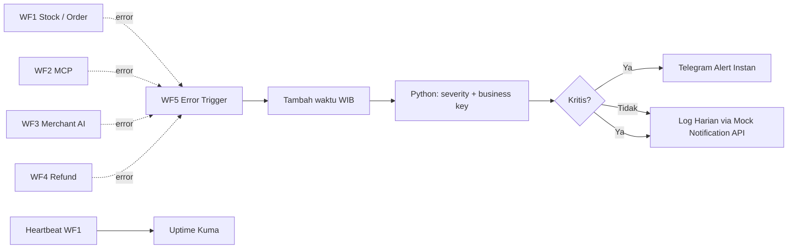

# 07 · Implementasi WF5: Alerting & Log Berseverity (adaptasi Handson Day 5)

Dokumen ini **tambahan** di atas dokumen wajib `docs/01`–`docs/05`. Studi kasus tetap H8Mart dan workflow final tetap **WF1–WF5**. Handson Day 5 memberi pola **Error Trigger → tambah waktu WIB → klasifikasi severity → dua kanal**; pola tersebut diterapkan ke WF5 yang diminta `guide/wf5-reliability-monitoring.md`.

## 1. Arsitektur



**Kanal kritis:** Telegram ke tim Ops untuk stok, order, refund, keterlambatan, atau kegagalan pada event penting. **Kanal rutin:** log penerimaan peristiwa ke Mock Notification API (`channel=log-harian`), bisa ditinjau dengan `GET /notify/messages?channel=log-harian` dari dalam instance; log berjalan juga untuk alert kritis agar ada jejak peristiwa. Email/Slack tidak diperlukan untuk lab ini.

## 2. File workflow siap impor

Impor `workflows/wf5-reliability-monitoring.json` ke n8n di EC2. Credential dan dua nilai placeholder **wajib disetel manual** setelah import, karena tidak boleh menyimpan secrets pada repo.

- Node Telegram `Kirim Alert Telegram`: set credential Telegram API pribadi dan ubah placeholder `ISI_CHAT_ID_OPS` dengan chat ID yang kamu miliki.
- Node `Catat Log Rutin` dan `Catat Log Kritis`: pilih credential Header Auth **X-Api-Key** untuk Mock API; URL internal `http://mock-api:8080/notify`. Jangan buka port 8080 ke publik.
- Workflow harus disimpan/publish. Pada pengaturan **WF1–WF4** pilih **Error Workflow = WF5 · Reliability & Monitoring H8Mart**, kemudian Save dan Publish.
- Pengujian **harus memakai Production Webhook yang sudah Published**, bukan Execute workflow manual; pengujian manual dapat gagal memicu Error Trigger.

## 3. Field log dan contoh visual

| Field | Contoh simulasi | Sumber |
| --- | --- | --- |
| `severity` | `kritis` / `rutin` | prioritas sistem dan daftar workflow |
| `workflow` | `WF4 · Kompensasi & Refund` | `Error Trigger.workflow.name` |
| `node_gagal` | `Payment Refund` | `Error Trigger.execution.lastNodeExecuted` |
| `waktu_wib` | `2026-11-07 23:45:00 WIB` | expression Luxon n8n (bukan jam server mentah) |
| `business_key` | `HM-SP-099` | konvensi pesan `Stop and Error` diawali `[HM-SP-099]` |
| `execution_url` | URL detail eksekusi | `Error Trigger.execution.url` |
| `tindakan` | `Periksa retry & dead-letter` | template respons WF5 |

**Contoh log ilustratif, BUKAN output AWS yang sudah diuji:**

```text
[KRITIS] WF4 · Kompensasi & Refund
Node: Payment Refund
Waktu: 2026-11-07 23:45:00 WIB
Business key: HM-SP-099
Masalah: gateway pembayaran tidak dapat dijangkau
Tindakan: Periksa retry, simpan dead-letter, hindari refund ganda
```

## 4. Cara membuktikan Day 5 di milestone H8Mart

| Kasus | Bukti nyata yang wajib diambil | Tempat |
| --- | --- | --- |
| Error terdeteksi | Execution source berstatus Error + Execution WF5 berhasil | `evidence/wf5/01-error-source.png`, `02-error-workflow.png` |
| Alert kritis | Telegram HP menunjukkan workflow, node, waktu, business key, link | `evidence/wf5/03-alert-telegram.png` |
| Log rutin | GET mock-api `GET /notify/messages?channel=log-harian` menghasilkan record baru | `evidence/wf5/04-log-rutin.png` |
| Retry & dead-letter | `ops.dead_letter` + retry API stok | `evidence/wf5/05-dead-letter.png`, `evidence/wf1/` |
| Silent failure | Respons stock 200 tetapi 0 item → jangan dianggap sukses, `Stop and Error` | `evidence/wf5/06-silent-failure.png` |
| Durasi lambat | M007 lambat, alert threshold teruji | `evidence/wf5/07-durasi-alert.png` |
| Heartbeat | Uptime Kuma Push monitor mengalami Up dan Down | `evidence/wf5/08-kuma-up-down.png` |

**Penting:** import WF5 saja **belum memenuhi seluruh rubric**: retry, dead-letter, silent failure, threshold, dan heartbeat harus juga dibangun di WF1/WF4 dan diuji. Jangan menyebut tugas selesai sebelum semua ada buktinya.
