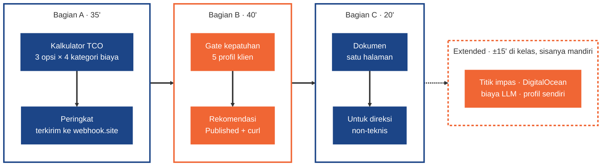
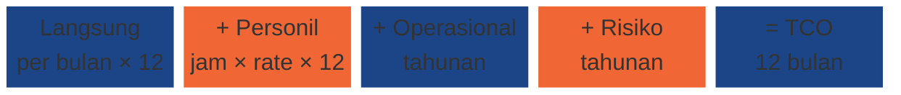
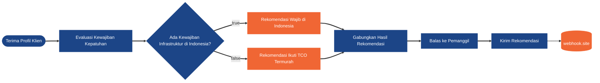
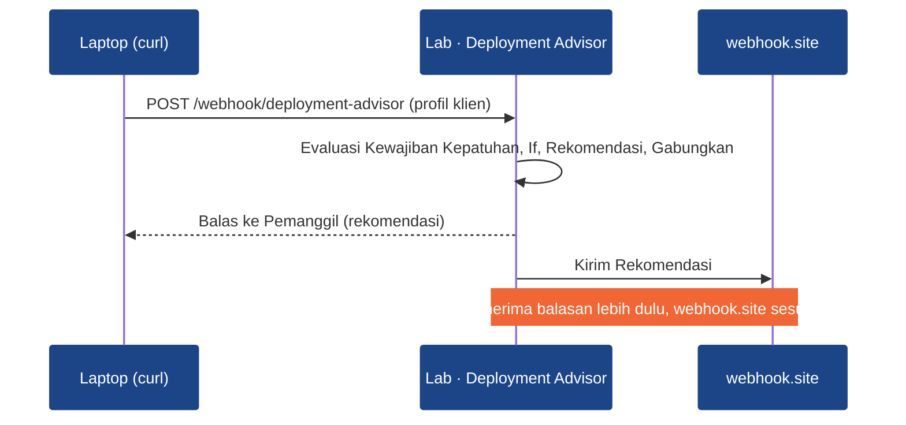

# Week 10 - Day 03: Deployment Strategy & Cost Analysis

[](#)
[](#)
[](#)
[](https://docs.n8n.io/)
[](https://docs.n8n.io/code/code-node/)
[](#)

Selamat datang di **Praktikum Hands-on Phase 3 Week 2 Day 3 (Sesi 8)** untuk **Applied AI Engineer Bootcamp**.

Dalam praktikum ini, Anda membakukan jawaban atas pertanyaan *"n8n Cloud, self-hosted, atau on-premise?"* menjadi dua workflow n8n: **Kalkulator TCO** yang menghitung biaya 12 bulan tiga opsi deployment dari tabel harga resmi, dan **Deployment Advisor** yang mengecek kewajiban regulasi lebih dulu sebelum memakai angka biaya. Hasilnya Anda tulis sebagai **dokumen rekomendasi satu halaman** untuk stakeholder non-teknis.

> **Kaitan dengan Phase 1:** opsi self-hosted di lab ini adalah **IaaS** (AWS EC2) dari P1W3D2 *Cloud Platform Fundamentals*, dan cara menghitungnya sama dengan *cost management* S3 vs R2 di P1W4D2: harga satuan × volume.
>
> **Kaitan dengan Phase 2:** biaya token LLM per panggilan memakai pola yang sama dan ikut masuk TCO bila workflow memanggil model (Extended 3).

Praktikum ini dikerjakan **individu**. Konsep trade-off, harga, regulasi, dan TCO ada di slide **P3W2D3 - Deployment Strategy & Cost Analysis**.

---

## Tujuan Pembelajaran

Tujuan ini sama dengan Objectives di slide. Setelah menyelesaikan praktikum ini, Anda mampu:

1. **Membandingkan Opsi Deployment:** menjelaskan trade-off n8n Cloud, self-hosted, dan on-premise dari sisi biaya, kontrol, dan effort maintenance. *(Bagian C)*
1. **Mengestimasi Biaya Compute:** menghitung biaya bulanan tiap opsi dari harga resmi (n8n Cloud, AWS EC2 Jakarta) dan menunjukkan pengaruh volume eksekusi. *(Bagian A)*
1. **Mengenali Kebutuhan Kepatuhan:** mengidentifikasi kapan UU PDP, POJK, dan PP 71/2019 mewajibkan lokasi data di Indonesia, lalu menuliskannya sebagai gate di workflow. *(Bagian B)*
1. **Menyusun Kerangka TCO:** menghitung TCO 12 bulan (langsung + personil + operasional + risiko) tiga opsi di node Code Python dan memeringkatnya. *(Bagian A)*
1. **Memilih & Merekomendasikan Strategi:** menulis rekomendasi deployment satu halaman untuk stakeholder non-teknis berdasarkan angka TCO dan dasar regulasi. *(Bagian C)*

---

## Estimasi Waktu

| Bagian | Jenis | Estimasi |
| --- | --- | --- |
| Bagian A: Kalkulator TCO (Langkah 1–5) | **Core** | 35 menit |
| Bagian B: Deployment Advisor (Langkah 6–10) | **Core** | 40 menit |
| Bagian C: Dokumen Rekomendasi (Langkah 11) | **Core** | 20 menit |
| Tantangan Extended (titik impas, opsi DigitalOcean, biaya LLM, profil sendiri) | Extended | 30 menit (±15' di kelas, sisanya mandiri) |

Total Core ±95 menit.

---

## Pengaturan Environment & Tools

- **Stack n8n lokal standar Phase 3** (n8n **2.44.7** + task-runners). Dari folder stack Anda (`aien-phase3/`) cukup:

  ```bash
  docker compose up -d
  ```

  Profile `mcp` dan `monitoring` tidak dipakai. `compose.yaml` di folder ini sama dengan stack bersama terbaru; kalau Anda sudah memperbaruinya di Sesi 7, tidak ada yang perlu disalin lagi. Compose lama dari Sesi 2 juga cukup untuk lab ini karena yang dipakai hanya `n8n` dan `task-runners`.

- **webhook.site**: buka <https://webhook.site> di tab baru. URL unik Anda dipakai sebagai "kanal manajemen" yang menerima hasil kedua workflow.
- **curl** untuk memanggil Production URL Deployment Advisor (Windows: pakai `curl.exe` di PowerShell, bukan alias `curl`).
- **Editor Markdown** (VS Code, Obsidian, atau Google Docs) untuk Bagian C.

Semua angka harga sudah disediakan di **Tabel Asumsi Harga** di bawah. Anda tidak perlu membuka situs pricing saat mengerjakan.

---

## Layout Direktori

```text
.
├── README.md                     # dokumen ini
├── assets/                       # gambar canvas untuk README ini
├── compose.yaml                  # stack standar (n8n 2.44.7 + task-runners)
├── .env.example
├── .gitignore                    # rahasia (.env, key), backup, log, file OS tidak ikut ter-commit
├── SETUP.md
├── aien-setup-check.json
├── seed/                         # data latihan PostgreSQL (tidak dipakai sesi ini)
├── profil-klien/                 # 5 profil calon klien untuk Bagian B (JSON)
│   ├── pt-amanah-finansial.json
│   ├── pt-mitra-dana-sejahtera.json
│   ├── bank-harapan-digital.json
│   ├── pt-ritel-nusantara.json
│   └── klinik-sehat-bersama.json
└── template-rekomendasi.md       # kerangka dokumen Bagian C
```

---

## Hands-On Lab

Dikerjakan **individu**.

### Ringkasan Misi

| Aspek | Isi |
| --- | --- |
| Objective | Membakukan rekomendasi deployment: hitung TCO 12 bulan tiga opsi, cek kewajiban regulasi calon klien, lalu tulis rekomendasinya. |
| Yang dipakai | Edit Fields (Set), Code Python yang menghasilkan banyak item, Sort, Webhook, If (Boolean), Merge, Respond to Webhook, HTTP Request. |
| Output | Workflow `Lab · Kalkulator TCO Deployment` (eksekusi sukses), workflow `Lab · Deployment Advisor (Gate Kepatuhan)` (Published, lolos 5 profil), dokumen rekomendasi satu halaman. |
| Urutan | ±95 menit Core: Bagian A → Bagian B → Bagian C (lihat Estimasi Waktu). |

> Gate kepatuhan selalu dievaluasi **sebelum** angka biaya. Opsi termurah yang tidak legal bukan pilihan.

Alur hands-on, dikerjakan berurutan:



### Studi Kasus

Anda Automation Engineer di sebuah konsultan automasi. Tim sales terus menerima pertanyaan yang sama dari calon klien: *"Sebaiknya kami pakai n8n Cloud, self-hosted, atau on-premise?"* Selama ini jawabannya dibuat manual di spreadsheet dan berbeda-beda tergantung siapa yang mengerjakan. Anda diminta membuat jawabannya konsisten: angka TCO dari satu tabel asumsi, aturan regulasi yang eksplisit, dan satu halaman rekomendasi yang bisa dibaca direksi klien.

### Tabel Asumsi Harga

Angka di bawah dipakai di node Code (Langkah 3) supaya semua peserta mendapat hasil yang sama. Harga resmi dicek **2 Nov 2026**; angka "dipakai di lab" adalah pembulatan atau asumsi yang tertulis jelas. Harga provider bisa berubah: untuk klien sungguhan, cek ulang sumbernya.

**Harga resmi (USD kecuali disebut lain):**

| Item | Harga resmi | Sumber (dicek 2 Nov 2026) | Dipakai di lab (USD/bulan) |
| --- | --- | --- | --- |
| n8n Cloud Starter | €20/bulan (tahunan), 2.500 eksekusi, 5 concurrent | [n8n.io/pricing](https://n8n.io/pricing/) | 22 (€20 × 1,08) |
| n8n Cloud Pro | €50/bulan (tahunan), 10.000 eksekusi | [n8n.io/pricing](https://n8n.io/pricing/) | 54 (€50 × 1,08) |
| Di atas 10.000 eksekusi | Business €667 (40.000 eksekusi) **hanya untuk self-hosted**; Cloud harus Enterprise (harga custom) | [n8n.io/pricing](https://n8n.io/pricing/) | 720, **asumsi** Enterprise setara harga publik tier 40.000 (€667 × 1,08) |
| AWS EC2 `t3.small` on-demand Linux, Asia Pacific (Jakarta) `ap-southeast-3` | USD 0,0264/jam | [AWS EC2 On-Demand Pricing](https://aws.amazon.com/ec2/pricing/on-demand/) (AWS Price List, region `ap-southeast-3`) | 19,27 (× 730 jam) |
| AWS EBS gp3, Jakarta | USD 0,096/GB-bulan | [AWS EBS Pricing](https://aws.amazon.com/ebs/pricing/) | 1,92 (20 GiB) |
| AWS public IPv4 | USD 0,005/jam per alamat | [AWS public IPv4 charge](https://aws.amazon.com/blogs/aws/new-aws-public-ipv4-address-charge-public-ip-insights/) | 3,65 (× 730 jam) |
| **Total self-hosted AWS EC2 Jakarta** | | | **25** (24,84 dibulatkan) |
| DigitalOcean Basic Droplet (Extended 2) | USD 12/bulan (1 vCPU, 2 GiB, 50 GiB SSD), region terdekat Singapura | [DigitalOcean Droplet Pricing](https://www.digitalocean.com/pricing/droplets) | 12 |

**Asumsi lab (bukan harga provider):**

| Opsi | Biaya langsung/bulan | Jam personil/bulan | Biaya operasional/tahun | Biaya risiko/tahun |
| --- | ---: | ---: | ---: | ---: |
| n8n Cloud | mengikuti plan (tabel atas) | 0,5 | 0 | 100 |
| Self-Hosted (AWS EC2 Jakarta) | 25 | 4 | 240 (snapshot, uji restore, training) | 300 |
| On-Premise | 210 (amortisasi server 150 + listrik & jaringan 60) | 12 | 900 | 500 |

- Rate SDM: **USD 15/jam** (field `rate_sdm_per_jam`, bisa diubah).
- Kurs: **€1 = USD 1,08** dan **USD 1 = Rp16.500**. Keduanya asumsi tabel, bukan kurs resmi; tulis kurs yang Anda pakai di dokumen Bagian C.
- Biaya token LLM (Extended 3): USD 0,10 per 1 juta token input dan USD 0,50 per 1 juta token output (model `gpt-6-luna`, harga di [halaman harga OpenAI](https://developers.openai.com/api/docs/pricing) dicek 2 Nov 2026).

Rumus yang dipakai kode di Langkah 3 (satu opsi, 12 bulan):



### Bagian A: Kalkulator TCO (Core, ±35 menit)

**Peta workflow Bagian A** (warna selang-seling menandai kelompok langkah: input, perhitungan, pengiriman):


Bentuk akhir `Lab · Kalkulator TCO Deployment` di canvas n8n (satu gambar utuh). Gambar lebar: klik gambar di GitHub untuk membuka ukuran penuh.


#### Langkah 1. Buat Workflow & Set Timezone (±3 menit)

Buat workflow baru bernama `Lab · Kalkulator TCO Deployment`. Buka menu `...` di kanan atas editor → **Settings**, set **Timezone** ke `Asia/Jakarta`, lalu **Save**.

#### Langkah 2. Manual Trigger & Profil Organisasi (±5 menit)

Tambahkan trigger **Trigger manually** (rename: `Jalankan Kalkulasi`). Setelahnya tambahkan **Edit Fields (Set)** (rename: `Profil Organisasi`) dengan tiga field di **Fields to Set**:

| Name | Type | Value |
| --- | --- | --- |
| `nama_organisasi` | String | `PT Sinar Sentosa` |
| `eksekusi_per_bulan` | Number | `8000` |
| `rate_sdm_per_jam` | Number | `15` |

> Pastikan `eksekusi_per_bulan` dan `rate_sdm_per_jam` bertipe **Number**. Kalau String, perkalian di Python menghasilkan error atau angka aneh.

#### Langkah 3. Hitung TCO 12 Bulan dengan Code Python (±12 menit)

Tambahkan node **Code** (rename: `Hitung TCO 12 Bulan`). **Mode** `Run Once for All Items`, **Language** `Python`. Salin kode berikut. Angka di dalamnya sama dengan Tabel Asumsi Harga.

```python
profil = _items[0]["json"]

eksekusi = profil["eksekusi_per_bulan"]
rate = profil["rate_sdm_per_jam"]

# Plan n8n Cloud dipilih dari jumlah eksekusi per bulan (Tabel Asumsi Harga di README)
if eksekusi <= 2500:
    plan_cloud = "Starter"
    harga_cloud = 22
elif eksekusi <= 10000:
    plan_cloud = "Pro"
    harga_cloud = 54
else:
    plan_cloud = "Enterprise"  # di atas 10.000 eksekusi Cloud butuh Enterprise (harga custom)
    harga_cloud = 720  # asumsi lab: setara harga publik tier 40.000 eksekusi (€667)

# Asumsi biaya per opsi, USD (Tabel Asumsi Harga di README)
opsi_deployment = [
    {
        "opsi": "n8n Cloud (" + plan_cloud + ")",
        "biaya_langsung_per_bulan": harga_cloud,
        "jam_personil_per_bulan": 0.5,
        "biaya_operasional_12_bulan": 0,
        "biaya_risiko_12_bulan": 100,
    },
    {
        "opsi": "Self-Hosted (AWS EC2 Jakarta)",
        "biaya_langsung_per_bulan": 25,  # t3.small 19,27 + EBS gp3 20 GiB 1,92 + IPv4 3,65 = 24,84
        "jam_personil_per_bulan": 4,
        "biaya_operasional_12_bulan": 240,
        "biaya_risiko_12_bulan": 300,
    },
    {
        "opsi": "On-Premise",
        "biaya_langsung_per_bulan": 210,  # amortisasi server 150 + listrik & jaringan 60
        "jam_personil_per_bulan": 12,
        "biaya_operasional_12_bulan": 900,
        "biaya_risiko_12_bulan": 500,
    },
]

hasil = []
for opsi in opsi_deployment:
    biaya_langsung = opsi["biaya_langsung_per_bulan"] * 12
    biaya_personil = opsi["jam_personil_per_bulan"] * rate * 12
    biaya_operasional = opsi["biaya_operasional_12_bulan"]
    biaya_risiko = opsi["biaya_risiko_12_bulan"]
    tco = biaya_langsung + biaya_personil + biaya_operasional + biaya_risiko

    hasil.append({
        "json": {
            "nama_organisasi": profil["nama_organisasi"],
            "eksekusi_per_bulan": eksekusi,
            "opsi": opsi["opsi"],
            "biaya_langsung_12_bulan": round(biaya_langsung, 2),
            "biaya_personil_12_bulan": round(biaya_personil, 2),
            "biaya_operasional_12_bulan": biaya_operasional,
            "biaya_risiko_12_bulan": biaya_risiko,
            "tco_12_bulan": round(tco, 2),
        }
    })

return hasil
```

Klik **Execute step**. Output harus **3 item**, satu per opsi deployment, masing-masing dengan empat kategori biaya dan `tco_12_bulan`.

> Satu item masuk, tiga item keluar: `return` berisi list tiga dict yang masing-masing dibungkus `"json"`. Ini kebalikan pola Sesi 3 (N item masuk, N item keluar).

#### Langkah 4. Urutkan dari TCO Termurah (±5 menit)

Tambahkan node **Sort** (rename: `Urutkan dari TCO Termurah`):

| Field | Isi |
| --- | --- |
| Type | `Simple` |
| Fields To Sort By → Field Name | `tco_12_bulan` |
| Order | `Ascending` |

Setelah node ini, urutan item sekaligus menjadi peringkat: item pertama termurah, item terakhir termahal.

#### Langkah 5. Ringkas & Kirim ke webhook.site (±10 menit)

1. Tambahkan node **Code** kedua (rename: `Susun Ringkasan Perbandingan`), `Run Once for All Items`, `Python`:

   ```python
   opsi_terurut = []
   for item in _items:
       opsi_terurut.append(item["json"])

   # Node Sort sudah mengurutkan dari TCO terkecil: item pertama termurah, item terakhir termahal
   termurah = opsi_terurut[0]
   termahal = opsi_terurut[-1]
   selisih = termahal["tco_12_bulan"]
   selisih -= termurah["tco_12_bulan"]

   peringkat = []
   posisi = 1
   for opsi in opsi_terurut:
       peringkat.append({
           "peringkat": posisi,
           "opsi": opsi["opsi"],
           "tco_12_bulan": opsi["tco_12_bulan"],
       })
       posisi += 1

   return [{
       "json": {
           "nama_organisasi": termurah["nama_organisasi"],
           "eksekusi_per_bulan": termurah["eksekusi_per_bulan"],
           "opsi_termurah": termurah["opsi"],
           "tco_termurah_usd": termurah["tco_12_bulan"],
           "opsi_termahal": termahal["opsi"],
           "tco_termahal_usd": termahal["tco_12_bulan"],
           "selisih_usd": round(selisih, 2),
           "peringkat": peringkat,
       }
   }]
   ```

1. Tambahkan **HTTP Request** (rename: `Kirim Ringkasan TCO`): **Method** `POST`, **URL** = URL webhook.site Anda, aktifkan **Send Body**, **Body Content Type** `JSON`, **Specify Body** `Using JSON`, isi **JSON** dengan expression `{{ JSON.stringify($json) }}`.
1. Klik **Execute workflow**. Buka webhook.site: catat `opsi_termurah`, `tco_termurah_usd`, dan isi `peringkat`. Angka ini dipakai di Bagian B (body profil klien) dan Bagian C.
1. Uji sensitivitas: di `Profil Organisasi` ubah `eksekusi_per_bulan` menjadi `35000`, **Execute workflow** lagi, bandingkan `peringkat`-nya. Catat hasilnya, lalu kembalikan ke `8000`.

> Workflow ini hanya punya Manual Trigger, jadi **tidak bisa** di-Publish (n8n 2.44.7 menolak Publish untuk workflow tanpa trigger otomatis). Buktinya cukup eksekusi berstatus **Success** di tab **Executions**.

### Bagian B: Deployment Advisor (Core, ±40 menit)

**Peta workflow Bagian B** (gate kepatuhan dievaluasi sebelum angka biaya; dua cabang bertemu lagi di Merge):



Urutan pesan saat curl memanggil Production URL (balasan ke curl keluar lebih dulu, baru dikirim ke webhook.site):



Bentuk akhir `Lab · Deployment Advisor (Gate Kepatuhan)` di canvas n8n (satu gambar utuh):


#### Langkah 6. Workflow & Webhook Trigger (±5 menit)

Buat workflow baru `Lab · Deployment Advisor (Gate Kepatuhan)`, set Timezone `Asia/Jakarta` seperti Langkah 1. Tambahkan node **Webhook** (rename: `Terima Profil Klien`):

| Field | Isi |
| --- | --- |
| HTTP Method | `POST` |
| Path | `deployment-advisor` |
| Respond | `Using 'Respond to Webhook' Node` |

> Pengaturan Respond ini baru berfungsi setelah node `Balas ke Pemanggil` ada (Langkah 10). Jangan Publish atau memanggil webhook sebelum itu: n8n menjawab `No Respond to Webhook node found in the workflow`.

#### Langkah 7. Gate Kepatuhan dengan Code Python (±12 menit)

Tambahkan node **Code** (rename: `Evaluasi Kewajiban Kepatuhan`), `Run Once for All Items`, `Python`:

```python
data = _items[0]["json"]["body"]

sektor = data["sektor"]
aset = data["total_aset_rp_miliar"]
berbasis_ti = data["berbasis_ti"]
data_sensitif = data["olah_data_pribadi_sensitif"]

# File profil masih berisi placeholder: hentikan dengan pesan yang jelas (README Langkah 10)
if str(data["opsi_tco_termurah"]).startswith("ISI_") or str(data["tco_termurah_usd"]).startswith("ISI_"):
    raise ValueError("Isi opsi_tco_termurah dan tco_termurah_usd di file profil dengan hasil Bagian A (README Langkah 10)")

wajib = False
tingkat_kewajiban = "tidak_ada"
dasar_regulasi = "-"

# Aturan paling ketat dievaluasi lebih dulu (slide "Peta Regulasi Lokasi Data")
if sektor == "bank_umum":
    wajib = True
    tingkat_kewajiban = "pusat_data_dan_drc_di_indonesia"
    dasar_regulasi = "POJK 11/POJK.03/2022 Pasal 35"
elif sektor == "instansi_publik":
    wajib = True
    tingkat_kewajiban = "sistem_dan_data_di_indonesia"
    dasar_regulasi = "PP 71/2019 Pasal 20"
elif sektor == "jasa_keuangan_non_bank" and (aset > 1000 or berbasis_ti):
    wajib = True
    tingkat_kewajiban = "pusat_data_dan_drc_di_indonesia"
    dasar_regulasi = "POJK 4/POJK.05/2021"
elif sektor == "jasa_keuangan_non_bank" and aset > 500:
    wajib = True
    tingkat_kewajiban = "pusat_data_di_indonesia"
    dasar_regulasi = "POJK 4/POJK.05/2021"
elif data_sensitif:
    tingkat_kewajiban = "tidak_wajib_lokasi_tapi_risiko_sanksi_tinggi"
    dasar_regulasi = "UU 27/2022 (UU PDP) Pasal 57"

return [{
    "json": {
        "nama_organisasi": data["nama_organisasi"],
        "sektor": sektor,
        "total_aset_rp_miliar": aset,
        "wajib_infrastruktur_indonesia": wajib,
        "tingkat_kewajiban": tingkat_kewajiban,
        "dasar_regulasi": dasar_regulasi,
        "opsi_tco_termurah": data["opsi_tco_termurah"],
        "tco_termurah_usd": data["tco_termurah_usd"],
    }
}]
```

Urutan `if` mengikuti slide *Peta Regulasi Lokasi Data*: aturan paling ketat dicek lebih dulu, karena satu profil bisa memenuhi lebih dari satu baris.

| Kondisi profil | `tingkat_kewajiban` | Dasar regulasi |
| --- | --- | --- |
| `sektor` = `bank_umum` | `pusat_data_dan_drc_di_indonesia` | POJK 11/POJK.03/2022 Pasal 35 |
| `sektor` = `instansi_publik` | `sistem_dan_data_di_indonesia` | PP 71/2019 Pasal 20 |
| `jasa_keuangan_non_bank` dan (aset > Rp1 triliun atau berbasis TI) | `pusat_data_dan_drc_di_indonesia` | POJK 4/POJK.05/2021 |
| `jasa_keuangan_non_bank` dan aset > Rp500 miliar | `pusat_data_di_indonesia` | POJK 4/POJK.05/2021 |
| Sektor lain yang mengolah data pribadi sensitif | `tidak_wajib_lokasi_tapi_risiko_sanksi_tinggi` (tidak wajib) | UU 27/2022 (UU PDP) Pasal 57 |
| Selain itu | `tidak_ada` | `-` |

> Data dari node Webhook ada di dalam key `body`, jadi baris pertama membaca `_items[0]["json"]["body"]`. Penyederhanaan untuk lab: aturan sebenarnya punya pengecualian dengan izin OJK atau komite, yang tidak dimodelkan di sini.

#### Langkah 8. If: Ada Kewajiban di Indonesia? (±5 menit)

Tambahkan node **If** (rename: `Ada Kewajiban Infrastruktur di Indonesia?`). Satu kondisi: kolom kiri diisi expression `{{ $json.wajib_infrastruktur_indonesia }}`, operator **Boolean** → **is true** (kolom kanan dibiarkan kosong).

#### Langkah 9. Dua Rekomendasi & Merge (±10 menit)

1. Di output **true**, tambahkan **Edit Fields (Set)** (rename: `Rekomendasi Wajib di Indonesia`). Aktifkan **Include Other Input Fields** (di bawah daftar field), lalu tambahkan:

   | Name | Type | Value |
   | --- | --- | --- |
   | `rekomendasi` | String | `Self-Hosted / On-Premise di data center wilayah Indonesia (mis. AWS region Jakarta atau DC sendiri)` |
   | `alasan` | String | `{{ 'Wajib ' + $json.tingkat_kewajiban + ' berdasarkan ' + $json.dasar_regulasi }}` |
   | `catatan_biaya` | String | `{{ 'Opsi dengan TCO terendah (' + $json.opsi_tco_termurah + ', USD ' + $json.tco_termurah_usd + ') tidak boleh dipakai untuk data yang diatur.' }}` |

1. Di output **false**, tambahkan **Edit Fields (Set)** (rename: `Rekomendasi Ikuti TCO Termurah`), juga dengan **Include Other Input Fields** aktif:

   | Name | Type | Value |
   | --- | --- | --- |
   | `rekomendasi` | String | `{{ $json.opsi_tco_termurah }}` |
   | `alasan` | String | `{{ $json.tingkat_kewajiban === 'tidak_ada' ? 'Tidak ada kewajiban lokasi data: pilih opsi dengan TCO 12 bulan terendah.' : 'Tidak ada kewajiban lokasi data, tetapi mengolah data pribadi sensitif: pilih TCO terendah dengan kontrol UU PDP (enkripsi, pembatasan akses, perjanjian pemrosesan data).' }}` |
   | `catatan_biaya` | String | `{{ 'TCO 12 bulan opsi terpilih: USD ' + $json.tco_termurah_usd }}` |

1. Tambahkan **Merge** (rename: `Gabungkan Hasil Rekomendasi`), **Mode** `Append`, **Number of Inputs** `2`. Sambungkan cabang true ke Input 1 dan cabang false ke Input 2.

> Dalam satu eksekusi hanya satu input Merge yang terisi. Merge di sini adalah titik temu dua cabang, supaya node berikutnya cukup dibuat sekali (pola yang sama dengan Sesi 6).

#### Langkah 10. Balas, Kirim, Publish & Uji 5 Profil (±8 menit)

1. Tambahkan **Respond to Webhook** (rename: `Balas ke Pemanggil`), **Respond With** `First Incoming Item`. Pemanggil (curl) langsung menerima rekomendasinya.
1. Setelahnya tambahkan **HTTP Request** (rename: `Kirim Rekomendasi`) dengan konfigurasi yang sama dengan Langkah 5 (URL webhook.site yang sama).
1. Klik **Publish**. Buka node Webhook, tab **Production URL**: `http://localhost:5678/webhook/deployment-advisor`.
1. Buka lima file di `profil-klien/`. Dengan find and replace di editor, ganti teks `ISI_OPSI_TERMURAH` dengan `opsi_termurah` hasil Langkah 5 dan teks `ISI_TCO_TERMURAH` dengan `tco_termurah_usd` hasil Langkah 5 (profil default 8.000 eksekusi). Ganti teks penanda itu saja, tanda kutip dibiarkan. Jangan mencari angka atau karakter pendek: angka lain di file (mis. `total_aset_rp_miliar`) ikut berubah dan hasil gate menjadi salah.
1. Dari folder lab ini (yang berisi `profil-klien/`), kirim tiap profil. Pilih sesuai terminal Anda.

   macOS, Linux, atau Git Bash di Windows:

   ```bash
   curl -s -X POST http://localhost:5678/webhook/deployment-advisor \
     -H "Content-Type: application/json" \
     -d @profil-klien/pt-amanah-finansial.json
   ```

   PowerShell 7 di Windows (`curl.exe`, bukan alias `curl`; tanda kutip pada `@file` wajib; satu baris):

   ```powershell
   curl.exe -s -X POST http://localhost:5678/webhook/deployment-advisor -H "Content-Type: application/json" -d "@profil-klien/pt-amanah-finansial.json"
   ```

   Ulangi dengan mengganti nama file: `pt-mitra-dana-sejahtera.json`, `bank-harapan-digital.json`, `pt-ritel-nusantara.json`, dan `klinik-sehat-bersama.json`. Catat `wajib_infrastruktur_indonesia`, `tingkat_kewajiban`, `dasar_regulasi`, dan `rekomendasi` tiap profil untuk Bagian C.

> Panggil **Production URL** (`/webhook/...`), bukan Test URL (`/webhook-test/...`). Kalau respons `404 ... not registered`, workflow belum di-Publish.

### Bagian C: Dokumen Rekomendasi (Core, ±20 menit)

#### Langkah 11. Tulis Satu Halaman dari Template (±20 menit)

Salin `template-rekomendasi.md` menjadi `rekomendasi-deployment.md`, lalu isi:

1. **Rekomendasi satu kalimat** untuk profil PT Sinar Sentosa (Bagian A).
1. **Tabel peringkat TCO** 12 bulan dengan empat kategori biaya (ambil dari output node `Hitung TCO 12 Bulan`), selisih termurah vs termahal, dan kurs yang dipakai.
1. **Tabel lima profil klien** dari Bagian B: kewajiban, dasar regulasi, rekomendasi.
1. **Dua biaya tersembunyi** yang tidak muncul di invoice, masing-masing dengan kategori TCO-nya (slide *Biaya Tersembunyi yang Sering Terlewat*).
1. **Catatan 3–5 kalimat tanpa istilah teknis** untuk direksi calon klien: berapa selisih biayanya, dan kapan selisih itu tidak boleh jadi dasar keputusan.

Maksimal satu halaman. Dokumen ini dipakai lagi di Milestone Phase 3 (komponen *Strategi deployment & biaya*).

### Kriteria Selesai

1. `Hitung TCO 12 Bulan` menghasilkan **3 item** dengan empat kategori biaya dan `tco_12_bulan`; eksekusi `Lab · Kalkulator TCO Deployment` berstatus **Success** di tab Executions.
1. webhook.site menerima ringkasan dengan `opsi_termurah`, `tco_termurah_usd`, `opsi_termahal`, `tco_termahal_usd`, `selisih_usd`, dan `peringkat` berisi 3 entri terurut.
1. Setelah `eksekusi_per_bulan` dinaikkan ke 35.000, `opsi_termurah` **berubah**: urutan opsi bergantung pada volume.
1. `Lab · Deployment Advisor (Gate Kepatuhan)` berstatus **Published** dan menjawab kelima profil dengan `wajib_infrastruktur_indonesia` sesuai tabel Langkah 7.
1. Profil yang terkena kewajiban mendapat rekomendasi **di Indonesia**, bukan opsi termurah, dan `alasan` menyebut dasar regulasinya.
1. `nama_organisasi` dan `sektor` tetap ada di payload akhir kedua cabang (bukti **Include Other Input Fields** aktif).
1. Dokumen Bagian C selesai, maksimal satu halaman, memuat lima bagian di Langkah 11.

---

## Tantangan Extended (Opsional)

1. **Titik impas volume dan rate SDM.** Jalankan Kalkulator dengan `eksekusi_per_bulan` 2000, 10000, 10001, dan 35000, catat `opsi_termurah` tiap run. Di volume berapa opsi termurah berganti? Lalu, dengan 8.000 eksekusi, ubah `rate_sdm_per_jam` (mis. 5, 10, 30): adakah rate yang membuat self-hosted lebih murah dari Cloud Pro? Jelaskan dengan formula TCO.
1. **Tambah opsi DigitalOcean.** Di `Hitung TCO 12 Bulan`, tambahkan dict keempat `Self-Hosted (DigitalOcean 2 GiB)` dengan biaya langsung 12 dan jam personil, operasional, risiko yang sama dengan AWS. Peringkat berubah? Untuk profil `bank-harapan-digital`, kenapa opsi ini tetap tidak boleh direkomendasikan walau lebih murah? (Petunjuk: lihat catatan region di Tabel Asumsi Harga.)
1. **Biaya LLM masuk TCO.** Tambahkan field `token_input_per_eksekusi` = 3000 dan `token_output_per_eksekusi` = 500 di `Profil Organisasi`. Di Code, hitung biaya token 12 bulan dengan harga di Tabel Asumsi Harga dan tambahkan ke `biaya_langsung_12_bulan` ketiga opsi. Apakah peringkat berubah? Kenapa?
1. **Profil Anda sendiri.** Buat file JSON baru untuk instansi publik (mis. dinas kabupaten, `"sektor": "instansi_publik"`) dan satu LJKNB dengan aset tepat Rp500 miliar. Kirim ke Advisor dan periksa apakah hasilnya sesuai tabel Langkah 7. Apa yang terjadi bila `sektor` diketik `Bank_Umum`? Usulkan perbaikan kecil di Code.

---

## Verifikasi & Pemeriksaan Solusi

**Bagian A:** output `Hitung TCO 12 Bulan` berbentuk 3 item seperti ini (angka acuan ada di slide Hasil Kalkulator; cocokkan setelah kalian menghitung sendiri):

```json
[
  { "nama_organisasi": "PT Sinar Sentosa", "eksekusi_per_bulan": 8000, "opsi": "n8n Cloud (...)",
    "biaya_langsung_12_bulan": 0, "biaya_personil_12_bulan": 0, "biaya_operasional_12_bulan": 0,
    "biaya_risiko_12_bulan": 0, "tco_12_bulan": 0 },
  { "opsi": "Self-Hosted (AWS EC2 Jakarta)", "...": "..." },
  { "opsi": "On-Premise", "...": "..." }
]
```

Payload di webhook.site berisi `nama_organisasi`, `eksekusi_per_bulan`, `opsi_termurah`, `tco_termurah_usd`, `opsi_termahal`, `tco_termahal_usd`, `selisih_usd`, dan `peringkat` (list 3 objek `peringkat`, `opsi`, `tco_12_bulan`). Cek manual: `tco_12_bulan` = `biaya_langsung_12_bulan` + `biaya_personil_12_bulan` + `biaya_operasional_12_bulan` + `biaya_risiko_12_bulan`, dan `selisih_usd` = termahal − termurah.

**Bagian B:** respons curl dan payload webhook.site berisi field profil (`nama_organisasi`, `sektor`, `total_aset_rp_miliar`), hasil gate (`wajib_infrastruktur_indonesia`, `tingkat_kewajiban`, `dasar_regulasi`), angka dari Bagian A (`opsi_tco_termurah`, `tco_termurah_usd`), dan rekomendasi (`rekomendasi`, `alasan`, `catatan_biaya`). Cocokkan `tingkat_kewajiban` tiap profil dengan tabel Langkah 7.

---

## Troubleshooting

| Gejala | Penyebab | Solusi |
| --- | --- | --- |
| `Hitung TCO 12 Bulan` hanya mengeluarkan 1 item | `return` hanya satu dict, atau Mode `Run Once for Each Item` | Mode `Run Once for All Items`; `return hasil` (list tiga dict) |
| Error `'eksekusi_per_bulan'` di `Hitung TCO 12 Bulan` | Nama field di `Profil Organisasi` berbeda (typo, spasi) | Samakan nama field persis dengan tabel Langkah 2 |
| Error `'<=' not supported between instances of 'str' and 'int'` | `eksekusi_per_bulan` bertipe String | Ubah Type ke **Number** di `Profil Organisasi` |
| `opsi_termurah` bukan opsi dengan TCO terkecil | Sort memakai `Descending` atau node Sort dilewati | Sort `Ascending` pada `tco_12_bulan`, sambungkan sebelum Code ringkasan |
| Tombol **Publish** di Kalkulator tidak bisa dipakai | Workflow hanya punya Manual Trigger | Normal: cukup Execute workflow dan cek Executions |
| curl menjawab `{"code":404,"message":"The requested webhook \"POST deployment-advisor\" is not registered." ...}` | Advisor belum di-Publish, atau path di URL berbeda dari Langkah 6 | Publish, lalu panggil `/webhook/deployment-advisor` persis |
| curl ke `/webhook-test/...` menjawab `The requested webhook "deployment-advisor" is not registered.` dan petunjuk `Click the 'Execute workflow' button` | Test URL hanya hidup satu panggilan setelah Execute workflow | Pakai Production URL (`/webhook/...`) setelah Publish |
| curl menjawab `{"code":0,"message":"No Respond to Webhook node found in the workflow"}` | Webhook diset `Using 'Respond to Webhook' Node`, tetapi `Balas ke Pemanggil` belum ditambahkan atau tidak tersambung | Tambahkan `Balas ke Pemanggil` setelah `Gabungkan Hasil Rekomendasi` (Langkah 10), simpan, lalu Publish ulang |
| Error `'body'` di `Evaluasi Kewajiban Kepatuhan` | Node Code menerima data yang tidak berasal dari Webhook (mis. dijalankan dengan Execute step tanpa data Webhook), jadi key `body` tidak ada | Publish, lalu uji lewat curl ke Production URL (Langkah 10) |
| `nama_organisasi` hilang di payload akhir | **Include Other Input Fields** belum aktif | Aktifkan di kedua node Edit Fields |
| curl menjawab `{"message":"Error in workflow"}`; di Executions: *Isi opsi_tco_termurah dan tco_termurah_usd di file profil dengan hasil Bagian A (README Langkah 10)* | Penanda `ISI_...` di file profil belum diganti | Ganti kedua penanda sesuai Langkah 10; untuk sebab lain, baca pesan error node di tab Executions |
| Gate memberi kewajiban yang tidak sesuai tabel Langkah 7 | Find and replace ikut mengubah angka lain di file (mis. `total_aset_rp_miliar`) | Ambil ulang file dari repositori lab, lalu ganti hanya teks `ISI_OPSI_TERMURAH` dan `ISI_TCO_TERMURAH` |
| PowerShell menolak parameter curl (`-s`, `-X`, `-d`) | Alias `curl` di PowerShell memanggil `Invoke-WebRequest` | Pakai `curl.exe` dan `-d "@profil-klien/<file>.json"` |

Workflow `Lab · Deployment Advisor (Gate Kepatuhan)` dan dokumen Bagian C dipakai lagi: **Sesi 9** men-deploy opsi self-hosted yang Anda hitung hari ini ke AWS EC2 Jakarta, dan **Milestone Phase 3** menilai justifikasi pilihan deployment Anda dengan estimasi biaya dan kebutuhan kepatuhan.

Selamat! Anda telah menyelesaikan **P3W2D3: Deployment Strategy & Cost Analysis**!
