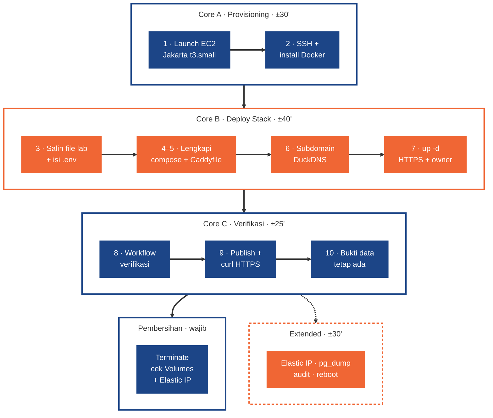
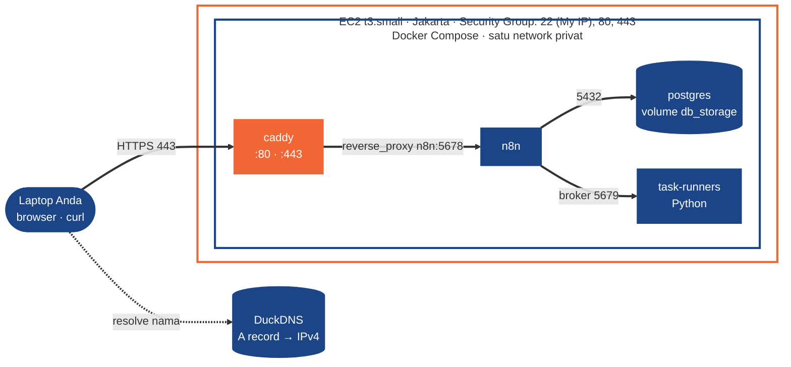
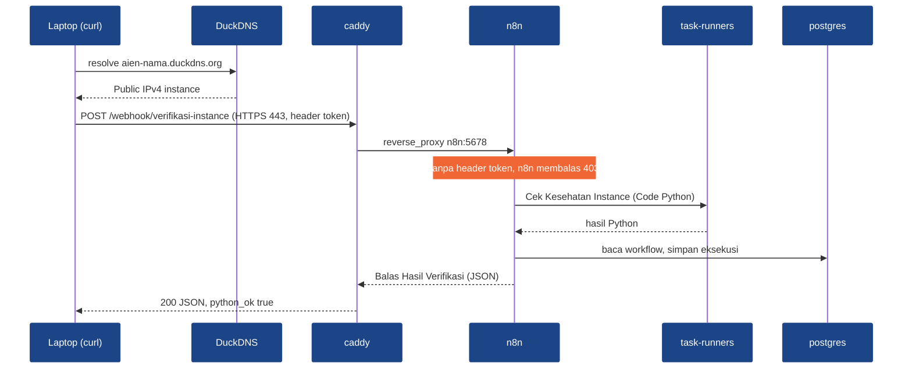
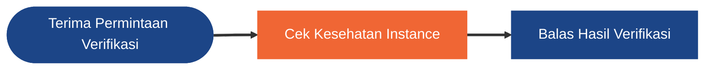

# Week 10 - Day 04: Self-Hosted Infrastructure Setup (Practical)

[](#)
[](#)
[](#)
[](https://docs.aws.amazon.com/AWSEC2/latest/UserGuide/ec2-launch-instance-wizard.html)
[](https://docs.n8n.io/hosting/configuration/environment-variables/endpoints/)
[](https://docs.n8n.io/hosting/configuration/environment-variables/database/)
[](https://caddyserver.com/docs/automatic-https)
[](https://www.duckdns.org/)

Selamat datang di **Praktikum Hands-on Phase 3 Week 2 Day 4 (Sesi 9)** untuk **Applied AI Engineer Bootcamp**.

Dalam praktikum ini, Anda memindahkan n8n dari laptop ke **server sungguhan**: satu instance **AWS EC2 di region Jakarta**, Docker Engine, stack empat service (**PostgreSQL + n8n + task runner Python + reverse proxy Caddy**), subdomain gratis **DuckDNS**, dan **HTTPS otomatis dari Let's Encrypt**. Anda lalu membuktikan instance itu benar-benar siap: workflow verifikasi dipanggil dari laptop lewat HTTPS, Code node Python tereksekusi, dan data tetap ada setelah restart. Praktikum ini dikerjakan **individu**; konsepnya ada di slide **P3W2D4 - Self-Hosted Infrastructure Setup (Practical)**.

> **Kaitan dengan Phase 1:** instance, region, security group, dan IAM adalah materi *Cloud Platform Fundamentals* (P1W3D2); `compose.yaml`, healthcheck, dan named volume adalah *Containerization and Deployment Basics* (P1W3D3); file konfigurasi yang bisa disalin ke server lain adalah inti *Infrastructure as Code* (P1W3D4).
>
> **Kaitan dengan Phase 2:** di *Model Serving & Production-Grade Deployment* (P2W3D2) Anda men-deploy agent ke Render dengan secret saat runtime, health check, dan smoke test. Polanya sama malam ini: secret di `.env`, `postgres` healthy, dan `curl` ke Production URL sebagai smoke test.

> ⚠️ **Lab ini memakai resource AWS berbayar.** Biayanya kecil (±USD 0,15 untuk satu sesi, lihat Estimasi Biaya), tetapi instance yang lupa dimatikan ditagih ±USD 25 per bulan. Kerjakan **Instruksi Pembersihan** sampai tuntas sebelum menutup laptop.

---

## Tujuan Pembelajaran

Tujuan ini sama dengan Objectives di slide. Setelah menyelesaikan praktikum hands-on ini, Anda akan mampu:

1. **Menyiapkan Instance AWS EC2:** provisioning instance Ubuntu di region Jakarta, Security Group least privilege, key pair, dan koneksi SSH dari nol. *(Core A, Langkah 1–2)*
1. **Meng-install & Mengonfigurasi Docker:** memasang Docker Engine + Compose di VPS, lalu melengkapi `compose.yaml` multi-service dan `.env`-nya. *(Langkah 2–5)*
1. **Men-deploy n8n dengan PostgreSQL & Task Runner:** n8n dengan database PostgreSQL persisten dan task runner eksternal untuk Code node Python, versi dikunci. *(Langkah 4–5, 7)*
1. **Mengonfigurasi Reverse Proxy & HTTPS:** mengarahkan subdomain DuckDNS ke instance dan menerbitkan sertifikat Let's Encrypt otomatis lewat Caddy. *(Langkah 5–7)*
1. **Memverifikasi Instance Berjalan:** semua service aktif, Production URL webhook HTTPS bisa dipanggil dari laptop, Python tereksekusi, data tetap ada setelah restart. *(Core C, Langkah 8–10)*

---

## Estimasi Waktu

| Bagian | Jenis | Estimasi |
| --- | --- | --- |
| A · Provisioning: Langkah 1–2 (launch EC2, Security Group, key pair, SSH, install Docker) | **Core** | 30 menit |
| B · Deploy stack: Langkah 3–7 (salin file lab ke instance, `.env`, lengkapi `compose.yaml` & `Caddyfile`, DuckDNS, `up -d`, owner) | **Core** | 40 menit |
| C · Verifikasi: Langkah 8–10 (workflow verifikasi, Publish, `curl` HTTPS dari laptop, `down`/`up` → data tetap) | **Core** | 25 menit |
| Tantangan Extended (Elastic IP, backup `pg_dump`, audit port, reboot, kunci enkripsi, AWS Budget) | Extended | 30 menit |
| Instruksi Pembersihan (terminate, volume, IP) | **Wajib** | 5 menit |

Total Core ±95 menit. Peserta tanpa akun AWS mengerjakan **Plan B Lokal** (Langkah 3–5 dan 8–10 di laptop, ±70 menit).

---

## Pengaturan Environment & Tools

Praktikum ini **tidak dikerjakan di stack n8n laptop Anda**. Laptop dipakai sebagai terminal SSH dan sebagai client penguji. Stack laptop dari Sesi 2 boleh tetap menyala; lab ini membuat instance baru yang terpisah.

| Kebutuhan | Keterangan |
| --- | --- |
| Akun AWS | Bisa membuat EC2 di region **Asia Pacific (Jakarta) `ap-southeast-3`**. Akun yang dibuat sejak 15 Jul 2025 mendapat kredit Free Tier USD 100 saat daftar + hingga USD 100 lagi dari menyelesaikan aktivitas di Console (maks USD 200). Free plan tidak menagih apa pun dan berakhir 6 bulan setelah akun dibuat atau saat kredit habis, lalu akun tertutup otomatis. `t3.small` termasuk *Free tier eligible* (AWS Free Tier & EC2 User Guide, dicek 2 Nov 2026). **Akun ini dipakai lagi untuk VPS Milestone** (dibuat setelah lab ini, paling lambat W4D2; instance lab malam ini tetap di-terminate), jadi jangan habiskan kreditnya. Akun lama: ditagih pay-as-you-go, ±USD 0,15 untuk satu sesi |
| **Region Jakarta aktif (H-1)** | Jakarta adalah **opt-in Region**: nonaktif secara default dan tidak tampil di daftar region sampai diaktifkan (AWS Account Management Reference Guide, dicek 2 Nov 2026). Aktifkan **malam sebelum kelas**: klik nama akun di kanan atas Console → **Account** → bagian **AWS Regions** → pilih **Asia Pacific (Jakarta)** → **Enable** → **Enable region**. Prosesnya beberapa menit, kadang beberapa jam; gratis. Belum aktif saat kelas? Pakai **Asia Pacific (Singapore) `ap-southeast-1`** (region default, harga `t3.small` sama: USD 0,0264/jam) dengan catatan data tidak di Indonesia, atau Plan B lokal |
| Akun DuckDNS | Login di <https://www.duckdns.org> dengan GitHub atau Google (gratis). Satu subdomain per peserta. Punya domain sendiri? Boleh dipakai (A record ke IP publik server). DNS-nya di Cloudflare? Set record ke **DNS only** (ikon awan abu-abu, bukan Proxied) supaya Caddy mengambil sertifikat HTTPS sendiri seperti dengan DuckDNS |
| Terminal | macOS/Linux: Terminal (`ssh`, `scp`, `curl` bawaan). Windows: **PowerShell 7** (bukan Windows PowerShell 5.1) untuk `ssh`/`scp` dan blok PowerShell di Langkah 9, atau **Git Bash** untuk semua blok `bash` (wajib untuk Plan B: `openssl`, `nano`). Perintah `openssl` dan `nano` di Core dijalankan **di dalam instance** lewat SSH, jadi tidak perlu ada di laptop |
| File lab | `compose.yaml`, `Caddyfile`, `compose.local.yaml`, `Caddyfile.local`, `.env.example`, `.gitignore` di folder lab ini (disalin ke instance di Langkah 3) |

Versi dikunci untuk batch ini: n8n & `n8nio/runners` **2.44.7** (lewat `N8N_VERSION` di `.env`), `postgres:16.15-alpine`, `caddy:2.11.7-alpine`. Tidak ada `:latest`.

### Estimasi Biaya (region Jakarta, dicek 2 Nov 2026)

| Komponen | Harga | Satu sesi (±4,5 jam) | Sebulan (730 jam) |
| --- | --- | --- | --- |
| EC2 `t3.small` Linux on-demand | USD 0,0264/jam (price list AWS Jakarta, publikasi 29 Okt 2026) | USD 0,12 | USD 19,3 |
| Alamat IPv4 publik (juga Elastic IP, termasuk saat idle) | USD 0,005/jam (aws.amazon.com/vpc/pricing) | USD 0,02 | USD 3,7 |
| EBS 20 GiB gp3 | USD 0,096/GB-bulan (price list AWS Jakarta) | USD 0,01 | USD 1,9 |
| **Total** | | **±USD 0,15** | **±USD 25** |

Stop instance menghentikan tagihan compute, tetapi EBS tetap ditagih (docs EC2 *Instance state changes*). Root volume ikut terhapus saat **Terminate** (default), jadi tagihan berhenti sepenuhnya hanya dengan terminate, ditambah release Elastic IP bila ada.


---

## Layout Direktori

```text
.
├── README.md             # dokumen ini
├── assets/               # gambar untuk README
├── compose.yaml          # stack 4 service, TODO 1–8 (Langkah 4–5), disalin ke instance
├── Caddyfile             # reverse proxy + HTTPS Let's Encrypt, TODO 1–2 (Langkah 5), disalin ke instance
├── compose.local.yaml    # override Plan B: Caddy di 8080/8443 + Caddyfile.local
├── Caddyfile.local       # Plan B: site localhost, tls internal (self-signed)
├── .env.example          # template .env, secret diisi openssl rand -hex 32
├── .gitignore            # rahasia (.env, key), backup, log, file OS tidak ikut ter-commit
└── SETUP.md              # ringkasan cara menyalin & menjalankan
```

`README.md`, `assets/`, dan `SETUP.md` tetap di laptop; yang disalin ke instance hanya enam file konfigurasi (Langkah 3).

---

## Hands-On Lab

Dikerjakan **individu**.

### Ringkasan Misi

| Aspek | Isi |
| --- | --- |
| Objective | Men-deploy n8n production (PostgreSQL + task runner Python + Caddy HTTPS) di EC2 Jakarta, lalu membuktikannya dari laptop. |
| Yang dipakai | AWS Console (EC2, Security Group, key pair), SSH, Docker Compose, `.env`, Caddy, DuckDNS, n8n Webhook (Header Auth), Code node Python, Respond to Webhook |
| Output | `https://<nama>.duckdns.org/webhook/verifikasi-instance` membalas JSON `python_ok: true` ke `curl` di laptop; data tetap ada setelah `docker compose down` lalu `up -d`; instance di-terminate setelah selesai. |
| Urutan | Core A (±30 menit) → Core B (±40 menit) → Core C (±25 menit). Extended setelah Core. Pembersihan wajib. |
| Tanpa akun AWS | **Plan B Lokal** (di bawah Langkah 10): stack yang sama di laptop dengan Caddy `tls internal`. |

> Bukti selesai adalah **JSON dari `curl` di laptop lewat HTTPS**, bukan container yang menyala.

**Papan misi** (bingkai putus-putus = opsional; Pembersihan wajib):



**Arsitektur yang Anda bangun** (hanya `caddy` yang terbuka ke internet; node oranye = pintu masuk):



**Alur satu request verifikasi** (dari laptop sampai balasan JSON):



**Peta workflow `Lab · Verifikasi Instance`** (Core C, Langkah 8):




### Studi Kasus

Tim automation kemarin (Sesi 8) memutuskan pindah dari n8n Cloud ke **self-hosted**: volume eksekusi sudah tinggi, dan tim compliance mensyaratkan data workflow serta credential sistem internal tinggal di **region Indonesia**. Anda diminta menyiapkan satu instance n8n yang *production-ready*: database persisten, Code node Python bisa jalan, diakses lewat domain dengan HTTPS valid, dan port yang terbuka tidak lebih dari yang dibutuhkan. Tim meminta **bukti** bahwa instance benar-benar selesai.

### Requirements

- Instance EC2 **Ubuntu Server 24.04 LTS** (atau 26.04 LTS bila tersedia di Quick Start), **`t3.small`**, storage **20 GiB gp3**, region **Asia Pacific (Jakarta)**.
- Security Group hanya tiga inbound rule: `22` dari **My IP**, `80` dan `443` dari `0.0.0.0/0`. Port `5678` dan `5432` **tidak** dibuka.
- Docker Engine + plugin Compose terpasang; user `ubuntu` masuk group `docker`.
- Folder `~/n8n-ec2/` di instance berisi enam file konfigurasi folder lab ini, dengan `.env` terisi (tiga secret acak) dan `compose.yaml` + `Caddyfile` sudah dilengkapi (TODO 1–8 dan TODO 1–2).
- Empat service berjalan: `postgres` (healthy), `n8n`, `task-runners`, `caddy`. Hanya `caddy` yang mem-publish port (80, 443).
- Subdomain DuckDNS menunjuk ke Public IPv4 instance; `https://<nama>.duckdns.org` tampil dengan sertifikat valid.
- Workflow **`Lab · Verifikasi Instance`**: Webhook (POST, Header Auth) → Code (Python) → Respond to Webhook, berstatus **Published**.
- `curl` dari laptop ke Production URL (HTTPS) mengembalikan JSON verifikasi; tanpa header token ditolak `403`.
- `workflow_entity` di PostgreSQL memuat workflow; setelah `docker compose down` lalu `up -d` (tanpa `-v`), owner dan workflow masih ada.

### Langkah Pengerjaan

#### Core A · Provisioning (±30 menit)

#### 1. Launch Instance EC2 di Region Jakarta (±15 menit)

Buka <https://console.aws.amazon.com/ec2/>. **Pertama**, ganti region di navigation bar kanan atas menjadi **Asia Pacific (Jakarta) `ap-southeast-3`**. Jakarta tidak ada di daftar? Region belum diaktifkan (lihat Pengaturan Environment): aktifkan sekarang dan sementara pakai **Asia Pacific (Singapore)**, atau kerjakan Plan B. Lalu klik **Launch instance** dan isi:

| Bagian wizard | Isi |
| --- | --- |
| Name and tags → Name | `n8n-selfhosted-lab` |
| Application and OS Images → Quick Start | **Ubuntu** → **Ubuntu Server 24.04 LTS**, architecture 64-bit (x86) |
| Instance type | `t3.small` (2 vCPU, 2 GiB) |
| Key pair (login) | **Create new key pair** → name `key-n8n-ec2`, Key pair type **RSA**, Private key file format **.pem** → Create (file langsung terunduh) |
| Network settings | **Create security group** · centang **Allow SSH traffic from** → **My IP** · centang **Allow HTTPS traffic from the internet** · centang **Allow HTTP traffic from the internet** |
| Configure storage | `20` GiB, **gp3** |

Klik **Launch instance**, lalu **View all instances**. Tunggu sampai *Instance state* `Running` dan *Status check* lolos. Klik instance, catat **Public IPv4 address**.

> ⚠️ File `.pem` hanya bisa diunduh **sekali**. Pindahkan ke folder kerja Anda (mis. folder lab ini; `.gitignore` di folder ini sudah memuat `*.pem`). Jangan pernah meng-commit atau membagikannya, dan salin ke instance hanya enam file di Langkah 3, bukan seluruh folder.

Hasil yang diharapkan: tab **Security** instance menunjukkan tepat tiga inbound rule (22 dari `<IP-Anda>/32`, 80 dan 443 dari `0.0.0.0/0`).

#### 2. SSH ke Instance & Install Docker (±15 menit)

Dari terminal laptop, di folder tempat file `.pem` tersimpan:

```bash
chmod 400 key-n8n-ec2.pem
ssh -i key-n8n-ec2.pem ubuntu@<PUBLIC_IPV4>
```

Jawab `yes` saat ditanya fingerprint. Setelah masuk ke instance (prompt `ubuntu@ip-...`):

```bash
sudo apt update && sudo apt upgrade -y
curl -fsSL https://get.docker.com -o get-docker.sh
sudo sh get-docker.sh
sudo usermod -aG docker $USER
newgrp docker
docker --version
docker compose version
docker ps
```

Hasil yang diharapkan: `docker ps` (tanpa `sudo`) menampilkan header tabel kosong `CONTAINER ID   IMAGE ...`. Ini bukti user Anda sudah bisa bicara dengan Docker daemon; `docker --version` saja belum membuktikannya karena tidak menyentuh daemon.

> `apt upgrade` kadang menampilkan layar ungu "Which services should be restarted?" atau menanyakan konfigurasi: tekan **Enter** (pilihan default). Windows tanpa `chmod`: jalankan perintah `ssh` dari PowerShell 7; bila SSH menolak key karena permission, ikuti Troubleshooting.

#### Core B · Deploy Stack (±40 menit)

#### 3. Salin File Lab & Isi `.env` (±8 menit)

Di sesi SSH, buat foldernya dulu:

```bash
mkdir -p ~/n8n-ec2
```

Lalu buka **terminal baru** di laptop (sesi SSH biarkan terbuka), masuk ke folder lab ini (yang berisi `README.md`, `compose.yaml`, dan file `.pem` Anda). Salin **hanya enam file konfigurasi** dengan nama eksplisit supaya file `.pem` dan `README.md` tidak ikut terkirim:

```bash
scp -i key-n8n-ec2.pem compose.yaml Caddyfile compose.local.yaml Caddyfile.local .env.example .gitignore ubuntu@<PUBLIC_IPV4>:~/n8n-ec2/
```

Windows PowerShell 7 memakai perintah `scp` yang sama persis (satu baris). Git Bash juga sama dengan macOS/Linux.

Kembali ke sesi SSH:

```bash
cd ~/n8n-ec2 && ls -a
cp .env.example .env
openssl rand -hex 32    # jalankan tiga kali, simpan tiap hasilnya
nano .env
```

| Variabel | Isi |
| --- | --- |
| `N8N_VERSION` | `2.44.7` (jangan diubah) |
| `POSTGRES_USER` / `POSTGRES_DB` | `n8n` / `n8n` |
| `POSTGRES_PASSWORD` | hasil `openssl` ke-1 |
| `N8N_ENCRYPTION_KEY` | hasil `openssl` ke-2 |
| `N8N_RUNNERS_AUTH_TOKEN` | hasil `openssl` ke-3 |
| `DOMAIN_NAME` | subdomain Anda, mis. `aien-nama.duckdns.org` (tanpa `https://`, nama dibuat di Langkah 6) |
| `SSL_EMAIL` | email Anda untuk notifikasi Let's Encrypt |

Simpan: `Ctrl+O`, `Enter`, `Ctrl+X`.

> Pakai `-hex`, bukan `-base64`: output base64 bisa memuat `$`, yang dibaca Compose sebagai awal variabel lain sehingga password yang sampai ke container berbeda dari yang Anda tulis. `N8N_ENCRYPTION_KEY` mengunci semua credential di database; simpan juga di password manager Anda.

#### 4. Lengkapi `compose.yaml`: Service `postgres` dan `n8n` (±12 menit)

`nano compose.yaml`. **TODO 1** di service `postgres`, tambahkan di bawah blok `volumes`:

```yaml
    healthcheck:
      test: ["CMD-SHELL", "pg_isready -U ${POSTGRES_USER} -d ${POSTGRES_DB}"]
      interval: 5s
      timeout: 5s
      retries: 10
```

**TODO 2–5** di service `n8n`: ganti baris komentar TODO di blok `environment` sehingga isinya menjadi (dua baris timezone yang sudah ada tetap di akhir):

```yaml
    environment:
      - DB_TYPE=postgresdb
      - DB_POSTGRESDB_HOST=postgres
      - DB_POSTGRESDB_PORT=5432
      - DB_POSTGRESDB_DATABASE=${POSTGRES_DB}
      - DB_POSTGRESDB_USER=${POSTGRES_USER}
      - DB_POSTGRESDB_PASSWORD=${POSTGRES_PASSWORD}
      - N8N_RUNNERS_MODE=external
      - N8N_RUNNERS_AUTH_TOKEN=${N8N_RUNNERS_AUTH_TOKEN}
      - N8N_RUNNERS_BROKER_LISTEN_ADDRESS=0.0.0.0
      - N8N_NATIVE_PYTHON_RUNNER=true
      - N8N_HOST=${DOMAIN_NAME}
      - N8N_PROTOCOL=https
      - N8N_WEBHOOK_URL=https://${DOMAIN_NAME}/
      - N8N_EDITOR_BASE_URL=https://${DOMAIN_NAME}/
      - N8N_PROXY_HOPS=1
      - N8N_ENCRYPTION_KEY=${N8N_ENCRYPTION_KEY}
      - GENERIC_TIMEZONE=Asia/Jakarta
      - TZ=Asia/Jakarta
```

**TODO 6** di service yang sama, ganti komentar TODO 6 di bawah `volumes`:

```yaml
    depends_on:
      postgres:
        condition: service_healthy
```

> **`N8N_WEBHOOK_URL`, bukan `WEBHOOK_URL`.** Banyak tutorial (termasuk versi lama lab ini) memakai `WEBHOOK_URL`. Di n8n 2.44.7 variabel itu masih berfungsi tetapi **deprecated** (sejak 2.35.0, docs n8n *Endpoints environment variables*, dicek 2 Nov 2026): log startup mencetak `WEBHOOK_URL -> Use N8N_WEBHOOK_URL instead`. `N8N_PROXY_HOPS=1` memberi tahu n8n ada satu reverse proxy (Caddy) di depannya. Service `n8n` **tidak boleh** punya blok `ports`.

#### 5. Lengkapi `task-runners`, `caddy`, dan `Caddyfile` (±7 menit)

**TODO 7** di service `task-runners`, blok `environment` menjadi:

```yaml
    environment:
      - N8N_RUNNERS_TASK_BROKER_URI=http://n8n:5679
      - N8N_RUNNERS_AUTH_TOKEN=${N8N_RUNNERS_AUTH_TOKEN}
      - TZ=Asia/Jakarta
```

**TODO 8** di service `caddy`, ganti komentar TODO 8:

```yaml
    ports:
      - "80:80"
      - "443:443"
```

Simpan, lalu `nano Caddyfile` dan ganti kedua TODO dengan:

```text
{
	email {$SSL_EMAIL}
}

{$DOMAIN_NAME} {
	reverse_proxy n8n:5678 {
		flush_interval -1
	}
}
```

Cek sintaks tanpa menjalankan apa pun:

```bash
docker compose config --quiet && echo "compose OK"
```

Hasil yang diharapkan: `compose OK`. Error `failed to parse compose.yaml: ... found a tab character that violates indentation` atau `yaml: line N` hampir selalu karena indentasi (pakai spasi, bukan tab, di `compose.yaml`).

#### 6. Buat Subdomain DuckDNS (±5 menit)

1. Buka <https://www.duckdns.org>, login dengan GitHub atau Google.
1. Di kolom **sub domain** ketik nama unik (mis. `aien-nama`), klik **add domain**.
1. Di baris domain itu, isi **current ip** dengan **Public IPv4** instance (Langkah 1), klik **update ip**.
1. Pastikan `DOMAIN_NAME` di `.env` sama persis: `aien-nama.duckdns.org`.
1. Cek dari **laptop**:

   ```bash
   dig aien-nama.duckdns.org +short        # macOS/Linux
   nslookup aien-nama.duckdns.org          # Windows
   ```

   Hasil harus Public IPv4 instance Anda. Biasanya dalam hitungan detik sampai beberapa menit.

> Punya domain sendiri? Buat A record (mis. `n8n`) → Public IPv4 instance di DNS provider Anda; di Cloudflare pilih **DNS only** (awan abu-abu). Isi `DOMAIN_NAME` dengan nama lengkapnya.

#### 7. Jalankan Stack, Tunggu Sertifikat, Buat Owner (±8 menit)

Di instance, dari `~/n8n-ec2/` (pastikan `dig` di Langkah 6 sudah benar):

```bash
docker compose up -d
docker compose ps
docker compose logs -f caddy
```

Pertama kali, image diunduh ±0,6 GB (terkompresi; ±2 GB di disk), jadi butuh beberapa menit. Di log `caddy`, tunggu baris yang memuat `certificate obtained successfully` untuk domain Anda, lalu `Ctrl+C`.

Hasil yang diharapkan dari `docker compose ps`: empat service `Up`, `postgres` berstatus `(healthy)`, dan **hanya baris `caddy` yang punya pemetaan ke host** `0.0.0.0:...->` (`0.0.0.0:80->80/tcp`, `0.0.0.0:443->443/tcp`, plus versi `[::]`). Baris lain tetap menampilkan port container seperti `5678/tcp` atau `5432/tcp` tanpa `0.0.0.0:`: itu port internal network Compose, tidak terbuka ke host (contoh lengkap di Verifikasi).

Buka `https://aien-nama.duckdns.org` di browser: gembok tampil tanpa peringatan. Buat **Owner Account** (email, nama, password). Simpan password-nya.

> Sertifikat tidak kunjung terbit? Jangan ulangi `down -v` berkali-kali (Let's Encrypt membatasi 5 sertifikat per nama domain yang sama per 7 hari). Cek dulu Troubleshooting baris "Sertifikat HTTPS gagal terbit".

#### Core C · Verifikasi (±25 menit)

#### 8. Buat Workflow `Lab · Verifikasi Instance` (±12 menit)

Di editor n8n instance Anda (bukan laptop), buat workflow baru `Lab · Verifikasi Instance`. Buka menu `...` → **Settings**, set **Timezone** `Asia/Jakarta`, Save.

**a. Credential Header Auth.** Buat token acak **di sesi SSH instance** dan simpan hasilnya di catatan Anda (dipakai lagi di Langkah 9):

```bash
openssl rand -hex 16
```

**b. Node Webhook** (rename `Terima Permintaan Verifikasi`):

| Field | Isi |
| --- | --- |
| HTTP Method | `POST` |
| Path | `verifikasi-instance` |
| Authentication | **Header Auth** → Credential for Header Auth → **Create new credential**: Name `X-Deploy-Token`, Value = token dari langkah a. Simpan dengan nama `Lab Header Auth · X-Deploy-Token` |
| Respond | **Using 'Respond to Webhook' Node** |

**c. Node Code** setelah Webhook (rename `Cek Kesehatan Instance`), Language **Python**, Mode **Run Once for All Items**:

```python
body = _items[0]["json"]["body"]

pesan = body["pesan"] if "pesan" in body else "tanpa-pesan"
dikirim_oleh = body["dikirim_oleh"] if "dikirim_oleh" in body else "anonim"

# Sintaks khas Python (generator expression di dalam sum). Kalau node ini
# berhasil, container task-runners benar-benar terhubung ke n8n dan
# native Python runner aktif.
angka = [1, 2, 3, 4, 5]
hasil_hitung = sum(n * n for n in angka)

return [{
    "json": {
        "status": "instance-ok",
        "python_ok": hasil_hitung == 55,
        "hasil_hitung": hasil_hitung,
        "pesan": pesan,
        "dikirim_oleh": dikirim_oleh
    }
}]
```

**d. Node Respond to Webhook** setelah Code (rename `Balas Hasil Verifikasi`): Respond With **JSON**, Options → **Response Code** `200`, dan **Response Body** (mode Expression):

```text
{
  "status": "{{ $json.status }}",
  "python_ok": {{ $json.python_ok }},
  "hasil_hitung": {{ $json.hasil_hitung }},
  "pesan": "{{ $json.pesan }}",
  "dikirim_oleh": "{{ $json.dikirim_oleh }}",
  "diverifikasi_pada": "{{ $now.toISO() }}"
}
```

`python_ok` dan `hasil_hitung` sengaja **tanpa** tanda kutip: nilainya boolean dan angka, bukan string. `$now` di Respond to Webhook adalah expression n8n (bukan Code node), jadi tidak bertentangan dengan aturan Python.

> Kode Python tanpa `import`: native Python runner memblokir modul standard library secara default.
>
> **Urutan penting:** jangan klik **Publish** atau memanggil URL sebelum node `Balas Hasil Verifikasi` ada. Webhook yang diatur **Using 'Respond to Webhook' Node** tanpa node Respond membalas `No Respond to Webhook node found in the workflow`.

#### 9. Publish & Panggil dari Laptop lewat HTTPS (±6 menit)

Klik **Publish**. Buka node Webhook, tab **Production URL**: harus berawalan `https://aien-nama.duckdns.org/webhook/...`. Kalau masih `http://localhost:5678/...`, TODO 4 belum terbaca (Troubleshooting).

Dari terminal **laptop** (bukan instance), simpan token di variabel supaya tidak diketik ulang di layar.

macOS/Linux/Git Bash:

```bash
TOKEN=<token-dari-langkah-8a>
curl -s -X POST "https://aien-nama.duckdns.org/webhook/verifikasi-instance" \
  -H "X-Deploy-Token: $TOKEN" \
  -H "Content-Type: application/json" \
  -d '{"pesan":"deployment selesai","dikirim_oleh":"tim-automation"}'
```

Lalu tanpa header token:

```bash
curl -s -o /dev/null -w "%{http_code}\n" -X POST "https://aien-nama.duckdns.org/webhook/verifikasi-instance"
```

Windows PowerShell 7 (`Invoke-RestMethod` menghindari masalah tanda kutip JSON di `curl.exe`):

```powershell
$TOKEN = "<token-dari-langkah-8a>"
$url = "https://aien-nama.duckdns.org/webhook/verifikasi-instance"
$body = @{ pesan = "deployment selesai"; dikirim_oleh = "tim-automation" } | ConvertTo-Json
Invoke-RestMethod -Method Post -Uri $url -Headers @{ "X-Deploy-Token" = $TOKEN } -ContentType "application/json" -Body $body
try { Invoke-RestMethod -Method Post -Uri $url } catch { $_.Exception.Response.StatusCode.value__ }
```

Hasil yang diharapkan: perintah pertama mengembalikan JSON dengan `"python_ok":true` (PowerShell menampilkannya sebagai tabel `python_ok : True`) dan `diverifikasi_pada` berakhiran `+07:00`; perintah kedua mencetak `403`.

#### 10. Bukti PostgreSQL & Volume: Data Tetap Ada (±7 menit)

Di instance, dari `~/n8n-ec2/`:

```bash
docker compose exec -T postgres psql -U n8n -d n8n -c "SELECT name, active FROM workflow_entity;"
docker compose down
docker compose up -d
docker compose ps
```

Tunggu ±30 detik sampai keempat service kembali `Up` (postgres `healthy`), lalu ulangi `curl` pertama di Langkah 9 dari laptop dan login ulang di browser.

Hasil yang diharapkan:

- Query menampilkan `Lab · Verifikasi Instance | t`. **Ini bukti workflow tersimpan di PostgreSQL**, bukan di SQLite: kalau `DB_TYPE` tidak terbaca, tabel ini kosong atau tidak ada.
- Setelah `down` lalu `up -d` (tanpa `-v`), container dibuat ulang dari nol, tetapi login dengan akun yang sama berhasil, workflow masih Published, dan `curl` kembali mengembalikan JSON yang sama. **Ini bukti data ada di named volume** (`db_storage`), bukan di filesystem container.

> Setelah `up -d`, eksekusi Python pertama kadang gagal sekali karena runner belum siap. Ulangi `curl` beberapa detik kemudian. Jangan pernah menambahkan `-v` di sini: `down -v` menghapus volume beserta seluruh data dan sertifikat.

#### Plan B Lokal (tanpa akun AWS, ±70 menit)

Untuk peserta yang belum bisa memakai AWS malam ini (akun belum aktif, kartu ditolak). Stack, `compose.yaml`, dan workflow-nya sama; yang diganti hanya Caddy: sertifikat **self-signed** dari CA internal Caddy (`tls internal`), tanpa domain publik.

1. Kerjakan Langkah 3–5 di **laptop**, di folder lab ini (tanpa `scp` dan tanpa `mkdir`). Windows: jalankan semua blok `bash` Plan B dari **Git Bash** (punya `openssl`, `nano`, `curl`); editor lain (VS Code) juga boleh untuk mengisi `.env`. Di `.env`: `DOMAIN_NAME=localhost`, `SSL_EMAIL` boleh dikosongkan. Token Header Auth (Langkah 8a) juga dibuat di Git Bash/terminal laptop: `TOKEN=$(openssl rand -hex 16); echo $TOKEN`.
1. Jalankan dengan override Plan B (Caddy di port 8080/8443, project Compose terpisah dari stack Sesi 2):

   ```bash
   docker compose -f compose.yaml -f compose.local.yaml up -d
   docker compose -f compose.yaml -f compose.local.yaml ps
   ```

1. Buka `https://localhost:8443`. Browser memperingatkan sertifikat tidak dikenal: itu wajar untuk `tls internal`; lanjutkan (Advanced → Proceed). Buat Owner Account.
1. Kerjakan Langkah 8–10. Di Plan B, setiap perintah `docker compose` (termasuk `exec`, `down`, `up -d` di Langkah 10) memakai `-f compose.yaml -f compose.local.yaml`. Production URL harus `https://localhost:8443/webhook/verifikasi-instance`. Untuk `curl`, tambahkan `-k` (menerima sertifikat self-signed):

   ```bash
   curl -sk -X POST "https://localhost:8443/webhook/verifikasi-instance" \
     -H "X-Deploy-Token: $TOKEN" -H "Content-Type: application/json" \
     -d '{"pesan":"deployment selesai","dikirim_oleh":"tim-automation"}'
   ```

1. Selesai: `docker compose -f compose.yaml -f compose.local.yaml down` (tambahkan `-v` bila ingin menghapus data latihan ini).

> Plan B membuktikan reverse proxy, HTTPS, PostgreSQL, task runner, dan URL publik lewat proxy. Yang tidak terbukti: provisioning EC2, Security Group, DNS, dan Let's Encrypt. Kerjakan Core A–C di AWS setelah akun siap.

### Checklist Implementasi

- [ ] Instance `t3.small` Ubuntu LTS 20 GiB gp3 di region Jakarta, berstatus Running.
- [ ] Security Group: tepat tiga inbound rule (22 dari My IP, 80, 443).
- [ ] `docker ps` jalan tanpa `sudo` (bukti user ada di group `docker`).
- [ ] `.env` berisi tiga secret hasil `openssl rand -hex 32` (bukan placeholder) dan `DOMAIN_NAME` subdomain Anda.
- [ ] `compose.yaml`: TODO 1–8 terisi; `docker compose config --quiet` tanpa error.
- [ ] `Caddyfile`: global `email {$SSL_EMAIL}` dan site `{$DOMAIN_NAME}` dengan `reverse_proxy n8n:5678`.
- [ ] `docker compose ps`: empat service Up, `postgres` healthy, hanya `caddy` yang punya pemetaan `0.0.0.0:...->`.
- [ ] `https://<nama>.duckdns.org` dengan gembok valid; Owner Account dibuat.
- [ ] Workflow `Lab · Verifikasi Instance` (3 node, Header Auth, Code Python) berstatus Published.
- [ ] `curl` dari laptop: JSON `python_ok: true`; tanpa token: `403`.
- [ ] Setelah `docker compose down` lalu `up -d` (tanpa `-v`): login, workflow, dan `curl` tetap berhasil.

### Kriteria Selesai

1. `https://<nama>.duckdns.org` bisa dibuka dari browser mana pun dengan sertifikat valid tanpa peringatan.
1. `docker compose ps` menampilkan `postgres` (healthy), `n8n`, `task-runners`, `caddy` berstatus Up, dan hanya `caddy` yang punya pemetaan ke host `0.0.0.0:...->`.
1. Production URL webhook berawalan `https://<nama>.duckdns.org/` (bukan `localhost:5678`).
1. `curl` dari laptop dengan header `X-Deploy-Token` mengembalikan JSON `"status": "instance-ok"`, `"python_ok": true`, `diverifikasi_pada` dengan offset `+07:00`; tanpa header ditolak `403`.
1. `workflow_entity` di PostgreSQL memuat workflow Anda (bukti database), dan semuanya tetap ada setelah `docker compose down` lalu `up -d` (bukti volume).
1. Instruksi Pembersihan selesai: instance **terminated**, tidak ada volume EBS `available`, tidak ada Elastic IP tersisa.

---

## Tantangan Extended (Opsional)

Kerjakan setelah Core selesai, **sebelum** Instruksi Pembersihan.

1. **Elastic IP (IP tetap):** Public IPv4 bawaan berubah setiap instance di-stop lalu start. EC2 → **Network & Security → Elastic IPs → Allocate Elastic IP address** → Allocate. Pilih IP itu → **Actions → Associate Elastic IP address** → pilih instance Anda. Perbarui **current ip** di DuckDNS ke Elastic IP, tunggu `dig` berubah, lalu buka domain lagi. Amati: IP publik lama hilang dari instance. Jawab dua kalimat: kenapa Elastic IP yang tidak di-release tetap menagih walau instance sudah di-terminate, dan langkah apa yang mencegahnya? *(Release di Instruksi Pembersihan.)*
1. **Backup `pg_dump` ke laptop:** di instance:

   ```bash
   docker compose exec -T postgres pg_dump -U n8n n8n > ~/backup-n8n-$(date +%F).sql
   ls -lh ~/backup-n8n-*.sql
   ```

   Dari laptop: `scp -i key-n8n-ec2.pem ubuntu@<PUBLIC_IPV4>:~/backup-n8n-*.sql .`. Buka file-nya dan cari `Lab · Verifikasi Instance`. Jelaskan dua kalimat: apa yang ikut ter-backup dan kenapa backup ini tidak berguna tanpa `N8N_ENCRYPTION_KEY` yang sama (slide Bacaan Mandiri *Backup Rutin dengan pg_dump*).
1. **Audit permukaan serangan:** dari laptop, buktikan hanya 80/443 yang terbuka:

   ```bash
   curl --max-time 5 http://<PUBLIC_IPV4>:5678 ; echo "exit=$?"
   nc -z -w 5 <PUBLIC_IPV4> 5432 && echo TERBUKA || echo TERTUTUP
   curl -sI http://aien-nama.duckdns.org | head -n 1
   ```

   PowerShell 7: `curl.exe --max-time 5 http://<PUBLIC_IPV4>:5678`, `(Test-NetConnection <PUBLIC_IPV4> -Port 5432).TcpTestSucceeded` (harus `False`), dan `curl.exe -sI http://aien-nama.duckdns.org`.

   Lalu cek Security Group: rule SSH harus berisi `<IP-Anda>/32`, bukan `0.0.0.0/0`. Kalau IP laptop Anda berubah (pindah jaringan), apa yang terjadi pada SSH dan bagaimana memperbaikinya?
1. **Reboot instance:** `sudo reboot`, tunggu 1–2 menit, SSH lagi, `cd ~/n8n-ec2 && docker compose ps`. Apakah keempat service jalan tanpa Anda menjalankan `up`? Baris mana di `compose.yaml` yang membuatnya begitu?
1. **Kunci enkripsi (konsep, tanpa eksekusi):** tulis 3–5 kalimat: apa yang terjadi bila Anda memindahkan backup `pg_dump` ke instance baru dengan `N8N_ENCRYPTION_KEY` berbeda, dan prosedur yang benar untuk rotasi kunci (slide Bacaan Mandiri *Kunci Enkripsi yang Tidak Boleh Hilang*).
1. **AWS Budget:** Billing and Cost Management → **Budgets** → **Create budget** → **Use a template (simplified)** → **Zero spend budget**, isi email Anda → **Create budget**. Jawab satu kalimat: apa yang dilakukan budget itu saat pengeluaran melewati batas, dan apa yang tidak dilakukannya? *(slide Bacaan Mandiri *Pasang Budget Sebelum Lupa*)*

---

## Verifikasi & Pemeriksaan Solusi

**Output yang diharapkan:**

`docker compose ps` dari uji lokal Plan B (2 Nov 2026, kolom disederhanakan; di EC2 nama project `n8n-ec2` dan port host `80`/`443`, bukan `8109`/`8409`):

```text
NAME                          IMAGE                            STATUS                    PORTS
aien-test-s09-caddy-1         caddy:2.11.7-alpine              Up 30 seconds             0.0.0.0:8109->80/tcp, [::]:8109->80/tcp, 0.0.0.0:8409->443/tcp, [::]:8409->443/tcp
aien-test-s09-n8n-1           docker.n8n.io/n8nio/n8n:2.44.7   Up 30 seconds             5678/tcp
aien-test-s09-postgres-1      postgres:16.15-alpine            Up 35 seconds (healthy)   5432/tcp
aien-test-s09-task-runners-1  n8nio/runners:2.44.7             Up 30 seconds             5680/tcp
```

Hanya baris `caddy` yang punya pemetaan `0.0.0.0:...->` (dan `[::]:...->`). `5678/tcp`, `5432/tcp`, `5680/tcp` tanpa `0.0.0.0:` adalah port yang dibuka image di network Compose, tidak terbuka ke host. Di EC2 baris `caddy` bisa juga mencantumkan port image lain tanpa pemetaan (mis. `443/udp`, `2019/tcp`); yang menentukan tetap ada tidaknya `0.0.0.0:`.

Bentuk respons `curl` Langkah 9 (nilai `diverifikasi_pada` berbeda tiap pemanggilan):

```json
{"status":"instance-ok","python_ok":true,"hasil_hitung":55,"pesan":"deployment selesai","dikirim_oleh":"tim-automation","diverifikasi_pada":"2026-11-02T04:32:03.172+07:00"}
```

| Field | Nilai wajib | Yang dibuktikan |
| --- | --- | --- |
| `python_ok` / `hasil_hitung` | `true` / `55` | Code node Python dieksekusi container `task-runners` |
| `diverifikasi_pada` | berakhiran `+07:00` | `GENERIC_TIMEZONE` dan Workflow Settings Asia/Jakarta terbaca |
| HTTP tanpa token | `403` (`Authorization data is wrong!`) | Header Auth aktif |

---

## Troubleshooting

| Gejala | Penyebab | Solusi |
| --- | --- | --- |
| Region Jakarta tidak ada di daftar region / launch ditolak | Jakarta (`ap-southeast-3`) adalah opt-in Region yang belum diaktifkan, atau aktivasi masih berjalan | Account → AWS Regions → Asia Pacific (Jakarta) → Enable (beberapa menit sampai jam). Sementara pakai Asia Pacific (Singapore) atau Plan B |
| `ssh: connect ... Connection timed out` | Rule SSH bukan IP Anda saat ini, atau instance belum Running | Security Group → Edit inbound rules → SSH Source **My IP**; cek *Instance state* |
| `Permissions 0644 for 'key-n8n-ec2.pem' are too open` | Permission file key terlalu terbuka | `chmod 400 key-n8n-ec2.pem`. Windows: Properties → Security → Advanced → Disable inheritance, sisakan hanya user Anda |
| `permission denied while trying to connect to the Docker daemon` | User belum aktif di group `docker` | `newgrp docker`, atau `exit` lalu SSH ulang |
| `docker compose config`: `failed to parse compose.yaml: go-yaml load error in scanner ... found a tab character that violates indentation` (versi Compose lama: `yaml: line N`) | Indentasi salah atau tab di `compose.yaml` | Samakan indentasi dengan contoh (spasi), baris `- VAR=...` sejajar |
| DNS belum propagate: `dig` kosong atau IP lama | DuckDNS belum di-update / salah ketik | Ulangi **update ip** di DuckDNS; tunggu 1–2 menit; pastikan `DOMAIN_NAME` sama persis |
| Sertifikat HTTPS gagal terbit (log caddy `challenge failed` dengan `DNS problem: NXDOMAIN looking up A for <domain>`, atau `timeout during connect`) | DNS belum menunjuk ke IP, port 80/443 tertutup di Security Group, atau Cloudflare mode Proxied | `dig` = IP instance; inbound rule 80 & 443 dari `0.0.0.0/0`; Cloudflare DNS only; lalu `docker compose restart caddy` |
| Log caddy `urn:ietf:params:acme:error:invalidContact ... contact email has forbidden domain "example.com"` | `SSL_EMAIL` di `.env` berisi placeholder atau domain contoh (`example.com`), yang ditolak Let's Encrypt | Isi `SSL_EMAIL` dengan email Anda sendiri, lalu `docker compose up -d` |
| Log caddy `too many certificates` / `rateLimited` | Terlalu sering `down -v` + `up` di domain yang sama (volume `caddy_data` terhapus) | Tunggu sesuai pesan, atau pakai subdomain DuckDNS baru; jangan pakai `down -v` untuk restart |
| Port 443 tertutup: browser `ERR_CONNECTION_REFUSED` / timeout | Rule 443 tidak ada, atau `caddy` belum Up | Tambah rule HTTPS; `docker compose ps`, `docker compose logs caddy` |
| Production URL masih `http://localhost:5678/...` | TODO 4 belum terbaca | Lengkapi `environment` service `n8n`, lalu `docker compose up -d` (Compose me-recreate container) |
| Login gagal / pesan *secure cookie* di browser | Membuka `http://<ip>` atau `http://<domain>` | Selalu buka `https://<domain>` (n8n `N8N_SECURE_COOKIE` default `true`) |
| Code node Python gagal / task runner tidak connect | `N8N_RUNNERS_AUTH_TOKEN` beda, `N8N_RUNNERS_BROKER_LISTEN_ADDRESS` tidak `0.0.0.0`, atau versi runners ≠ n8n | Kedua service membaca `${N8N_RUNNERS_AUTH_TOKEN}`; cek `docker compose logs task-runners`; `N8N_VERSION` sama |
| n8n restart terus, log `Mismatching encryption keys` | `N8N_ENCRYPTION_KEY` di `.env` diganti setelah volume `n8n_storage` dibuat (kunci lama tersimpan di `/home/node/.n8n/config`) | Kembalikan kunci lama; atau, untuk instance latihan yang masih kosong, `docker compose down -v` lalu `up -d` |
| Log n8n berisi "There are deprecations related to your n8n setup" | Pemberitahuan perubahan default di 2.44.7 (`N8N_UNVERIFIED_PACKAGES_ENABLED`, `N8N_RUNNERS_TASK_TIMEOUT`, `N8N_COMPRESSION_NODE_...`) | Abaikan. Yang **tidak boleh** muncul: `WEBHOOK_URL -> Use N8N_WEBHOOK_URL instead` (ganti ke `N8N_WEBHOOK_URL`) |
| n8n restart terus, log `password authentication failed for user "n8n"` | Password berisi `$` (base64) atau `.env` diubah setelah volume dibuat | Generate ulang dengan `-hex`; volume database lama masih memakai password lama: `docker compose down -v` (data hilang) lalu `up -d` |
| `curl` → `404`: `The requested webhook "POST verifikasi-instance" is not registered.` | Workflow belum Published, atau memanggil `webhook-test` | Publish; pakai Production URL `/webhook/...` |
| `curl` → `500`: `No Respond to Webhook node found in the workflow` | Webhook diatur **Using 'Respond to Webhook' Node**, tetapi node `Balas Hasil Verifikasi` belum ada atau belum tersambung | Tambahkan node Respond to Webhook setelah Code, lalu Publish ulang |
| `curl` → `403` padahal header dikirim | Nilai token beda dengan credential, atau nama header salah | Header persis `X-Deploy-Token`; buka credential dan tempel ulang token |
| Plan B: port 8443 sudah dipakai | Aplikasi lain di laptop | Tambahkan `CADDY_HTTPS_PORT=9443` (dan `CADDY_HTTP_PORT=9080`) di `.env`, buka `https://localhost:9443` |

---

## Instruksi Pembersihan

Lab ini membuat resource berbayar. Kerjakan semuanya, berurutan:

1. *(Bila ada yang ingin disimpan)* backup lewat Extended 2 atau di editor: workflow → `...` → **Download**.
1. Di instance: `cd ~/n8n-ec2 && docker compose down -v`, lalu `exit`.
1. EC2 → **Instances** → pilih `n8n-selfhosted-lab` → **Instance state** → **Terminate (delete) instance** → konfirmasi. *Stop* saja tidak cukup: volume EBS tetap ditagih.
1. EC2 → **Elastic Block Store → Volumes**: pastikan tidak ada volume berstatus `available` dari lab ini; kalau ada, **Actions → Delete volume**.
1. EC2 → **Elastic IPs** (hanya bila mengerjakan Extended 1): pilih IP → **Actions → Release Elastic IP addresses**. Paling sering terlewat.
1. EC2 → **Security Groups**: hapus security group lab (`launch-wizard-N`) bila tidak dipakai lagi (gratis, supaya rapi).
1. DuckDNS: subdomain boleh dibiarkan (gratis) atau dihapus. Keesokan hari, cek **Billing and Cost Management → Bills** untuk memastikan tagihan berhenti.
1. Plan B: `docker compose -f compose.yaml -f compose.local.yaml down -v` di folder lab ini.

---

Instance yang malam ini Anda bangun adalah bentuk deployment yang dinilai di komponen rubric **Deployment self-hosted/cloud** (env variables, database, HTTPS, terverifikasi berjalan) pada Milestone Phase 3. VPS Milestone dibuat setelah lab ini (paling lambat W4D2) dan dibiarkan hidup sampai nilai diumumkan; instance malam ini tetap di-terminate. Besok di **Sesi 10 (Monitoring & Observability)** kita kembali ke stack laptop untuk memantau eksekusi dan mendeteksi kegagalan yang terjadi diam-diam.

Selamat! Anda telah menyelesaikan **P3W2D4: Self-Hosted Infrastructure Setup (Practical)**!
