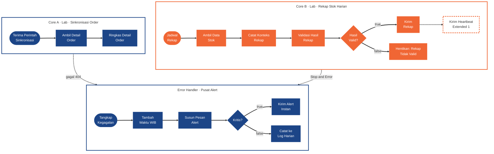
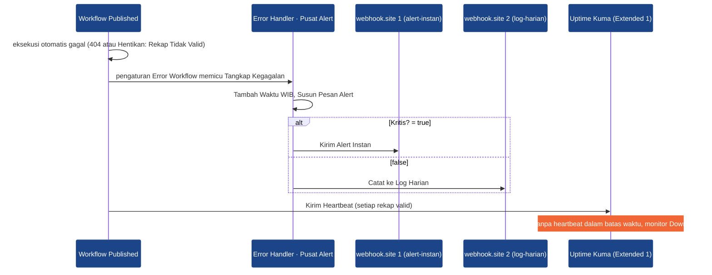

# Week 10 - Day 05: Monitoring & Observability for Automation

[](#)
[](#)
[](#)
[](https://docs.n8n.io/integrations/builtin/core-nodes/n8n-nodes-base.errortrigger/)
[](https://docs.n8n.io/integrations/builtin/core-nodes/n8n-nodes-base.stopanderror/)
[](https://docs.n8n.io/deploy/host-n8n/configure-n8n/basic-configuration/use-environment-variables/executions/)
[](https://github.com/louislam/uptime-kuma)

Selamat datang di **Praktikum Hands-on Phase 3 Week 2 Day 5 (Sesi 10)** untuk **Applied AI Engineer Bootcamp**.

Dalam praktikum ini, Anda menaikkan Error Workflow dari Sesi 5 menjadi **pusat alert berseverity** (satu Error Workflow untuk semua workflow, dua kanal: alert-instan dan log-harian), lalu menangkap **silent failure**: workflow rekap yang berstatus Success padahal datanya kosong atau lambat. Extended yang disarankan memasang **heartbeat** dengan Uptime Kuma, supaya workflow yang berhenti berjalan sama sekali tetap ketahuan. Hasilnya: monitoring dan alerting untuk workflow yang sudah di-deploy, termasuk deteksi kegagalan diam-diam. Praktikum ini dikerjakan **individu**. Kalau butuh mengingat konsepnya, buka slide **P3W2D5 - Monitoring & Observability for Automation**.

> **Kaitan dengan Phase sebelumnya:** di Phase 1 Anda memantau pipeline data lewat logs, metrics, dan tracing, serta memasang data quality check (row count, null check). Di Phase 2 output LLM dievaluasi dan dipantau sebelum dipercaya. Hari ini prinsip yang sama diterapkan ke eksekusi workflow: **status sukses bukan bukti hasil benar.**

---

## Tujuan Pembelajaran

Tujuan ini sama dengan Objectives di slide. Setelah menyelesaikan praktikum hands-on ini, Anda akan mampu:

1. **Memantau Eksekusi Workflow:** membaca tab Executions (status, Run Time, Exec. ID), memfilter eksekusi, membuka log per node, dan memakai Retry execution. *(Langkah 7, 10, Extended 3)*
1. **Menyiapkan Log yang Berguna:** mengonfigurasi kebijakan penyimpanan dan pruning data eksekusi lewat environment variable dan Workflow Settings. *(Langkah 1–2, 10)*
1. **Membangun Pusat Alert Berseverity:** satu Error Workflow reusable yang memilah alert kritis dan rutin ke kanal berbeda, dengan pesan yang actionable. *(Langkah 3–7)*
1. **Mendeteksi Silent Failure:** memvalidasi hasil dan durasi eksekusi, lalu mengubahnya menjadi kegagalan yang terlihat lewat Stop and Error. *(Langkah 8–10, Extended 2)*
1. **Menerapkan Heartbeat Monitoring:** memasang push monitor Uptime Kuma (dead man's switch) untuk workflow scheduled yang berhenti berjalan. *(Extended 1)*

---

## Estimasi Waktu

| Bagian | Jenis | Estimasi |
| --- | --- | --- |
| Persiapan: Langkah 1–2 (perbarui stack, kebijakan penyimpanan eksekusi, verifikasi) | **Core** | 10 menit |
| Core A: Langkah 3–7 (pusat alert berseverity + workflow sinkronisasi order, uji 404) | **Core** | 45 menit |
| Core B: Langkah 8–10 (rekap stok scheduled, validasi hasil, Stop and Error, simulasi silent failure) | **Core** | 35 menit |
| Extended 1: Heartbeat Uptime Kuma (**disarankan**) | Extended | 20 menit |
| Extended 2: ambang durasi (perlambatan) | Extended | 10 menit |
| Extended 3: Retry execution dari tab Executions | Extended | 10 menit |

Total Core ±90 menit.

---

## Pengaturan Environment & Tools

- **Stack n8n lokal standar Phase 3** (n8n **2.44.7** + task-runners). Sesi ini menambah **kebijakan penyimpanan eksekusi** yang dibaca dari `.env`, dan memakai service **`uptime-kuma`** (profile `monitoring`, Uptime Kuma **2.5.8**) untuk Extended 1.

  > **Perbarui stack dulu (sekali, sebaiknya sebelum kelas).** Stack lama Anda belum membaca variabel `EXECUTIONS_DATA_*` dari `.env`. Caranya ada di Langkah 1. Data n8n Anda tetap aman (volume tidak berubah). Untuk Extended 1, unduh image Uptime Kuma sebelum kelas: `docker compose --profile monitoring pull uptime-kuma`.

- **webhook.site:** buka [webhook.site](https://webhook.site) di **dua tab** sehingga Anda punya **dua URL unik**:

  | Tab | Peran di lab |
  | --- | --- |
  | webhook.site #1 | Kanal **alert-instan** (on-call, butuh tindakan sekarang) |
  | webhook.site #2 | Kanal **log-harian** (alert rutin + kiriman rekap stok) |

  > URL webhook.site bersifat publik. Jangan kirim data asli/rahasia ke sana; data lab ini hanya simulasi.

- **DummyJSON** (tanpa API key) sebagai "sistem luar": `carts/{id}` untuk data order, `products/search?q=...` untuk data stok.
- **Terminal** dengan `curl` (Windows PowerShell: `Invoke-RestMethod`, contoh ada di Langkah 7).

---

## Layout Direktori

```text
.
├── README.md                          # dokumen ini
├── assets/                            # gambar untuk README
├── compose.yaml                       # stack standar + blok EXECUTIONS_DATA_* (dibaca dari .env) + uptime-kuma (profile monitoring)
├── .env.example                       # TODO 1-6: kebijakan penyimpanan eksekusi (diisi di Langkah 1)
├── .gitignore                         # rahasia (.env, key), backup, log, file OS tidak ikut ter-commit
├── SETUP.md                           # setup stack (bagian 6b: Sesi 10)
├── aien-setup-check.json
└── seed/                              # data latihan Sesi 4 & 7 (tidak dipakai hari ini)
```

---

## Hands-On Lab

Dikerjakan **individu**.

### Ringkasan Misi

| Aspek | Isi |
| --- | --- |
| Objective | Satu pusat alert berseverity untuk semua workflow, dan workflow rekap yang tidak bisa lagi "sukses" dengan data kosong atau lambat. |
| Yang dipakai | Environment variable `EXECUTIONS_DATA_*`, Error Trigger, Edit Fields, Code (Python), If, HTTP Request, Webhook, Schedule Trigger, Stop and Error, Workflow Settings, tab Executions. Extended: Uptime Kuma push monitor. |
| Output | Tiga workflow: `Error Handler · Pusat Alert`, `Lab · Sinkronisasi Order`, `Lab · Rekap Stok Harian` (dua terakhir Published). Alert `kritis` di webhook.site #1, alert `rutin` dengan `rekap_id` di webhook.site #2. |
| Urutan | Persiapan (±10 menit) → Core A (±45 menit) → Core B (±35 menit) → Extended (Extended 1 paling disarankan). |

> Error Workflow hanya terpicu oleh eksekusi **otomatis** (Production URL webhook, Schedule Trigger) dari workflow yang sudah **Publish**. Tombol **Execute workflow** di editor tidak pernah memicunya (slide *Satu Pusat Alert untuk Semua Workflow*).

### Studi Kasus

Tim Operations sudah memakai automasi kalian sejak Week 1. Minggu lalu ada dua insiden yang baru ketahuan dari komplain pelanggan:

1. Workflow **sinkronisasi order** gagal karena satu order membawa ID yang tidak ada di sistem sumber (404). Tidak ada yang membuka tab Executions selama tiga hari.
1. Workflow **rekap stok** tetap berstatus **Success** setiap hari, tetapi laporan yang terkirim kosong: API sumbernya membalas `200 OK` dengan daftar produk kosong sejak kata kunci pencariannya salah diubah.

Permintaan manajer: **tim tidak boleh lagi tahu kegagalan dari pelanggan**, tetapi juga tidak mau dibanjiri notifikasi. Hanya kegagalan yang butuh tindakan sekarang yang masuk kanal alert-instan; sisanya cukup di log harian.

### Arsitektur Lab

Tiga workflow dan jalur error di antaranya. Garis putus-putus adalah jalur gagal yang sengaja Anda picu; `Kirim Heartbeat` bergaris putus karena bagian Extended 1:



Urutan kejadian saat sebuah workflow gagal, dan sinyal heartbeat di Extended 1:



Bentuk akhir ketiga workflow di canvas n8n (satu gambar utuh per workflow). Gambar lebar: klik gambar di GitHub untuk membuka ukuran penuh.


### Requirements

- `.env` berisi enam nilai `EXECUTIONS_DATA_*` sesuai tabel Langkah 1, dan terbaca di container `n8n`.
- **Error Workflow** `Error Handler · Pusat Alert`: **Error Trigger → Edit Fields → Code (Python) → If → 2× HTTP Request** (true: webhook.site #1, false: webhook.site #2).
- Pesan alert memuat: severity, nama workflow, node yang gagal, waktu WIB, pesan error, business key (bila ada), link eksekusi, dan tindakan awal.
- Workflow **`Lab · Sinkronisasi Order`**: **Webhook (POST, path `sinkronisasi-order`, Respond When Last Node Finishes) → HTTP Request → Code (Python)**, Error Workflow terpasang, Published.
- Workflow **`Lab · Rekap Stok Harian`**: **Schedule (tiap 2 menit) → HTTP Request → Edit Fields → Code (Python) → If → [true] HTTP Request | [false] Stop and Error**, Error Workflow terpasang, **Save execution progress** aktif, Published.
- `order_id` 9999 menghasilkan alert `kritis` di webhook.site #1; rekap dengan data kosong menghasilkan alert `rutin` dengan `rekap_id` di webhook.site #2.

### Persiapan · Kebijakan Penyimpanan Eksekusi (±10 menit)

#### 1. Perbarui Stack & Isi Kebijakan Penyimpanan (±5 menit)

1. Dari folder stack Phase 3 Anda (mis. `aien-phase3/`), matikan stack: `docker compose --profile mcp down` (sekaligus mematikan service Sesi 4/7 kalau masih jalan; data tetap aman di volume).
1. Salin dari folder lab ini ke folder stack Anda, menimpa yang lama: `compose.yaml` dan folder `seed/`.
1. Buka `.env.example` di folder lab ini, salin **blok TODO Sesi 10 paling bawah** (enam baris `EXECUTIONS_DATA_*`) ke akhir file `.env` Anda. Belum punya `.env`? Salin `.env.example` menjadi `.env`.
1. Isi keenam TODO dengan kebijakan lab ini (slide *Log Retention & Data Pruning*):

   | TODO | Variable | Nilai | Artinya |
   | --- | --- | --- | --- |
   | 1 | `EXECUTIONS_DATA_SAVE_ON_ERROR` | `all` | simpan semua eksekusi gagal |
   | 2 | `EXECUTIONS_DATA_SAVE_ON_SUCCESS` | `all` | simpan semua eksekusi sukses (bukti silent failure ada di sini) |
   | 3 | `EXECUTIONS_DATA_SAVE_ON_PROGRESS` | `true` | simpan progres tiap node walau eksekusi belum selesai |
   | 4 | `EXECUTIONS_DATA_PRUNE` | `true` | hapus data lama secara berkala |
   | 5 | `EXECUTIONS_DATA_MAX_AGE` | `72` | umur maksimal 72 jam (3 hari) |
   | 6 | `EXECUTIONS_DATA_PRUNE_MAX_COUNT` | `200` | simpan maksimal 200 eksekusi |

   > Kalau sebuah TODO dibiarkan kosong, `compose.yaml` memakai default resmi n8n (`all`, `all`, `false`, `true`, `336`, `10000`). Itulah kenapa nilainya **harus** diisi supaya kebijakan lab berlaku.

#### 2. Jalankan Ulang & Verifikasi (±5 menit)

```bash
docker compose up -d
docker compose exec -T n8n env | grep EXECUTIONS_DATA | sort
```

Hasil yang diharapkan (enam baris, urutan alfabet):

```text
EXECUTIONS_DATA_MAX_AGE=72
EXECUTIONS_DATA_PRUNE=true
EXECUTIONS_DATA_PRUNE_MAX_COUNT=200
EXECUTIONS_DATA_SAVE_ON_ERROR=all
EXECUTIONS_DATA_SAVE_ON_PROGRESS=true
EXECUTIONS_DATA_SAVE_ON_SUCCESS=all
```

Windows PowerShell: `docker compose exec -T n8n env | Select-String EXECUTIONS_DATA`. Buka `http://localhost:5678` dan pastikan editor n8n terbuka.

> **Titik rawan:** nilai masih `336` / `10000` → TODO di `.env` belum terisi, atau stack belum dijalankan ulang setelah `.env` diubah. `docker compose restart` **tidak** membaca ulang `.env`; pakai `docker compose up -d`.

### Core A · Pusat Alert Berseverity (±45 menit)

#### 3. Error Workflow: Error Trigger + Waktu WIB (±8 menit)

1. Buat workflow baru, beri nama persis **`Error Handler · Pusat Alert`**. Kenapa baru, bukan `Error Handler · Konsolidasi Order` dari Sesi 5? Handler Sesi 5 dibuat khusus untuk dead-letter satu workflow; pusat alert hari ini memilah severity untuk banyak workflow sekaligus. Handler Sesi 5 tetap dipakai workflow Sesi 5 (jangan dihapus), dan di Settings workflow hari ini pastikan yang dipilih `Error Handler · Pusat Alert`, bukan handler lama.
1. Tambahkan **Error Trigger**, rename **`Tangkap Kegagalan`**.
1. Tambahkan **Edit Fields (Set)**, rename **`Tambah Waktu WIB`**. Aktifkan **Include Other Input Fields** supaya data Error Trigger ikut diteruskan, lalu tambah satu field:

   | Name | Type | Value |
   | --- | --- | --- |
   | `waktu_wib` | String | `{{ $now.setZone('Asia/Jakarta').toFormat('yyyy-MM-dd HH:mm:ss') }} WIB` |

   > Waktu dibuat di Edit Fields, bukan di Python: Code node Python di n8n tidak boleh `import datetime` (diblokir sandbox task runner, Sesi 5). Klik **Execute step**: node memakai data contoh Error Trigger sehingga expression bisa dicek sebelum ada kegagalan sungguhan.

#### 4. Code (Python): Susun Pesan Alert (±10 menit)

Tambahkan **Code** setelah `Tambah Waktu WIB`, rename **`Susun Pesan Alert`**, Mode **Run Once for All Items**, Language **Python**. **Salin** kode berikut, jangan diketik ulang:

```python
# Pusat alert: satu Error Workflow untuk semua workflow.
# Severity ditentukan dari daftar workflow kritis (kegagalannya butuh tindakan manusia sekarang).
WORKFLOW_KRITIS = ["Lab · Sinkronisasi Order"]

data = _items[0]["json"]
workflow = data.get("workflow", {})
eksekusi = data.get("execution")   # ada bila gagal saat eksekusi
pemicu = data.get("trigger")       # ada bila gagal di trigger node
sumber = eksekusi if eksekusi else (pemicu or {})
error = sumber.get("error", {})

nama_workflow = workflow.get("name", "tidak diketahui")
pesan_error = error.get("message", "tidak ada pesan error")
node_gagal = sumber.get("lastNodeExecuted", "-")
execution_url = sumber.get("url", "-")
waktu = data.get("waktu_wib", "-")

# Business key (bila ada): konvensi tim, pesan error diawali "[kunci]" (mis. dari Stop and Error)
business_key = "-"
if pesan_error.startswith("[") and "]" in pesan_error:
    business_key = pesan_error[1:pesan_error.index("]")]

if nama_workflow in WORKFLOW_KRITIS or pemicu:
    severity, kanal = "kritis", "alert-instan"
    tindakan = "Buka link eksekusi, perbaiki penyebabnya, lalu Retry execution."
else:
    severity, kanal = "rutin", "log-harian"
    tindakan = "Tinjau saat review Executions harian."

pesan = (
    f"[{severity.upper()}] {nama_workflow} gagal di node '{node_gagal}'\n"
    f"Waktu: {waktu}\nError: {pesan_error}\nKey: {business_key}\n"
    f"Link: {execution_url}\nTindakan: {tindakan}"
)

return [{"json": {
    "severity": severity,
    "kanal": kanal,
    "workflow": nama_workflow,
    "node_gagal": node_gagal,
    "waktu": waktu,
    "pesan_error": pesan_error,
    "business_key": business_key,
    "execution_url": execution_url,
    "tindakan": tindakan,
    "pesan": pesan,
}}]
```

Yang perlu dipahami:

- **Dua bentuk data Error Trigger.** Kegagalan saat eksekusi mengirim `execution` (`lastNodeExecuted`, `error.message`, `url`); kegagalan di trigger node mengirim `trigger` tanpa `execution` (slide *Data yang Diterima Error Trigger*). Kode memakai `.get()` supaya pusat alert sendiri tidak ikut gagal saat bentuknya berbeda.
- **Severity dari satu daftar.** `WORKFLOW_KRITIS` berisi nama workflow yang kegagalannya butuh tindakan sekarang. Menambah workflow kritis baru cukup menambah namanya di sini.
- **Business key.** Error Trigger tidak membawa data item yang sedang diproses. Karena itu konvensinya: workflow yang ingin kuncinya ikut di alert menulisnya di awal pesan error, mis. `[rekap-20261106-2040] ...` dari Stop and Error (Core B).

Klik **Execute step**: output berisi `severity`, `kanal`, `pesan`, dan field lain dari data contoh.

#### 5. If + Dua Kanal Notifikasi (±8 menit)

1. Tambahkan **If**, rename **`Kritis?`**, satu kondisi: `{{ $json.severity }}` · **String** · **is equal to** · `kritis`.
1. Output **true** → **HTTP Request** rename **`Kirim Alert Instan`**: Method `POST`, URL = **webhook.site #1**, **Send Body** ON, Body Content Type **JSON**, Specify Body **Using JSON**, JSON = `{{ JSON.stringify($json) }}`.
1. Output **false** → **HTTP Request** rename **`Catat ke Log Harian`**: sama, URL = **webhook.site #2**.
1. **Publish** workflow ini.

> Di production kedua node ini menunjuk kanal berbeda (Slack on-call vs email digest, slide *Kanal Notifikasi untuk Alert*). Struktur pusat alert tidak berubah saat kanalnya diganti.

#### 6. Workflow `Lab · Sinkronisasi Order` (±10 menit)

Buat workflow baru **`Lab · Sinkronisasi Order`** (nama harus persis sama dengan isi `WORKFLOW_KRITIS`).

1. **Webhook**, rename **`Terima Perintah Sinkronisasi`**: HTTP Method `POST`, Path `sinkronisasi-order`, Respond **When Last Node Finishes**.
1. **HTTP Request**, rename **`Ambil Detail Order`**: Method `GET`, URL (expression): `https://dummyjson.com/carts/{{ $json.body.order_id }}`.
1. **Code**, rename **`Ringkas Detail Order`**, Python, Run Once for All Items:

   ```python
   cart = _items[0]["json"]

   return [{"json": {
       "order_id": cart["id"],
       "jumlah_produk": cart["totalProducts"],
       "total_item": cart["totalQuantity"],
       "total_harga": round(cart["total"], 2),
       "status_sinkronisasi": "berhasil",
   }}]
   ```

`order_id` dari pemanggil menentukan nasib eksekusi: `1` ada di DummyJSON (HTTP 200), `9999` tidak ada (HTTP 404) sehingga node `Ambil Detail Order` gagal. Workflow tidak perlu diubah untuk menguji kedua kondisi.

> Header Auth untuk webhook sudah dibahas di Sesi 6–7. Di lab ini dilewati supaya fokus ke monitoring; di production tetap wajib.

#### 7. Pasang Error Workflow, Publish, Uji (±9 menit)

1. Di `Lab · Sinkronisasi Order`: menu `...` → **Settings** → **Error Workflow** → pilih `Error Handler · Pusat Alert` → **Save**. Pastikan **Timezone** `Asia/Jakarta` (instance sudah memakai `GENERIC_TIMEZONE=Asia/Jakarta`).
1. **Publish**.
1. Panggil **Production URL** dua kali, sekali sukses dan sekali gagal:

   ```bash
   curl -s -X POST http://localhost:5678/webhook/sinkronisasi-order \
     -H 'Content-Type: application/json' -d '{"order_id": 1}'; echo
   curl -s -X POST http://localhost:5678/webhook/sinkronisasi-order \
     -H 'Content-Type: application/json' -d '{"order_id": 9999}'; echo
   ```

   Windows PowerShell:

   ```powershell
   Invoke-RestMethod -Method Post -Uri http://localhost:5678/webhook/sinkronisasi-order -ContentType 'application/json' -Body '{"order_id": 1}'
   Invoke-RestMethod -Method Post -Uri http://localhost:5678/webhook/sinkronisasi-order -ContentType 'application/json' -Body '{"order_id": 9999}'
   ```

1. Baca hasilnya di tiga tempat:

   | Tempat | `order_id` 1 | `order_id` 9999 |
   | --- | --- | --- |
   | Terminal | JSON ringkasan order (`total_harga` 13037.88) | HTTP 500 `{"message":"Error in workflow"}` |
   | Tab **Executions** workflow ini | Success | Error, node `Ambil Detail Order` merah |
   | webhook.site | tidak ada alert | **#1** menerima alert `severity` `kritis` |

1. Latihan membaca Executions: buka Overview → tab **Executions** → tombol **Filters** (ikon corong) → Status **Error**. Buka eksekusi yang gagal, klik node merah, baca pesan error-nya, lalu bandingkan dengan `pesan_error` dan `execution_url` di alert. Link di alert harus membuka eksekusi yang sama.

> **Titik rawan:** webhook.site kosong padahal eksekusi Error → URL dipanggil lewat **Test URL** (`/webhook-test/...`) atau tombol Execute workflow, atau Error Workflow dipilih tetapi workflow belum di-**Publish** ulang.

### Core B · Deteksi Silent Failure (±35 menit)

#### 8. Workflow `Lab · Rekap Stok Harian`: Ambil Data (±10 menit)

Buat workflow baru **`Lab · Rekap Stok Harian`**.

1. **Schedule Trigger**, rename **`Jadwal Rekap`**: Trigger Interval **Minutes**, Minutes Between Triggers `2`.

   > Di production rekap seperti ini jalan sekali sehari. Interval 2 menit hanya supaya siklusnya bisa diamati di kelas.

1. **HTTP Request**, rename **`Ambil Data Stok`**: Method `GET`, URL `https://dummyjson.com/products/search?q=phone`.
1. **Edit Fields (Set)**, rename **`Catat Konteks Rekap`**, **Include Other Input Fields** aktif, dua field:

   | Name | Type | Value |
   | --- | --- | --- |
   | `rekap_id` | String | `{{ 'rekap-' + $now.toFormat('yyyyLLdd-HHmm') }}` |
   | `durasi_ms` | Number | `{{ $now.toMillis() - DateTime.fromISO($('Jadwal Rekap').item.json.timestamp).toMillis() }}` |

   `rekap_id` adalah **business key** rekap ini (dipakai di alert). `durasi_ms` adalah lama eksekusi sejak Schedule Trigger menyala sampai data stok selesai diambil: bahan deteksi perlambatan (Extended 2).

#### 9. Validasi Hasil, If, Stop and Error (±12 menit)

1. **Code**, rename **`Validasi Hasil Rekap`**, Python, Run Once for All Items. **Salin**:

   ```python
   # Validasi HASIL, bukan status HTTP: 200 dengan daftar kosong tetap gagal.
   AMBANG_DURASI_MS = 5000   # rekap normal selesai jauh di bawah ini

   data = _items[0]["json"]
   produk = data.get("products", [])
   jumlah_produk = len(produk)
   total_stok = sum(p.get("stock", 0) for p in produk)
   durasi_ms = data.get("durasi_ms", 0)
   rekap_id = data.get("rekap_id", "rekap")

   masalah = []
   if jumlah_produk == 0:
       masalah.append("daftar produk kosong (0 item) padahal HTTP 200")
   elif total_stok == 0:
       masalah.append("semua produk berstok 0")
   if durasi_ms > AMBANG_DURASI_MS:
       masalah.append(f"rekap lambat: {durasi_ms} ms, ambang {AMBANG_DURASI_MS} ms")

   pesan_tidak_valid = "-"
   if masalah:
       pesan_tidak_valid = f"[{rekap_id}] " + "; ".join(masalah)

   return [{"json": {
       "rekap_id": rekap_id,
       "jumlah_produk": jumlah_produk,
       "total_stok": total_stok,
       "durasi_ms": durasi_ms,
       "hasil_valid": len(masalah) == 0,
       "pesan_tidak_valid": pesan_tidak_valid,
   }}]
   ```

1. **If**, rename **`Hasil Valid?`**: `{{ $json.hasil_valid }}` · **Boolean** · **is true**.
1. Output **true** → **HTTP Request** rename **`Kirim Rekap`**: `POST` ke **webhook.site #2**, Send Body JSON, `{{ JSON.stringify($json) }}`.
1. Output **false** → **Stop and Error** rename **`Hentikan: Rekap Tidak Valid`**: Error Type **Error Message**, Error Message (expression) `{{ $json.pesan_tidak_valid }}`.

> **Inti Core B:** yang divalidasi bukan status HTTP (pasti `200`), melainkan apakah hasilnya masuk akal (slide *Validasi Hasil: Pola di Lab Core B*). Stop and Error membuat eksekusi berstatus **Error**, sehingga Error Workflow terpicu dan pesan alert membawa `rekap_id` sebagai business key.

#### 10. Settings, Publish, Simulasikan Silent Failure (±13 menit)

1. Menu `...` → **Settings**: **Error Workflow** = `Error Handler · Pusat Alert`, **Save execution progress** = **Save**. **Save**, lalu **Publish**.
1. **Kondisi normal.** Tunggu eksekusi terjadwal pertama (maksimal 2 menit). Tab **Executions**: Success. webhook.site #2 menerima rekap dengan `hasil_valid: true`.
1. **Simulasikan silent failure.** Ubah URL `Ambil Data Stok` menjadi `https://dummyjson.com/products/search?q=zzzz`, lalu **Publish** ulang. Pada eksekusi terjadwal berikutnya, amati:
   - node `Ambil Data Stok` tetap hijau (HTTP 200, `total` 0);
   - `Validasi Hasil Rekap` menghasilkan `hasil_valid: false`;
   - eksekusi berakhir **Error** di `Hentikan: Rekap Tidak Valid`;
   - webhook.site **#2** menerima alert `severity` `rutin` dengan `business_key` = `rekap_id` eksekusi itu.

   Tanpa node validasi, eksekusi yang sama tercatat **Success** dan tidak ada yang tahu laporannya kosong.

   Tampilan eksekusi itu di tab **Executions** `Lab · Rekap Stok Harian`: semua node hijau sampai `Hasil Valid?`, lalu berakhir **Error** di `Hentikan: Rekap Tidak Valid`.

   

1. **Kembalikan** URL ke `?q=phone` dan **Publish** ulang. Eksekusi berikutnya kembali Success.

> **Titik rawan:** If error tipe data (*Wrong type: 'true' is a boolean but was expecting a string*) → `hasil_valid` dibandingkan sebagai String; pilih tipe **Boolean** · **is true**. Alert tidak datang padahal eksekusi Error → Error Workflow belum dipilih di Settings workflow ini, atau perubahan belum di-**Publish**.

### Kriteria Selesai

1. `docker compose exec -T n8n env` menampilkan enam `EXECUTIONS_DATA_*` dengan `MAX_AGE` 72 dan `PRUNE_MAX_COUNT` 200.
1. `order_id` 1 menghasilkan eksekusi Success tanpa alert; `order_id` 9999 menghasilkan eksekusi Error dan alert `kritis` di webhook.site #1 yang memuat workflow, node, waktu WIB, pesan error, dan link eksekusi.
1. Rekap dengan `q=zzzz` menghasilkan eksekusi **Error** di node Stop and Error (padahal HTTP 200) dan alert `rutin` dengan `business_key` di webhook.site #2.
1. Satu Error Workflow yang sama melayani kedua workflow, dan memilah kanalnya otomatis.
1. `Lab · Sinkronisasi Order` dan `Lab · Rekap Stok Harian` berstatus **Published**, dengan Error Workflow terpasang.

---

## Tantangan Extended (Opsional)

**Sebelum mulai:** Core selesai dan rekap kembali memakai `?q=phone`. Tulis jawaban pertanyaan di catatan Anda.

### Extended 1 (disarankan) · Heartbeat dengan Uptime Kuma (±20 menit)

Validasi hasil di Core B masih punya titik buta: kalau workflow **tidak berjalan sama sekali** (ter-unpublish, instance mati), tidak ada eksekusi untuk divalidasi dan tidak ada error untuk dilaporkan. Heartbeat membalik cara memantaunya: yang dipantau adalah **ketiadaan sinyal** (slide *Dead Man's Switch: Heartbeat*).

1. Nyalakan Uptime Kuma (profile `monitoring`):

   ```bash
   docker compose --profile monitoring up -d
   docker compose --profile monitoring ps
   ```

   Service `uptime-kuma` berstatus `Up`. Buka `http://localhost:3001`.
1. **Setup pertama:** di layar *Which database would you like to use?* pilih **SQLite**, lalu di *Create your admin account* buat akun admin (username dan password bebas, simpan baik-baik). Akun ini hanya ada di container Anda.
1. **Kanal notifikasi:** menu profil (kanan atas) → **Settings** → **Notifications** → **Set Up Notification**. Notification Type **Webhook**, Friendly Name `Kanal Alert Lab`, Post URL = **webhook.site #1**, Request Body: pilih preset `application/json`. Klik **Test**: webhook.site #1 menerima satu request. **Save**.
1. **Push monitor:** **Add New Monitor** → Monitor Type **Push**, Friendly Name `Heartbeat · Rekap Stok Harian`, Heartbeat Interval `180` (detik), Retries `0`, centang notifikasi `Kanal Alert Lab`. Salin **Push URL** yang ditampilkan (`http://localhost:3001/api/push/<token>?status=up&msg=OK&ping=`, dengan keterangan *You should call this URL every 180 seconds.*) dan catat bagian `<token>`. **Save**.
1. **Kirim heartbeat dari n8n.** Di `Lab · Rekap Stok Harian`, tambahkan **HTTP Request** setelah `Kirim Rekap` (ujung cabang true), rename **`Kirim Heartbeat`**:

   | Field | Isi |
   | --- | --- |
   | Method | `GET` |
   | URL | `http://uptime-kuma:3001/api/push/<token-anda>` |
   | Send Query Parameters | ON: `status` = `up`, `msg` = `rekap-stok-ok` |

   > Host-nya **`uptime-kuma`** (nama service di compose), bukan `localhost`. Di dalam container n8n, `localhost` adalah container n8n sendiri; gejalanya node `Kirim Heartbeat` merah dengan pesan *The service refused the connection* (lanjutannya *perhaps it is offline*). Pelajaran yang sama dengan PostgreSQL di Sesi 7.

1. **Publish**. Dalam ≤ 2 menit monitor berubah **Up** (bar hijau bertambah tiap 2 menit). Output node `Kirim Heartbeat` berisi `{"ok": true}`.
1. **Simulasikan workflow berhenti diam-diam.** **Unpublish** `Lab · Rekap Stok Harian`. Tidak ada eksekusi gagal, tidak ada alert dari n8n. Tunggu: ±3 menit setelah ping terakhir (180 detik, sesuai Heartbeat Interval) monitor **Down** dengan pesan *No heartbeat in the time window*, dan webhook.site #1 menerima notifikasi `[🔴 Down]` dari Uptime Kuma.
1. **Pulihkan:** **Publish** lagi. Ping berikutnya (≤ 2 menit) mengembalikan status **Up** dan Kuma mengirim notifikasi `[✅ Up]`. Up pertama setelah monitor dibuat tidak mengirim notifikasi; yang dikirim hanya perubahan Down dan pemulihannya.

Pertanyaan: kenapa node heartbeat dipasang di ujung cabang **true**, bukan langsung setelah Schedule Trigger?

### Extended 2 · Ambang Durasi (±10 menit)

Perlambatan juga silent failure: eksekusi tetap Success, tetapi makin lama (slide *Deteksi Workflow Lambat: Ambang Durasi*).

1. Di `Validasi Hasil Rekap`, ubah `AMBANG_DURASI_MS = 5000` menjadi `2000`.
1. Di `Ambil Data Stok`, ubah URL menjadi `https://dummyjson.com/products/search?q=phone&delay=3000` (DummyJSON menunda respons 3 detik).
1. **Publish**, tunggu eksekusi berikutnya. Amati kolom **Run Time** di tab Executions, status eksekusi, dan isi alert di webhook.site #2.
1. Kembalikan ambang ke `5000`, URL ke `?q=phone`, lalu **Publish**.

> Kalau Extended 1 sudah terpasang, monitor Uptime Kuma akan Down selama uji ini karena rekap berakhir Error (heartbeat tidak terkirim). **Pause** monitor dulu, atau anggap ini bukti tambahan bahwa heartbeat ikut menangkap rekap yang tidak valid.

Pertanyaan: berapa `durasi_ms` yang tercatat, dan kenapa ambang durasi lebih baik ditentukan dari baseline (tren Run Time beberapa hari), bukan angka tebakan?

### Extended 3 · Retry Execution (±10 menit)

1. Buka tab **Executions** `Lab · Sinkronisasi Order`, pilih eksekusi **Error** (`order_id` 9999).
1. Klik ikon **Retry execution** (panah melingkar di samping **Debug in editor**), pilih **Retry with original workflow (from node with error)**.
1. Amati eksekusi baru di daftar (bertanda *Retry of execution #n*), statusnya, dan apakah webhook.site #1 menerima alert lagi.

Pertanyaan: kenapa retry ini tidak memulihkan apa pun, dan kapan **Retry with currently saved workflow (from node with error)** yang tepat dipakai?

---

## Verifikasi & Pemeriksaan Solusi

Bentuk alert **kritis** di webhook.site #1 (`order_id` 9999). Nilai waktu, ID, dan link berbeda di laptop Anda:

```json
{
  "severity": "kritis",
  "kanal": "alert-instan",
  "workflow": "Lab · Sinkronisasi Order",
  "node_gagal": "Ambil Detail Order",
  "waktu": "2026-11-06 20:41:12 WIB",
  "pesan_error": "The resource you are requesting could not be found",
  "business_key": "-",
  "execution_url": "http://localhost:5678/workflow/AbC123/executions/42",
  "tindakan": "Buka link eksekusi, perbaiki penyebabnya, lalu Retry execution.",
  "pesan": "[KRITIS] Lab · Sinkronisasi Order gagal di node 'Ambil Detail Order'\nWaktu: 2026-11-06 20:41:12 WIB\nError: The resource you are requesting could not be found\nKey: -\nLink: http://localhost:5678/workflow/AbC123/executions/42\nTindakan: Buka link eksekusi, perbaiki penyebabnya, lalu Retry execution."
}
```

Bentuk alert **rutin** di webhook.site #2 (rekap `q=zzzz`):

```json
{
  "severity": "rutin",
  "kanal": "log-harian",
  "workflow": "Lab · Rekap Stok Harian",
  "node_gagal": "Hentikan: Rekap Tidak Valid",
  "waktu": "2026-11-06 21:12:04 WIB",
  "pesan_error": "[rekap-20261106-2112] daftar produk kosong (0 item) padahal HTTP 200",
  "business_key": "rekap-20261106-2112",
  "execution_url": "http://localhost:5678/workflow/XyZ789/executions/57",
  "tindakan": "Tinjau saat review Executions harian.",
  "pesan": "[RUTIN] Lab · Rekap Stok Harian gagal di node 'Hentikan: Rekap Tidak Valid'\nWaktu: 2026-11-06 21:12:04 WIB\nError: [rekap-20261106-2112] daftar produk kosong (0 item) padahal HTTP 200\nKey: rekap-20261106-2112\nLink: http://localhost:5678/workflow/XyZ789/executions/57\nTindakan: Tinjau saat review Executions harian."
}
```

Rekap normal (`q=phone`) yang terkirim ke webhook.site #2 berbentuk `{"rekap_id": "...", "jumlah_produk": ..., "total_stok": ..., "durasi_ms": ..., "hasil_valid": true, "pesan_tidak_valid": "-"}`. Angka produk dan stok mengikuti data DummyJSON saat itu; yang dicek adalah `hasil_valid` dan status eksekusi.

| Kondisi | Status node HTTP Request | Status eksekusi | Kanal |
| --- | --- | --- | --- |
| `order_id` 1 | 200 | Success | tidak ada alert |
| `order_id` 9999 | 404 (node merah) | Error | #1 alert-instan, `kritis` |
| Rekap `q=phone` | 200 | Success | #2 menerima rekap |
| Rekap `q=zzzz` | 200, `total` 0 | Error di Stop and Error | #2 alert `rutin` + `business_key` |

---

## Troubleshooting

Pesan di kolom Gejala adalah pesan asli dari uji di n8n 2.44.7 dan Uptime Kuma 2.5.8.

| Gejala | Penyebab | Solusi |
| --- | --- | --- |
| `env` masih `MAX_AGE=336`, `PRUNE_MAX_COUNT=10000` | TODO di `.env` kosong, atau `compose.yaml` lama | Isi TODO 1–6, pakai `compose.yaml` dari folder lab, lalu `docker compose up -d` |
| Tidak ada variabel `EXECUTIONS_DATA_*` sama sekali | `compose.yaml` belum diganti | Salin `compose.yaml` dari folder lab (Langkah 1) |
| Eksekusi **Error** tetapi webhook.site kosong | Dipicu lewat Test URL / tombol Execute workflow, atau Error Workflow belum dipilih, atau belum Publish ulang | Panggil **Production URL** (`/webhook/...`) atau tunggu Schedule; Settings → Error Workflow, lalu **Publish** |
| `The requested webhook "POST sinkronisasi-order" is not registered.` (HTTP 404, hint *The workflow must be active for a production URL to run successfully*) | Production URL dipanggil sebelum **Publish**, atau path salah | **Publish**; path `sinkronisasi-order` |
| `The requested webhook "sinkronisasi-order" is not registered.` (HTTP 404, hint *Click the 'Execute workflow' button on the canvas, then try again*) | Test URL (`/webhook-test/...`) dipanggil tanpa Execute workflow | Pakai Production URL setelah Publish |
| Semua alert masuk #2 (`rutin`) | Nama workflow beda dari `WORKFLOW_KRITIS` (spasi, titik tengah `·`) | Samakan nama persis: `Lab · Sinkronisasi Order` |
| Pusat alert sendiri Error | Kode diketik ulang (indentasi/kutip), atau `waktu_wib` belum ada | Salin ulang kode Langkah 4; cek Include Other Input Fields di `Tambah Waktu WIB` |
| `Security violations detected` / `Line 1: Import of standard library module 'datetime' is disallowed. Allowed stdlib modules: none` | `from datetime import ...` di Code node Python | Hitung waktu di Edit Fields dengan `$now` (Langkah 3) |
| `Wrong type: 'true' is a boolean but was expecting a string [condition 0, item 0]` di `Hasil Valid?` | Kondisi If bertipe String | Pilih **Boolean** · **is true** |
| `Referenced node doesn't exist` di `Catat Konteks Rekap` | Nama node Schedule bukan `Jadwal Rekap` | Rename trigger, atau sesuaikan `$('Jadwal Rekap')` |
| Rekap `q=zzzz` tetap **Success** | Belum Publish ulang setelah ganti URL, atau belum ada node `Validasi Hasil Rekap` | Publish; tunggu jadwal berikutnya |
| Rekap sesekali **Error** dengan alert `rutin` `[rekap-...] rekap lambat: 10191 ms, ambang 5000 ms` padahal workflow tidak diubah | DummyJSON (layanan publik) sedang lambat; `AMBANG_DURASI_MS` bekerja sesuai desain | Tidak perlu diperbaiki, jadwal berikutnya normal lagi. Kalau sering terjadi, naikkan `AMBANG_DURASI_MS` |
| (Extended 1) Monitor Kuma **Down** sebentar padahal workflow Published | Satu rekap Error (mis. rekap lambat di atas) berarti tidak ada ping; Kuma menunggu 180 detik | Normal: monitor **Up** lagi di rekap sukses berikutnya |
| `The service refused the connection - perhaps it is offline` di `Kirim Heartbeat` | URL memakai `localhost` | Pakai `http://uptime-kuma:3001/api/push/<token>` |
| `The resource you are requesting could not be found`, deskripsi `Monitor not found or not active.` di `Kirim Heartbeat` | Token salah atau monitor di-pause | Salin ulang token dari Push URL, **Resume** monitor |
| `Task request timed out` di node Code, deskripsi *Your Code node task was not matched to a runner within the timeout period* | Code (Python) berjalan beberapa detik setelah n8n dinyalakan ulang, saat `task-runners` belum terhubung kembali | Tunggu 15–20 detik, lalu **Execute step** lagi atau tunggu jadwal berikutnya. Pastikan `docker compose ps` menunjukkan `task-runners` **Up** |
| Port 3001 bentrok | Ada aplikasi lain di 3001 | Ubah mapping di `compose.yaml` menjadi `"3011:3001"`, buka `localhost:3011` (URL dari n8n tetap `uptime-kuma:3001`) |
| PowerShell: perintah curl aneh | `curl` adalah alias Invoke-WebRequest | Pakai contoh `Invoke-RestMethod` di Langkah 7 |

---

## Instruksi Pembersihan

`Lab · Rekap Stok Harian` berjalan tiap 2 menit dan Uptime Kuma terus memantaunya. Setelah selesai:

1. **Unpublish** `Lab · Rekap Stok Harian` dan `Lab · Sinkronisasi Order`.
1. Di Uptime Kuma, **Pause** monitor `Heartbeat · Rekap Stok Harian` supaya tidak mengirim notifikasi Down.
1. Matikan stack (data tetap aman di volume):

   ```bash
   docker compose --profile monitoring down
   ```

Jangan hapus `Error Handler · Pusat Alert`: pusat alert ini dipakai lagi di **Sesi 11 (AI on Automation)**, saat langkah AI yang gagal juga harus memberi alert, dan di **Milestone Phase 3**, yang menilai komponen *Monitoring & observability* (execution log, alert kegagalan dan perlambatan, kegagalan diam-diam) serta *Error handling & recovery*. Minggu depan dimulai Week 3: AI on Automation, troubleshooting & governance, lalu merancang automasi dari kebutuhan bisnis.

Selamat! Anda telah menyelesaikan **P3W2D5: Monitoring & Observability for Automation**!
